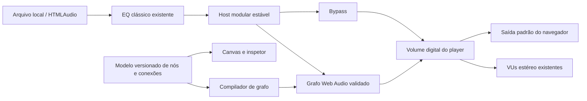

# Solicitação ao Claude — Atualização obrigatória da documentação DSP do Vynamp

**Revisão 1.4 · Equalizadores obrigatórios + acesso e controles do DSP · 25/10/2026**

> **Novidade da revisão 1.4:** incorporados os ajustes de UX do protótipo: acesso visível ao DSP, quatro atalhos, oito categorias, knobs/sliders/chaves, edição numérica sob demanda, precisão de presets e validação coerente. Leia §5.1 e §9.1 e integre esses contratos às specs canônicas. Todas as exigências da revisão 1.3 permanecem preservadas. Este documento continua sendo uma solicitação exclusivamente documental ao Claude.

> **Proveniência:** versão ampliada do arquivo `D:/Projects/vynamp-media-player/Prompt_Claude_Documentacao_DSP_Equalizadores_Obrigatorios_v1.3.md`. O arquivo de origem não foi alterado; esta é a cópia completa atualizada para entrega.


## Objetivo

Analise integralmente a **documentação, a arquitetura, as decisões técnicas e os padrões de UX/UI já existentes** no repositório do nosso reprodutor de música moderno. Em seguida, **atualize a documentação do projeto** para contemplar um sistema profissional de processamento digital de áudio (**DSP — Digital Signal Processing**) que vá muito além de um equalizador convencional.

**Esta tarefa é exclusivamente documental. Não implemente, altere ou refatore código nesta etapa.** O resultado deve ser uma especificação realista, modular, incremental e pronta para orientar trabalhos futuros de arquitetura, implementação, testes e design.

> **REQUISITO OBRIGATÓRIO DE EQUALIZAÇÃO — NÃO OMITIR:** o Vynamp deve ter a especificação de **equalizador gráfico clássico de 10 bandas**, **equalizadores gráficos avançados de 10, 20, 31 e 64 bandas** e **equalizador paramétrico com até 32 filtros independentes**. Todas essas modalidades devem aparecer explicitamente nos documentos funcionais, técnicos, de UI/UX, roadmap, testes e critérios de aceitação. **Para o MVP visual/interativo existente em HTML, SVG e JavaScript, a interface funcional de todos esses modos é obrigatória**, mesmo quando o processamento real de áudio de determinado modo depender da engine nativa. Isso **não altera automaticamente** os marcos de entrega do produto nativo: o suporte nativo a 64 bandas anteriormente classificado como M5 permanece M5 até decisão documentada. A presente tarefa do Claude continua sendo **apenas atualizar documentação**, sem implementar o MVP.

> **Continuidade de escopo já acordado:** antes desta solicitação, já havia sido planejada a inclusão de **um simulador de efeito de vinil** e **um simulador de amplificador valvulado** no DSP. **Mantenha ambos no escopo original do projeto.** Este pedido complementa a documentação, **não substitui, cancela, rebaixa de prioridade ou reinventa** os dois recursos. Localize as definições já feitas no repositório ou contexto de trabalho disponível e preserve suas decisões, nomes, parâmetros, prioridades, UX, roadmap e critérios previamente acordados. Se não encontrar documentação suficiente, registre-os como **previamente planejados (detalhes a confirmar)**, nunca como recursos implementados nem como propostas inteiramente novas. Não suponha detalhes de decisões anteriores ausentes do repositório.

## 1. Antes de modificar qualquer documento

1. Explore o repositório e encontre os documentos relevantes (README, especificações, arquitetura, roadmaps, decisões de arquitetura/ADRs, requisitos, documentação de áudio, UX/UI, guias e planos), usando os caminhos reais encontrados.
2. Identifique a linguagem, frameworks, bibliotecas, plataformas, sistemas de áudio, limitações, convenções e recursos já previstos ou implementados **apenas se houver evidência no repositório**.
3. Identifique onde cada parte da especificação deve ser integrada. **Prefira atualizar arquivos existentes**, criando novos documentos somente quando isso melhorar a organização; vincule-os pelo índice ou README relevante.
4. Preserve nomenclaturas, convenções, decisões anteriores e compatibilidade com o restante do projeto; em caso de conflito, documente a divergência e proponha a decisão, sem substituí-la silenciosamente.
5. Diferencie explicitamente **implementado**, **planejado**, **proposto** e **dependente de investigação**. Não afirme que o player já suporta funcionalidades apenas descritas aqui.
6. Evite redundâncias: consolide requisitos repetidos e mantenha referências cruzadas entre documentos.
7. **Investigue primeiro** onde o **Vinyl Simulator / Vinyl Effect** e o **Tube Amplifier Simulator / Valve Amp** já aparecem no planejamento/documentação. **Integre e aprofunde o que existe**, sem sobrescrever decisões antigas com valores ou comportamentos hipotéticos. Se as definições anteriores não estiverem disponíveis, sinalize lacunas e apresente os parâmetros abaixo como candidatos a validação.
8. Localize a especificação de skin/MVP HTML/SVG/JS, se presente (por exemplo, `SKIN-REQUIREMENTS-GPT-MVP-OBRIGATORIO-v1.2.md`), e **reconcilie as exigências do equalizador** com o catálogo DSP e a documentação do produto. Não rebaixe a obrigatoriedade de interface dos cinco modos sob a justificativa de uma fase futura do áudio nativo. Se houver contradição com versões antigas das specs, aponte o arquivo/seção e documente a distinção **protótipo HTML obrigatório × entrega nativa por marcos**.

## 2. Visão geral do DSP

Documente o DSP como **motor de áudio modular e extensível**, desacoplado da interface, com módulos independentes, configuráveis e ativáveis/desativáveis. Deve contemplar:

- Processamento interno em ponto flutuante (avaliar **float32** e **float64**, custo/benefício e limites reais da arquitetura).
- Processamento em tempo real com baixa latência, estabilidade e uso controlado de CPU/memória.
- Compatibilidade com áudio mono, estéreo e multicanal conforme capacidades comprovadas/planejadas do player.
- Separação entre **decodificação, processamento DSP, análise/medição e saída de áudio**.
- Cadeia de processamento explícita, com regras para ordenação de módulos, dependências e incompatibilidades.
- Bypass por módulo e bypass global, sem clicks/pops; transições suaves de parâmetros (parameter smoothing/crossfade quando adequado).
- Presets globais, por dispositivo de saída e por fone/caixa, com persistência e restauração segura.
- Regras claras para **modo bit-perfect/exclusive**, incompatibilidades com DSP ativo e apresentação transparente dessas restrições ao usuário.
- Monitoramento de clipping, headroom, latência e consumo de recursos.
- Comportamento seguro em falha de plugin, perda de dispositivo, underrun e troca de formato/faixa.

## 3. Catálogo de módulos DSP

Para **cada módulo abaixo**, documente: objetivo, caso de uso, parâmetros, unidade/faixa de valores (quando tecnicamente justificável), posição típica na cadeia, dependências, comportamento no bypass, efeitos colaterais/trade-offs, requisitos de UX/UI, testes e prioridade (MVP, Fase 2 ou Avançado). Não invente faixas arbitrárias; quando necessário marque como decisão aberta.

### 3.1 Ganho, equalização e correção tonal

- **Preamp / Input Gain**: ganho de entrada e reserva de headroom; prevenção de clipping quando há boosts.
- **Equalizadores gráficos e paramétrico (PEQ)**: **10, 20, 31 e 64 bandas gráficas + até 32 filtros paramétricos obrigatórios na especificação**, com editor de filtros, curvas calculadas, presets, acessibilidade e estados. O modo clássico de 10 bandas deve continuar compacto; os modos avançados ficam em uma visualização própria. **Não resumir tudo a "equalizador multibandas" nem citar os demais apenas como possibilidades futuras.**

- **Dynamic EQ**: equalização sensível ao nível do sinal, com threshold, ratio, attack/release quando aplicável.
- **Loudness Compensation**: compensação perceptual em baixos volumes; diferenciar de normalização.
- **AutoEQ / Headphone Correction**: aplicação/importação de curvas ou filtros por modelo de fone; cuidados com origem dos perfis, limitações e clipping.
- **Bass Enhancer** e **Harmonic Exciter**: efeitos opcionais de coloração, com moderação, controle de ganho e indicação de não neutralidade.
- **Convolution / FIR**: carregar respostas ao impulso (IR), filtros FIR e correções avançadas; considerar latência, comprimento do filtro, particionamento e formatos.
- **Room Correction**: fluxo de aplicação de filtros medidos externamente ou gerados por um módulo futuro; não presumir calibração automática ou microfone suportado.

#### 3.1.1 Especificação mandatória dos equalizadores do Vynamp

A documentação atualizada **DEVE incluir e manter consistente** a seguinte matriz:

| Modalidade | Quantidade e organização | Requisitos documentados | Escopo do MVP HTML/SVG/JS |
|---|---|---|---|
| **Gráfico clássico** | **10 bandas**: 31, 62, 125, 250, 500 Hz; 1, 2, 4, 8 e 16 kHz | Painel compacto; ganho por banda, preamp, on/off, reset, preset e mini curva | **Obrigatório e interativo** |
| **Gráfico avançado 10 bandas** | **10 bandas**, no editor avançado | Controles completos, escala e curva maiores | **Obrigatório e interativo** |
| **Gráfico avançado 20 bandas** | **20 bandas**, centros distribuídos em escala logarítmica documentada | Cada banda editável, valores de frequência e dB e curva conjunta | **Obrigatório e interativo** |
| **Gráfico avançado 31 bandas** | **31 bandas**, centros nominais de **1/3 de oitava** | Identificar frequências efetivas, Q/largura de banda, ganho e resposta | **Obrigatório e interativo** |
| **Gráfico avançado 64 bandas** | **64 bandas**, distribuição densa/logarítmica explicitada | **64 controles reais na interface** (rolagem/zoom/agrupamento), frequências, ganho, curva e persistência | **Obrigatório e interativo** — sem confundir com o marco M5 do áudio nativo |
| **Paramétrico** | **Até 32 filtros independentes** | Adicionar, remover, ativar, editar tipo, frequência, ganho, Q, canal e inclinação quando pertinente | **Obrigatório e interativo** |

**Controles e comportamento que a documentação deve especificar, sem exceções:**

1. **Preamp independente**, com referência de interface **−24 a +12 dB**; 10 bandas clássicas **±12 dB**; editor gráfico avançado **±15 dB**; ganho de filtros paramétricos **−24 a +24 dB**, sujeito à validação da engine. Documentar reserva de headroom e avisos em caso de múltiplos boosts.
2. **Modos gráficos de 10/20/31/64**: frequência central visível e nível em dB por banda; slider ajustável por mouse/toque/teclado; ativar/desativar EQ; reset para 0 dB; valores atualizados imediatamente; presets específicos por modalidade; alternância sem perder configurações independentes de cada modo.
3. **31 bandas**: apresentar a relação com **1/3 de oitava**; **20 e 64 bandas**: definir explicitamente o intervalo útil, o espaçamento logarítmico, a largura/Q e o método de obtenção da curva. **Não descrever 64 bandas como 1/3 de oitava.** Registrar limitações em função do sample rate.
4. **Editor paramétrico**: até **32 filtros ativos/armazenados conforme limites declarados**; tipos **peaking/bell, low shelf, high shelf, low pass, high pass, notch e band pass**; controles de frequência, ganho quando aplicável, Q, slope quando pertinente, canal (**Both/Left/Right** inicialmente); inclusão/remoção, bypass por filtro e validações de entradas.
5. **Frequência e Nyquist**: documentar intervalo de referência do editor **10 Hz a min(40 kHz, 0,45 × Fs)** para filtros ajustáveis, sujeito à implementação real. Controles/centros fora do limite válido devem indicar **indisponível e motivo**, sem mover frequências de forma silenciosa ou exibir uma curva impossível.
6. **Curva calculada da resposta total**: gráfico em eixo logarítmico, com escala legível e pontos arrastáveis onde fizer sentido; atualizar em tempo real a partir da configuração de filtros — **não desenhar curva meramente decorativa**. Exibir resposta por banda/filtro e resposta combinada, com diferenciação entre previsão teórica e medição real do áudio.
7. **Presets e persistência**: salvar/carregar/renomear/duplicar/excluir, importação/exportação versionadas quando suportadas, reset, desfazer/refazer quando previsto, seleção automática por contexto e perfil por dispositivo. Persistir de forma independente os valores de cada modalidade; manter coerência entre painéis Classic, Library e configurações.
8. **UX e acessibilidade**: o Classic mantém **10 bandas visíveis**; 20/31/64 usam editor ampliado com rolagem, zoom ou agrupamento **sem sacrificar alvos de toque/leitura**. Cada slider deve anunciar nome, frequência e valor em dB; suportar foco, teclas de seta, Home/End, estados active/disabled/focus e indicação de preset modificado.
9. **Bypass, bit-perfect e segurança**: habilitar/desabilitar sem estalos, documentar conflito com saída transparente/bit-perfect, compensação de ganho, detecção de clipping, possíveis impactos de fase/latência/CPU e transição entre modalidades sem reiniciar indevidamente a reprodução.
10. **Verdade funcional no protótipo**: um controle manipulável **não comprova processamento audível**. Onde filtros Web Audio estiverem conectados e testados, declarar exatamente quais modos processam som; onde não estiverem, especificar rótulo visível **`[DEMO — sem processamento de áudio neste modo]`**. Nunca chamar um gráfico SVG ou sliders não conectados de DSP real.

**Regra de aceite inegociável para o MVP HTML/SVG/JS:** devem existir cinco seleções alcançáveis (**Gráfico 10, Gráfico 20, Gráfico 31, Gráfico 64 e Paramétrico**). O seletor e todos os controles são interativos; **64 significa 64 bandas configuráveis, não 10 barras funcionais e 54 ornamentais**; o paramétrico permite configurar até 32 filtros. Esta instrução **é requisito documental para orientar o GPT que desenvolverá o protótipo**, não autorização para o Claude modificar código agora.

### 3.2 Dinâmica e loudness

- **ReplayGain / ReplayGain 2.0 / R128 (conforme viabilidade)**: modos faixa e álbum; metadados, fallback e ganho alvo; explicitar diferenças entre normalização por metadados e processamento dinâmico.
- **Loudness Normalization**: medição/normalização em LUFS quando fizer sentido; diferenciação entre normalização offline, baseada em metadados e em tempo real.
- **Compressor**: threshold, ratio, knee, attack, release, makeup gain e redução de ganho.
- **Multiband Compressor**: divisão por bandas/crossovers e controle independente; artefatos, fase e latência.
- **True Peak Limiter**: controle de overs inter-sample e ceiling em dBTP; necessidade de oversampling e latência/lookahead; tratar como proteção, não licença para elevar ganho indiscriminadamente.
- **Clipping Protection**: prevenção, detecção e indicadores de clipping por estágio; distinguir clip no processamento, saída PCM e hardware.
- **Declipper (experimental)**: tentativa de restauração de áudio já clipado, explicitando incerteza e limitações.

### 3.3 Imagem estéreo, canais e espacialização

- **Crossfeed**: mistura filtrada entre canais para audição com fones, com intensidade ajustável.
- **Stereo Width**: ajuste de largura estéreo com verificações de mono-compatibilidade.
- **Mid/Side Processing**: manipulação independente de componentes Mid e Side.
- **Stereo Balance / Pan**: balanço entre canais e alternativas de pan law quando aplicável.
- **Phase Alignment e Channel Delay**: atrasos e ajustes de fase por canal; riscos de cancelamento e compatibilidade.
- **Channel Matrix / Upmix / Downmix**: mapeamento, mixagem e roteamento mono/estéreo/multicanal, sem alegar suporte a formatos licenciados inexistentes.
- **Bass Management**: crossovers, saída de subwoofer, roteamento LFE e delays quando houver hardware/canais compatíveis.
- **Spatial Audio / Binaural / HRTF**: opções de espacialização, fontes estéreo/multicanal, limitações de posicionamento e suporte por plataforma; não prometer head tracking sem infraestrutura existente.

### 3.4 Tempo, conversão e finalização

- **Resampler / Sample Rate Conversion**: qualidade, anti-aliasing, latência, requisitos de dispositivos e tratamento de mudanças de sample rate.
- **Time Stretch**: alterar velocidade preservando aproximadamente pitch; discutir qualidade, transientes e CPU.
- **Pitch Shift**: alterar tonalidade sem alterar necessariamente a duração; tolerância a artefatos.
- **Dither e Noise Shaping**: apenas onde houver conversão de precisão/quantização adequada, tipicamente no estágio final para PCM inteiro; evitar dither redundante.
- **Output Gain e Format Conversion**: ganho final, clamping/conversão, formatos de amostra e segurança contra clipping.

### 3.5 Emulações analógicas já planejadas — VINIL E AMPLIFICADOR VALVULADO (preservar)

**Obrigatório manter os dois módulos no catálogo DSP e na documentação, com identidade própria, configuração independente, presets, integração no pipeline, UI/UX, testes e roadmap.** Não os confunda com um equalizador, um exciter genérico nem com processamento obrigatório para todas as músicas. São efeitos opcionais e colorativos, sujeitos a bypass e controle de intensidade. Respeite primeiramente quaisquer especificações já definidas para eles no projeto.

#### A. Vinyl Simulator / Vinyl Effect — simulação de reprodução em disco de vinil

Documente, conforme o escopo previamente combinado e a viabilidade da engine:

- **Caráter tonal da reprodução em vinil:** coloração de frequência, leve alteração de resposta, possível compressão/saturação e limitação da separação entre canais; controles de intensidade e presets, sem alegar que existe uma única “resposta de vinil” universal.
- **Ruídos de superfície opcionais:** hiss, groove noise, crackle/estalos, clicks, rumble de baixa frequência e eventuais artefatos de desgaste. Permitir controle separado por tipo/quantidade; **desligados ou discretos por padrão**, conforme definição já existente. Evitar ruído quando pausa/silêncio se o requisito do produto assim determinar; especificar o comportamento nas transições e troca de faixa.
- **Wow & Flutter:** flutuação lenta/rápida de velocidade e afinação com intensidade regulável; evitar instabilidade excessiva e especificar qualidade e latência do algoritmo.
- **Crosstalk / separação estéreo:** mistura controlada entre canais com atenção à compatibilidade mono.
- **Variabilidade de reprodução e desgaste (opcional):** diferenças de textura entre discos, chiados/arranhões simulados e distorções relacionadas à leitura, sem produzir defeitos não controláveis pelo usuário.
- **33⅓, 45 e 78 RPM (opcional):** somente como seleção de perfis/características de simulação quando fizer sentido; não afirmar que uma mudança de RPM necessariamente exige alteração da velocidade de reprodução digital.
- **RIAA:** esclarecer que a equalização de gravação/reprodução em discos físicos **não deve ser reaplicada automaticamente** a arquivos digitais já masterizados. Qualquer filtro inspirado em RIAA requer justificativa técnica e apresentação como emulação, não correção obrigatória.
- **Controles/UX sugeridos a validar:** Enable/Bypass, Amount, Tone, Noise, Crackle, Clicks, Rumble, Wow, Flutter, Stereo Character, preset, random seed opcional para reprodutibilidade e ganho de saída compensado.
- **Presets candidatos:** Clean Vinyl, Warm Vinyl, Vintage/Worn Vinyl; respeitar presets já acordados se houver.
- **Cuidados:** efeitos sonoros de superfície não devem esconder avisos, mascarar clipping, produzir picos inesperados nem degradar o áudio ao serem desligados. Delimitar se e como ruídos continuam durante pausa, seek, fade e faixas silenciosas.

#### B. Tube Amplifier / Valve Amp Simulator — simulação de amplificador valvulado

Documente, conforme definições anteriores e viabilidade:

- **Saturação não linear / soft clipping controlado:** comportamento de drive, headroom e nível de saída; possibilidade de criar harmônicos pares e ímpares e alteração dependente do nível do sinal. Evitar declarar que saturação digital simples reproduz fielmente um circuito valvulado específico.
- **Coloração tonal (“warmth”) e resposta dinâmica:** diferenças entre caráter sutil e saturação audível; possível compressão suave e sensibilidade ao drive.
- **Modelagem de estágios (opcional):** preamp/tube stage, bias, resposta de transformador e interação entre estágios **apenas quando tecnicamente justificados**; documentar o nível de fidelidade pretendido (efeito criativo, modelo comportamental ou emulação de circuito).
- **Oversampling/anti-aliasing:** analisar sobremostragem para reduzir aliasing de harmônicos produzidos pela não linearidade; especificar custo de CPU, latência e qualidade configurável onde aplicável.
- **Comportamentos adicionais (opcionais):** sag/resposta lenta, hum/noise, assimetria de saturação e curvas/tipos de válvula **somente se previstos ou validados**. Hum e ruído devem ser independentes e fáceis de desligar.
- **Controles/UX sugeridos a validar:** Enable/Bypass, Drive, Bias, Warmth/Tone, Mix (dry/wet quando viável), Output Gain, Oversampling/Quality, modelos/presets (ex.: Clean Tube, Warm Tube, Driven Tube).
- **Consistência de volume:** evitar que o efeito pareça “melhor” apenas por aumentar o volume; propor equalização de loudness A/B, compensação de saída e proteção contra clipping.
- **Cuidados:** transparência de que é uma simulação digital, gestão de picos e faixa dinâmica, ausência de estalos ao ajustar Drive/Bias, descontinuidade de estado ou bypass e testes contra distorção por aliasing.

#### Integração dos dois efeitos no DSP

- Cada simulador deve ser **módulo independente**, com parâmetros serializáveis, bypass seguro, presets, medição pré/pós e compatibilidade com a política de bit-perfect do player.
- Documente a **ordem recomendada e opções de encadeamento** (por exemplo, correção tonal → emulação de vinil/valvulado → controle final de picos), mas preserve a ordem previamente decidida e **não prometa reordenação livre** se a engine não suportar.
- Prever uso **isolado ou simultâneo**, com headroom suficiente, compensação de ganho e visualização de possível acúmulo de ruído/distorção.
- Exigir controles de intensidade gradual, presets de fábrica configuráveis, compare A/B, restauração de defaults e indicação explícita de que **alteram o áudio intencionalmente**.
- Registrar implicações para **latência, consumo de CPU, qualidade em diferentes sample rates/canais, transições suaves, reprodução sem lacunas, seek e pausa**.
- No roadmap, **herdar o status e a prioridade já acordados** para ambos. Na ausência de registro, marcar **“planejamento pré-existente — prioridade a confirmar”** e não deslocá-los arbitrariamente para uma fase tardia.

### 3.6 Extensibilidade

- **Sistema de módulos DSP internos**: interfaces, registro, metadados, parâmetros, ordem, versionamento e serialização de estado.
- **Plugin Host (a avaliar)**: investigar VST3, LV2 e alternativas pertinentes **à plataforma e à stack reais**; documentar licenças, compatibilidade de sistema operacional, isolamento de falhas, segurança, estabilidade e impacto de manutenção. Não assumir integração nativa simples.
- **Presets e compartilhamento**: importação/exportação versionada, validação de arquivos, migração de formatos, presets de fábrica versus usuário.

## 4. Cadeia/pipeline de processamento

Documente, com diagrama Mermaid, **um pipeline ilustrativo** e suas possíveis variações. Como ponto de partida:

```text
Fonte/Arquivo/Stream
  -> Decoder / Conversão inicial para formato interno
  -> Análise de metadados / ReplayGain / Input Gain
  -> EQ gráfico (10/20/31/64) OU paramétrico (até 32 filtros), conforme modo escolhido
  -> Correção de fones / Convolution (conforme cadeia validada)
  -> Emulações analógicas opcionais: Vinyl Simulator / Tube Amplifier (ordem validada)
  -> Efeitos de dinâmica e de imagem (conforme ordem validada)
  -> Medições pré/pós processamento em pontos definidos
  -> Proteção final de picos (quando aplicável)
  -> Resampling / Conversão para formato do dispositivo
  -> Dither (se necessário e somente no estágio apropriado)
  -> Backend / Dispositivo de áudio
```

**Não trate a sequência como universal ou rígida.** Justifique a ordem recomendada por módulo, documente as restrições (por exemplo, posicionamento de medidores e proteção contra clipping em todo o pipeline), e como funcionam encadeamento, bypass, mudança de sample rate e presets. Se o projeto já tiver arquitetura própria, adapte o diagrama à arquitetura real.

Inclua especificações de:

- Interface conceitual de processamento por blocos, buffer format, channel layout, sample rate e estado por módulo.
- Agendamento/processamento de áudio em tempo real, sem bloqueios desnecessários, alocações excessivas, IO ou operações pesadas no callback de áudio.
- Aplicação thread-safe de parâmetros entre UI e engine sem introduzir estalos.
- Relato e compensação de latência dos módulos que introduzem atraso, quando aplicável.
- Separação entre DSP de reprodução e DSP para análise/visualização.
- Tratamento de módulos com dependências, formatos incompatíveis e caminhos de fallback.
- Considerações sobre caminhos de saída: backends **já existentes** e outros **somente se fizerem sentido** (por exemplo, WASAPI/ASIO no Windows e PipeWire/ALSA no Linux). Registrar trade-offs de shared/exclusive mode, quando aplicável.

## 5. UI/UX — Painel DSP moderno

Especifique uma experiência visual profissional, sem sobrecarregar iniciantes:

- Página ou painel **Audio DSP** com visão resumida dos módulos.
- Toggle geral de DSP e toggles individuais de efeito, com indicação clara de ativo/inativo/bypass/incompatível.
- Presets de uso: **Original/Neutro**, **Fones**, **Caixas Estéreo**, **Home Theater** (apenas se suportado) e presets personalizados.
- Visão **Básica** (poucos controles) e **Avançada** (parâmetros completos, roteamento e medição).
- **Equalizador obrigatório com seletor Gráfico 10/20/31/64 / Paramétrico (até 32 filtros)**; Classic compacto com 10 bandas e editor avançado próprio para modos grandes, sem esconder ou reduzir a contagem. Inclua curva interativa calculada, bandas/filtros arrastáveis quando aplicável, valores em Hz/kHz e dB, preamp, parâmetros Q/tipo/canal, presets, reset, bypass e aviso de clipping.
- Para o **MVP HTML/SVG/JS**, exigir controles navegáveis e editáveis para **cada uma das 64 bandas** e **cada um dos até 32 filtros**, com estado independente por modo; renderização SVG fiel às alterações, navegação por teclado e identificação honesta de demonstrações de áudio. Alteração visual de parâmetros não prova efeito audível.
- Cadeia visual de efeitos e configuração de ordem **somente onde a reordenação for suportada e segura**.
- Cards/painéis independentes para **Vinyl Simulator** e **Tube Amplifier**, com identidade visual coerente com o player, sem confundir metáforas de discos/válvulas com controles funcionais. Incluir visualização clara de intensidade, caráter tonal, ganho de saída, presets, indicador de coloração intencional e bypass separado.
- **Vinil:** controle progressivo de ruído/estalos/variação de rotação e presets, sem ruídos inesperados quando estiver desligado; **Valvulado:** controles de Drive/Warmth/Output e indicação de saturação/oversampling conforme o modelo validado.
- Comparação A/B, reset de módulo, bypass instantâneo sem estalos e opção de desfazer alterações.
- Feedback explícito para ganho elevado, clipping, headroom baixo, latência excessiva, módulos não suportados e conflitos com bit-perfect.
- Acessibilidade: teclado, leitor de tela, contraste, estados compreensíveis sem depender só de cor, tooltips e unidades legíveis.
- Interface responsiva conforme o produto; não impor suporte mobile se não estiver nos requisitos.
- Aplicação das leis e boas práticas de UI/UX relevantes (Hick, Jakob, Fitts, Gestalt, consistência, feedback, divulgação progressiva), sem sacrificar precisão técnica.

Descreva componentes, estados, fluxos do usuário, mensagens de erro e comportamento esperado. Não desenhe telas definitivas nem codifique componentes nesta etapa, salvo se o padrão documental do repositório pedir wireframes textuais.

### 5.1 Ajustes de acesso e controles do DSP — referência aprovada

**Origem:** ajuste solicitado pelo usuário no protótipo existente: “muitos inputs”, preferência por “botões redondos e slides” e acesso aos itens DSP excessivamente escondido. Interpretar como **knobs circulares, sliders e chaves apropriados ao parâmetro**, mantendo edição numérica precisa sob demanda. Não transformar todas as ações em botões circulares nem substituir os sliders dos equalizadores gráficos por knobs.

Os requisitos `DSP-UX-*` abaixo complementam esta solicitação documental. Incorporá-los aos documentos canônicos de UI, design system, DSP, testes e requisitos de skin/MVP. Manter referências cruzadas e mapear os IDs para o padrão do projeto. A referência web implementa esses ajustes; isso não comprova processamento dos módulos no produto nativo nem conclusão do MVP integral.

#### 5.1.1 Acesso visível e navegação por famílias

- **DSP-UX-01 — Entrada principal:** disponibilizar **Áudio e efeitos** no cabeçalho do layout estendido, com ícone e rótulo visível. Preservar o acesso existente pelo transporte/preferências e o painel compacto de EQ; o usuário não deve precisar descobrir o DSP dentro de um menu profundo.
- **DSP-UX-02 — Atalhos contextuais:** junto à área do instrumento, oferecer **EQ**, **Dinâmica**, **Estéreo** e **Vitrola**. EQ abre o editor avançado; os demais levam diretamente ao módulo/família correspondente. Na referência, os destinos iniciais são compressor, largura estéreo e vinil. Não duplicar o estado de parâmetros entre acessos.
- **DSP-UX-03 — Categorias:** mostrar no topo do painel oito famílias reconhecíveis: **Ganho/EQ, Dinâmica, Acústica, Estéreo, Tempo/formato, Criativos, Vitrola e Saída**. Preservar lista completa pesquisável de módulos e acesso ao equalizador avançado. As famílias são navegação, não switches de processamento.
- **DSP-UX-04 — Seleção coerente:** ao selecionar uma categoria, manter o módulo atual se ele já pertence a ela; caso contrário, abrir um módulo inicial apropriado. Destacar categoria e módulo atuais, tornar o item selecionado visível na lista e evitar que um filtro de pesquisa anterior esconda o destino.
- **DSP-UX-05 — Espaço e foco:** adaptar navegação às resoluções suportadas sem esconder parâmetros essenciais ou reduzir alvos. Em telas estreitas suportadas, permitir abrir/fechar a navegação de módulos. Fechar o painel deve devolver foco ao acionador; se ele não estiver visível, usar a entrada principal como destino seguro.

As oito famílias organizam o catálogo: **não são um limite de oito efeitos**. A referência contém 39 módulos e 198 campos verificados. Esses números descrevem o protótipo, não autorizam excluir módulos adicionais exigidos pelo catálogo ou congelar a arquitetura nativa nessa contagem.

#### 5.1.2 Escolha do controle conforme o parâmetro

| ID | Tipo de controle | Aplicação e contrato |
|---|---|---|
| DSP-UX-06 | Knob circular vetorial | Ganho, frequência, Q, intensidade, drive, ratio e outros parâmetros contínuos adequados. Rótulo, unidade, posição e valor devem ser legíveis. Preferir gesto vertical; não exigir que o ponteiro percorra um círculo. |
| DSP-UX-07 | Slider | Tempos, mistura dry/wet, largura estéreo, balanço/pan e parâmetros com comparação linear clara. Os equalizadores gráficos mantêm sliders por banda, com todas as bandas exigidas editáveis. |
| DSP-UX-08 | Chave liga/desliga | Opções binárias, com nome e estado acessíveis. Não confundir “habilitado” com “bypass”; o texto deve tornar o efeito da ação inequívoco. |
| DSP-UX-09 | Campo textual ou seletor | Nomes, metadados, tipos de filtro, canais, modelos e opções discretas continuam usando componentes apropriados. A solicitação de reduzir inputs não proíbe controles necessários. |
| DSP-UX-10 | Valor clicável + editor exato | Exibir readout discreto abaixo/junto do knob ou slider. Clicar no valor abre edição numérica com unidade, faixa e validação. Não deixar uma grade inteira de inputs numéricos permanentemente exposta. |

Usar metadados do parâmetro — tipo, unidade, mínimo, máximo, passo, default, escala e disponibilidade — como fonte do componente. A aparência não pode mudar o significado, a faixa ou a precisão armazenada. Não inferir limites técnicos somente pela aparência de um knob.

Na referência, knobs usam área de 88×88 DIP e arco de 270°. Esses são valores de referência visual, a consolidar nos tokens existentes; não representam exigência de tamanho fixo em toda plataforma. Agrupar parâmetros relacionados por função, mantendo ordem de leitura lógica, alinhamento de rótulos e unidades. A referência organiza knobs, sliders, opções textuais/discretas e chaves sem eliminar a relação semântica entre os campos.

#### 5.1.3 Interação, precisão e validação

- **DSP-UX-11 — Mouse/toque:** arraste vertical no knob e arraste no slider ajustam o valor. Oferecer ajuste fino com Shift no desktop. Duplo clique no knob restaura o default do parâmetro; disponibilizar restauração também por ação acessível a teclado/toque, sem depender desse gesto.
- **DSP-UX-12 — Teclado:** controles contínuos devem suportar foco e ajuste por setas, Home/End e passos maiores quando aplicável. Shift oferece passo fino. Não capturar atalhos globais de reprodução enquanto o usuário edita texto/número. O editor exato oferece confirmação por Enter e cancelamento por Escape; restaurar o foco ao fechar.
- **DSP-UX-13 — Escala:** usar mapeamento logarítmico para frequência e para outros parâmetros quando tecnicamente apropriado, preservando valor real e unidade anunciados. Não confundir posição normalizada com o valor serializado. Documentar o mapeamento e os passos de interação.
- **DSP-UX-14 — Precisão importada:** um preset válido pode conter valor entre os passos do gesto. Preservar esse valor ao carregar e apresentar; não arredondar ou quantizar silenciosamente ao renderizar o controle. O passo de interação não é automaticamente uma restrição de validade do arquivo ou da engine.
- **DSP-UX-15 — Editor exato:** validar números finitos, faixa, unidade e relações entre parâmetros. Em rejeição, manter o editor aberto, explicar o problema e preservar o último estado válido. Cancelar não altera o parâmetro. Não mostrar confirmação de sucesso quando o valor foi recusado.
- **DSP-UX-16 — Validação conjunta:** crossovers e outros parâmetros dependentes devem ser validados como uma configuração consistente. Exemplo: se a regra exigir crossover inferior estritamente menor que o superior, igualdade ou inversão são rejeitadas sem sobrescrever o valor anterior com um default. Readout, knob/slider, gráfico e estado persistido devem refletir o mesmo valor efetivo.
- **DSP-UX-17 — Defaults e presets:** manter bypass, reset, presets, importação/exportação e independência de estado já previstos. Reset de parâmetro não equivale a reset do módulo ou de toda a cadeia. Trocar tema, categoria ou ponto de entrada não reinicializa ajustes.

O protótipo usa controles range nativos ligados à apresentação SVG e estado canônico único. Essa é uma referência de implementação web, **não uma imposição de tecnologia para a interface nativa**. A especificação final deve exigir o mesmo contrato observável e acessível.

#### 5.1.4 Hierarquia, acessibilidade e feedback

- **DSP-UX-18 — Estados:** distinguir hover, foco, arraste, ativo, bypass, disabled, erro e incompatível. Informar o motivo de indisponibilidade em texto acessível; não depender apenas de cor ou de tooltip por hover. O estado geral da cadeia não pode ser deduzido apenas pela posição de uma chave individual.
- **DSP-UX-19 — Acessibilidade:** cada controle anuncia nome, valor, unidade e limites apropriados. Manter foco visível, contraste suficiente, alvos previstos no design system, ampliação de texto, navegação sem mouse e alternativa numérica ao arraste. Respeitar movimento reduzido e alto contraste. Validar leitores de tela na plataforma final; teste visual não é certificação WCAG.
- **DSP-UX-20 — Harmonização:** usar tokens da skin para superfícies, tipografia, ícones, estados e espaçamento. Evitar bordas/caixas decorativas em cada parâmetro, excesso de destaque ou múltiplas cores competindo com a música. Não reduzir o espaço reservado aos VUs estéreo originais para acomodar controles permanentes do DSP.
- **DSP-UX-21 — Feedback e desempenho:** refletir a alteração imediatamente na UI, sem exigir recarregar ou reabrir o módulo. Atualizar apenas o necessário. A integração de parâmetros com o áudio continua sujeita a smoothing, segurança de thread e ausência de estalos definidos nas seções técnicas; animação suave de knob não comprova transição suave do sinal.

Princípios aplicados: Jakob (controles familiares de áudio), Fitts (alvos adequados e entrada principal visível), Hick (famílias e edição exata sob demanda), Gestalt (parâmetros relacionados agrupados), Nielsen (estado, prevenção de erro, reversibilidade e foco) e acessibilidade (alternativas a gesto, teclado e legibilidade).

#### 5.1.5 Limites do ajuste e continuidade do escopo

1. Preservar **Classic 10 bandas**, **Gráficos avançados 10/20/31/64** e **Paramétrico até 32 filtros**, inclusive contagens, curvas calculadas, validação e persistência independente. Knobs não substituem o editor de bandas obrigatório.
2. Preservar todos os módulos previstos e os simuladores **Vinyl/Vitrola** e **Tube Amplifier**, com configurações, presets, prioridades e bypass independentes. O atalho Vitrola é uma entrada para a área existente, não uma fusão dos simuladores.
3. Manter as visões Básica/Avançada, comparação A/B, desfazer e demais requisitos do documento. Sua ausência no protótipo não autoriza removê-los das specs ou marcá-los como implementados.
4. Na referência, EQ clássico de 10 bandas possui adaptação de áudio web; outros modos/módulos sem adaptação continuam **DEMO — sem processamento de áudio neste modo**. Verificar o código/evidências antes de registrar capacidades. Não converter o novo acabamento visual em promessa de DSP nativo funcional.
5. A organização por categorias não altera a ordem da cadeia, não habilita reordenação livre e não muda os marcos nativos, incluindo EQ64 em M5 salvo decisão formal.


## 6. Medidores e visualização de áudio

Documente medição visual em tempo real **sem confundir instrumentos de exibição com efeitos DSP**:

- Spectrum Analyzer FFT com opções de tamanho de janela, smoothing e escalas adequadas.
- VU Meter (comportamento balístico) versus Peak Meter (amplitude máxima).
- True Peak Meter em dBTP, com definição de metodologia.
- Loudness Meter: momentary, short-term, integrated LUFS e loudness range (LRA), conforme viabilidade.
- Oscilloscope estéreo.
- Goniometer / Vectorscope.
- Stereo Correlation Meter.
- Curva de resposta total do EQ/FIR quando tecnicamente calculável.
- Indicadores de clipping, redução de ganho, CPU, buffer e latência de DSP.

Explique fontes de dados, pontos de medição (pré/pós-DSP), taxa de atualização da UI, impacto no desempenho, suavização visual, desativação de visualizadores e redução de consumo quando minimizado/inativo. Planeje compatibilidade com os VU meters existentes no projeto, preservando suas convenções visuais.

## 7. Requisitos não funcionais

Descreva critérios verificáveis para:

1. **Qualidade sonora:** precisão, transparência quando desativado, ausência de clipping evitável, comportamento com headroom e processamento de arquivos de diferentes bit depths/sample rates. Nas emulações analógicas, documentar que a coloração é intencional, controlável e totalmente reversível.
2. **Performance:** metas de CPU, memória, latência, estabilidade de buffer, processamento em blocos e disponibilidade de instrumentação — definir números somente após avaliar a arquitetura/alvos reais.
3. **Robustez:** troca de faixa, seek, pausa/retomada, troca de saída, perda de dispositivo, mudança de sample rate, mudanças rápidas de parâmetros e falha de plugin.
4. **Compatibilidade:** formatos, canais, backends e sistemas operacionais realmente suportados ou explicitamente planejados.
5. **Segurança:** validação de arquivos de presets/impulse response/plugins, limites de tamanho, tratamento de conteúdos inválidos, proteção contra travamentos e riscos de código de terceiros.
6. **Privacidade e uso offline:** nenhuma dependência de serviços remotos para DSP local sem justificativa ou consentimento explícito.
7. **Observabilidade:** logs não sensíveis, métricas, diagnóstico de clipping/underrun, sem sobrecarga no thread de áudio.
8. **Acessibilidade e usabilidade:** defaults seguros, linguagem compreensível e reversibilidade de ajustes.

## 8. Roadmap priorizado

Organize as funcionalidades em fases com dependências, justificativas e critérios para avanço. Use esta proposta como referência, **adaptando ao estado real do repositório**:

| Fase | Escopo recomendado |
|---|---|
| **MVP / Fundação** | Arquitetura DSP modular, ganho/preamp, equalizador clássico de 10 bandas, base paramétrica, presets, bypass, smoothing, ReplayGain, medição de clipping, peak/VU/FFT básicos, persistência e testes da cadeia. **No MVP visual HTML/SVG/JS, são mandatórios os cinco modos interativos (gráficos 10/20/31/64 + paramétrico até 32 filtros)**, ainda que alguns sejam rotulados `[DEMO]` por não processarem áudio; isso não antecipa automaticamente a implementação nativa de 64 bandas. **Preservar o cronograma já definido para Vinyl Simulator e Tube Amplifier**, sem movê-los implicitamente para outra fase. |
| **Fase 2 / Hi-Fi** | True Peak Limiter, compressor, crossfeed, AutoEQ/importação de filtros, convolution FIR, loudness compensation, resampling de qualidade, medições LUFS e recursos avançados de presets. |
| **Fase 3 / Avançado** | Dynamic EQ, multiband, mid/side, bass management, channel matrix, phase/delay, room correction, spatial audio/HRTF, time stretch, pitch shift e visualizadores avançados. |
| **Fase 4 / Ecossistema (condicional)** | Host de plugins de terceiros, importação/exportação avançada, sandboxing/isolamento e integrações extensíveis, dependendo de viabilidade técnica/licenciamento. |

**Obrigatório:** represente explicitamente **o planejamento nativo do EQ de 64 bandas (atualmente M5)** e, em coluna/nota separada, a **cobertura obrigatória da interface de 64 bandas no MVP HTML/SVG/JS**, evitando contradições entre documentos. Inclua **Vinyl Simulator** e **Tube Amplifier Simulator** explicitamente na tabela/planejamento resultante, com o **status, fase e prioridade previamente acordados**. Se não houver dados suficientes, crie uma linha **“Efeitos já planejados — fase a confirmar: vinil + amplificador valvulado”**, sem apagar nem postergar silenciosamente o compromisso anterior.

Indique dependências e riscos importantes; não transforme automaticamente toda funcionalidade em compromisso fechado de entrega.

## 9. Testes e critérios de aceitação

Crie uma matriz de testes planejados para módulos e para o pipeline geral, incluindo:

- Bypass que não muda o sinal além das tolerâncias técnicas definidas.
- Validação numérica de respostas de filtros (frequência, Q, ganho, fase conforme pertinente).
- **Cobertura de equalização, obrigatória e verificável:** testar as cinco seleções **10/20/31/64/Paramétrico**, verificar a criação/edição de **exatamente 10, 20, 31 e 64 controles gráficos** conforme o modo, e a inclusão/remoção/edição de até **32 filtros paramétricos**, com contagem visível e testável.
- **Frequências e parâmetros:** verificar centros nominais das 10 bandas clássicas e 31 bandas de 1/3 de oitava, espaçamento logarítmico declarado para 20/64, limites de Nyquist, ganhos/preamp/Q, filtro on/off e entrada inválida.
- **Interatividade e visualização:** alteração de cada banda/filtro atualiza o valor e a curva calculada, mantendo sincronismo entre editor gráfico, estado serializado e visualização; reset/bypass, presets e alternância preservam valores independentes por modo.
- **MVP em HTML/SVG/JS:** teste por mouse, teclado e navegação responsiva, principalmente editor de **64 sliders reais**; persistência ao recarregar a página e trocar tema. Exigir evidência de contagem e uma matriz PASS/FAIL/BLOCKED; **não aceitar somente mockup estático**.
- **Demonstração versus som real:** comprovar quais filtros estão de fato ligados à cadeia de áudio; se um modo é apenas visual, conferir rótulo de `[DEMO]` explícito, ausência de afirmação de processamento real e tratamento transparente de modos indisponíveis.
- Sem clicks/pops perceptíveis ao ativar/desativar efeitos ou movimentar controles.
- Headroom e clipping com várias bandas em boost simultaneamente.
- ReplayGain faixa/álbum e diferenças de loudness entre arquivos.
- Limiter true peak com medição apropriada dos picos entre amostras.
- FIR/IR inválida, grande demais, canais incorretos e mudança de sample rate.
- Resampling e conversão de formatos com testes de aliasing/quantização e dither quando aplicável.
- Presets inválidos, versões incompatíveis, importação e restauração segura.
- Reprodução prolongada, CPU elevada, seek rápido e troca de dispositivos.
- Consistência das visualizações (VU, peak, true peak e LUFS não são equivalentes).
- Conflitos entre modo bit-perfect e DSP ativo, com comportamento claramente documentado.
- Compatibilidade de áudio multicanal e plugins apenas caso façam parte do escopo suportado.
- **Vinil:** conferir bypass transparente, controle de superfície/crackle, limites de picos de estalos, wow/flutter, comportamento no silêncio/pausa/seek, estabilidade dos presets e possibilidade de repetir resultados quando necessário.
- **Valvulado:** medir harmônicos e aliasing em diferentes frequências/sinais, verificar oversampling, resposta a Drive/Bias, compensação de ganho, ausência de clicks/pops no ajuste e preservação de dinâmica conforme o caráter desejado.
- **Combinação vinil + valvulado:** verificar clipping cumulativo, ordem da cadeia, ganho compensado em comparação A/B, consumo de CPU, latência e transições durante troca de faixa/dispositivo.

Para cada teste, proponha **objetivo, método, evidência esperada e critério de aprovação**, sem fingir que os testes já foram executados.

### 9.1 Critérios adicionais de aceite dos ajustes de UI do DSP

Acrescentar estes cenários à matriz planejada, mantendo os testes técnicos anteriores. IDs locais podem ser mapeados para os requisitos oficiais. Testes executados no protótipo devem ser registrados separadamente dos testes ainda planejados para o produto nativo.

| ID | Cenário | Resultado exigido |
|---|---|---|
| DSP-UX-AC-01 | Abrir pelo cabeçalho e pelos quatro atalhos. | Painel/editor correto, sem navegação profunda; estado compartilhado e retorno de foco ao fechar. |
| DSP-UX-AC-02 | Percorrer oito categorias, pesquisar e alternar módulos. | Categoria/módulo selecionados identificáveis, destino visível, catálogo completo alcançável; busca anterior não esconde o atalho acionado. |
| DSP-UX-AC-03 | Ajustar knob por arraste vertical, Shift e teclado; ajustar slider e chave. | Valor, unidade, posição e estado efetivo coerentes; nomes acessíveis; sem depender somente de gesto. |
| DSP-UX-AC-04 | Abrir edição exata, confirmar valor válido e cancelar outro ajuste. | Confirmação aplica uma vez; cancelamento mantém valor anterior; foco retorna ao acionador. |
| DSP-UX-AC-05 | Carregar preset válido com valor fora do passo de gesto, por exemplo −23,5 quando permitido. | Valor preservado no estado, readout e exportação; não quantizado ao renderizar ou trocar tema. |
| DSP-UX-AC-06 | Tentar crossover igual/invertido e depois corrigir. | Rejeição mantém editor aberto e último valor válido; mensagem explica a relação; correção válida confirma e sincroniza os controles. |
| DSP-UX-AC-07 | Duplo clique/reset acessível, bypass, reset de módulo e troca de preset. | Escopos distintos e comportamento documentado; nenhuma reinicialização indevida de outros módulos/modos. |
| DSP-UX-AC-08 | Recarregar e abrir o mesmo efeito por outro acesso. | Persistência e estado único preservados; não criar cópias divergentes de parâmetros. |
| DSP-UX-AC-09 | Navegar com teclado, texto ampliado, alto contraste e movimento reduzido nas resoluções suportadas. | Sem controles essenciais cortados; foco/valor/unidade legíveis; navegação responsiva utilizável. |
| DSP-UX-AC-10 | Percorrer EQ10/20/31/64 e PEQ32 após aplicar o design de controles. | Contagens e funções obrigatórias preservadas; sliders gráficos continuam reais e editáveis, não substituídos por decoração. |
| DSP-UX-AC-11 | Verificar rótulos de capacidade e cadeia de áudio. | UI identifica DEMO/indisponível/processamento comprovado; não alega som alterado apenas porque o knob se move. |
| DSP-UX-AC-12 | Testar reprodução, fila, waveform, 12 skins/VUs e abertura/fechamento do DSP. | Sem regressão de reprodução ou layout; VUs originais estéreo e proporções preservados. |

#### Referência e evidências existentes — não confundir com implementação nativa

A referência HTML/SVG/JS entregue contém `interactive/audio-controls.js`, `interactive/audio-controls.css` e a integração em `interactive/dsp-workspace.js`. Consulte `CONTROLES-DE-AUDIO.md` para o histórico da decisão. Nesta cópia de entrega, os caminhos são relativos à pasta deste documento; no repositório do produto, localizar ou vincular a referência sem inventar caminhos existentes.

Evidências da referência: `audio-controls-validation.json` (gestos, teclado, editor e acessos), `audio-control-regressions.json` (precisão importada e crossover rejeitado), `audio-header-validation.json` (cabeçalho e ampliação), `v12-control-evidence.json` (campos/módulos) e testes reproduzíveis em `interactive/tests/`. Há também testes de categorias e retorno de foco. A validação ocorreu em Chrome/Windows; não equivale à certificação de acessibilidade, à medição de qualidade sonora ou à conclusão de todos os requisitos deste prompt.

As duas correções de regressão devem permanecer explícitas na documentação de aceite: **não quantizar presets válidos pelo passo visual** e **não aceitar visualmente um valor rejeitado pelo estado canônico**. A atualização documental do Claude deve listar, para cada requisito, onde foi incorporado e se está especificado, demonstrado no web MVP ou implementado/testado na engine nativa.


## 10. Entregáveis da atualização documental

Ao concluir, a documentação deve conter:

1. Visão funcional do subsistema DSP e glossário de termos.
2. Catálogo de módulos e parâmetros, prioridades e dependências, com **capítulos completos e continuidade do planejamento anterior para as simulações de vinil e amplificador valvulado**.
   - **Subcapítulo obrigatório de equalizadores** com matriz **Gráfico 10/20/31/64 + Paramétrico até 32 filtros**, faixas/validações, modelos de dados, controles, presets, estados, curva, organização de UI, roadmap distinto para MVP visual e engine nativa e testes de aceite por modalidade.
3. Diagrama Mermaid do fluxo de áudio e descrição dos contratos/interfaces conceituais.
4. Especificação UX/UI do painel DSP, presets e medidores.
5. Requisitos funcionais e não funcionais com critérios de aceitação verificáveis.
6. Roadmap incremental e matriz de testes planejados.
7. Riscos, trade-offs, decisões em aberto e restrições reais de compatibilidade/licenciamento.
8. Links internos/índice atualizados, sem documentos contraditórios.

## 11. Regras e resultado esperado

- **Não escreva código de implementação.** Modifique apenas arquivos de documentação necessários.
- **Não instale dependências, não execute migrações e não altere build/pipelines.**
- **Não invente arquitetura, suporte a hardware, licenças nem recursos já implementados.** Se a informação faltar, registre a dúvida e proponha opções com trade-offs.
- Escreva em **português brasileiro**, preservando os nomes técnicos internacionalmente conhecidos quando úteis.
- Seja específico o suficiente para uma implementação futura, mas evite detalhamento arbitrário que dependa de decisões ainda não tomadas.
- Preserve consistência com a identidade visual, as leis de UI/UX e a experiência atual do player.
- **Não retire nem torne opcionais os equalizadores Gráfico 10/20/31/64 e Paramétrico até 32 filtros na documentação e no contrato de UI do MVP HTML/SVG/JS.** Modos somente decorativos, uma lista sem editor de 64 bandas ou a ausência de testes por modo **não satisfazem a especificação**. Preserve o marco M5 da implementação *nativa* de 64 bandas, a menos que exista uma decisão formal de mudança.
- **Não retire, substitua nem replaneje silenciosamente Vinyl Simulator ou Tube Amplifier Simulator**: eram funcionalidades do DSP **já combinadas antes desta atualização**. Em caso de conflito com o novo catálogo ou fases, indique o conflito e mantenha a decisão existente até validação.
- Ao final, apresente um resumo objetivo contendo:
  - arquivos Markdown criados/alterados (caminhos reais);
  - principais seções incluídas;
  - decisões propostas e pendências que precisam ser validadas;
  - confirmação de que **nenhum código de produto foi alterado**.

**Critério obrigatório de verificação documental:** ao final, produza uma pequena tabela de conformidade com linhas **EQ-10, EQ-20, EQ-31, EQ-64 e EQ-PEQ32**, cada uma apontando o caminho/seção real em que foi descrita, o estado no MVP visual, o marco da implementação nativa e os testes planejados. **Se uma dessas cinco linhas não puder ser preenchida, declare a atualização documental INCOMPLETA**; não diga que terminou nem omita a pendência.

**Critério de conclusão:** outro engenheiro deve conseguir ler a documentação atualizada e entender com clareza **o que será construído, por quê, em qual ordem, como o DSP se integrará ao player, como o usuário configurará os efeitos e como o resultado será validado**, sem precisar reinterpretar este pedido.

---

## 12. Complemento de implementação — VUs integrados e DSP modular (28/10/2026)

Este complemento registra a **referência HTML/SVG/JavaScript, revisão 15**, implementada após os ajustes de acesso e controles de §5.1. O restante deste arquivo mantém sua finalidade de instruir o Claude a atualizar a documentação do produto. **Os requisitos anteriores permanecem válidos.** Não interpretar as evidências web como implementação da engine nativa, mudança de roadmap ou conclusão do MVP v1.2 integral.

### 12.1 Integração visual dos 12 VU meters estéreo

A auditoria individual identificou10 instrumentos com gabinete comum, um modelo com madeira e um com champagne. O conflito principal era o contraste fixo do gabinete externo contra a superfície de cada skin; o host já não precisava de outra caixa.

Foram comparadas três apresentações: **Original**, **Metal adaptativo** e **Integrado ao painel**. A terceira é o padrão: usa tokens da superfície para aproximar o gabinete comum do painel, mantendo contornos sutis. Metal adaptativo mantém um gradiente discreto condicionado à skin. Original restaura a apresentação do arquivo. A preferência fica em Aparência e é persistida. Madeira e champagne preservam seus materiais próprios em todos os modos.

**Contrato VU-INT:**

1. Preservar byte a byte os12 arquivos SVG aprovados. Não editar escalas, ponteiros, vidro, LEDs, marcações, coordenadas, proporções ou identidade dos mostradores.
2. Adaptar somente a apresentação do gabinete externo, sua junta/contorno e rótulos externos na cópia DOM exibida. Não apagar elementos, recortar instrumentos ou simplificar desenhos.
3. Não adicionar moldura, sombra ou fundo de container concorrente. O host fornece dimensão, foco e interação; o SVG fornece o instrumento.
4. Usar tokens semânticos da skin; a aplicação não deve recolorir LEDs, escala ou ponteiros para fazê-los combinar artificialmente com o tema.
5. Manter tamanho natural responsivo pelo viewBox, opção Ampliar, clique para alternar e botão direito para escolher entre os12 modelos. Acabamento não deve alterar a ordem nem o funcionamento desse menu.
6. Validar todas as144 combinações de12 skins × 12 VUs, temas claros/escuros, mobile e restauração do original. A legibilidade de detalhes pequenos deve contar com ampliação; não distorcer o desenho para simular legibilidade.

Referências: `interactive/meter-finish.js/css`, `comparacao-acabamentos-vu.html`, `meter-finish-validation.json`. O comparativo mostra36 SVGs:12 modelos em três acabamentos, com seleção das 12 skins. A adaptação é de apresentação em tempo de execução; não foi embutida como script nos pacotes `.vyntheme`.

### 12.2 Arquitetura do grafo modular e ligação com áudio

A nova visão **Fluxo modular**, acessível por Áudio e efeitos, complementa o editor tradicional. O catálogo e seus controles anteriores continuam disponíveis. Cada instância no grafo tem seus próprios parâmetros; duplicar um nó não compartilha seus valores por referência. Quando pertinente, o inspetor oferece **Copiar ajuste do catálogo** de forma explícita. O catálogo anterior não controla silenciosamente todas as instâncias nem passa a ser DSP real por causa do novo editor.



Modelo canônico em `graph-model.js`: versão1, nós, conexões, vista e preferências. Cada nó contém identidade, tipo, posição, habilitação/bypass, estado recolhido, grupo/rack e parâmetros. Uma conexão contém ID, nó/porta de origem e nó/porta de destino. Posições, parâmetros e conexões são preservados na serialização.

**Portas suportadas:** áudio estéreo e controle CV. Somente saída→entrada do mesmo tipo é válida. A saída CV do LFO conecta à entrada de modulação do nó Ganho; não é MIDI, automação genérica de todos os parâmetros ou áudio. O grafo rejeita ciclos, conexões duplicadas, portas ausentes, autoconexões, valores inválidos e presets incompatíveis. Os nós fixos Audio Input/Output não são removidos nem duplicados. O modelo permite fan-out e soma de rotas paralelas; ganhos podem acumular, exigindo headroom.

A ordem de construção é topológica e determinística. Somente nós na rota de processamento aplicável são compilados, além dos terminais necessários. Conexões de controle a uma rota ativa são consideradas. Nós desconectados continuam editáveis, mas não processam e não exibem fluxo ativo. Uma cadeia habilitada sem caminho entre entrada e saída resulta em silêncio; não deve existir uma conexão seca oculta ignorando o roteamento do usuário.

`graph-audio.js` transforma o modelo em AudioNodes; `graph-editor.js` apresenta o mesmo modelo e os controles. Mover nós, pan, zoom, recolher e mudar acabamento não reconstroem a cadeia de áudio. Ajustes comuns atualizam AudioParams com suavização; mudanças de topologia criam uma nova rota com transição curta e liberam os nós/oscillators antigos. Não há processamento JavaScript amostra a amostra na thread da UI. A revisão atual usa nós nativos Web Audio; não introduz AudioWorklet nem dependência externa.

### 12.3 Capacidades reais e limites — não omitir esta tabela

| Família/nós | Estado na referência15 | Limites a documentar |
|---|---|---|
| Audio Input/Output, ganho, pré-amplificação, mixer | Áudio real | Estéreo; entrada após EQ clássico, saída antes de volume. Mixer soma as rotas e pode aumentar picos. |
| EQ gráficos10/20/31/64 | Áudio real **dentro do grafo modular** | Biquads peaking em série, ganho ±15 dB, preamp−24/+12 dB. EQ10 usa centros clássicos; EQ31 usa centros de1/3 de oitava;20/64 usam distribuição logarítmica20 Hz–20 kHz. Q e centros são apresentados no inspetor. |
| Paramétrico até 32 filtros | Áudio real no grafo | Peaking, shelves, passes, notch, bandpass; Both/Left/Right, bypass individual, frequência/ganho/Q. Não há seletor de slope arbitrário nesta nova visão. |
| Filtros passa-altas/baixas, shelves/bell, controles tonais | Áudio real | Filtros Web Audio; frequência acima de0,45 × Fs bloqueia ativação em vez de ser movida silenciosamente. |
| Compressor | Áudio real | DynamicsCompressorNode com makeup automático do navegador e ganho Makeup adicional. O nível de saída pode subir; não presumir que compressão significa apenas atenuação. |
| Limiter amostral | Áudio real com limitações | Compressor20:1/knee0; **não é brickwall, true peak, dBTP nem garantia de proteção contra clipping**. Não substitui o True Peak Limiter exigido anteriormente. |
| Stereo Width, Mid/Side, balance/pan/mono, phase/delay, crossfeed | Áudio real | Width com graves em mono ainda não tem adaptador; pan suporta lei−3 dB. Opções não implementadas bloqueiam ativação em vez de serem ignoradas. Fontes mono são explicitamente expandidas para estéreo antes dos splitters. |
| Echo e Reverb | Áudio real | Echo com feedback limitado; Reverb usa IR sintética determinística e não representa uma sala medida ou importação FIR. Troca de decay/damping gera nova IR, não novo grafo. |
| Saturação suave | Áudio real | Waveshaper tanh com oversampling2 ×, drive e dry/wet. Não equivale ao Tube Amplifier planejado. |
| LFO→Ganho | Controle real | Modulação senoidal limitada a±0,25 de ganho linear. Sem conexão a portas de áudio. |
| Spectrum e pico/RMS | Análise real | FFT1024 amostras, pico amostral/RMS em dBFS, antes do volume. Não são LUFS/dBTP. Sem valores sintéticos para coleção demo. |
| Vinyl Simulator e Tube Amplifier | Configuração completa do catálogo preservada; **sem processamento desses modelos no grafo** | Dependem de adaptadores/algoritmos próprios e validação acústica. Não afirmar que o nó Saturação implementa uma válvula. Não alterar fases, prioridade ou critérios anteriores. |
| True Peak, LUFS, gate/expander e demais módulos do catálogo sem adaptador | Nós de configuração, explicitamente indisponíveis para áudio | Configurar não executa o efeito. Se um desses nós estiver habilitado na rota ativa, a cadeia não é ativada e a razão é exibida. Bypass explícito permite a rota sem alegar o efeito. |

Os modos do **editor avançado anterior** conservam seus rótulos e ligação de áudio originais. A nova capacidade de EQ real pertence às instâncias do grafo; não marcar retroativamente um editor desconectado como funcional no áudio. No roadmap,64 bandas nativas continuam M5 salvo decisão formal. Os requisitos de slopes, presets globais/dispositivo, auto-seleção, FIR, LUFS e demais funcionalidades anteriores continuam no contrato, mesmo quando não implementados aqui.

### 12.4 Canvas e interação obrigatória

- Nós arrastáveis pelo cabeçalho; seleção individual/Shift e seleção retangular múltipla; grupos/racks por nome e edição lateral.
- Controles rápidos, knobs/sliders/chaves reutilizados, valor exato, bypass, reset, duplicação, remoção e recolher/expandir. Entradas e saídas são fixas; controles binários não mudam ordem do sinal.
- Conectar portas por arraste ou por clique; alternativa de conexão sem arraste com seletores de origem/destino no inspetor. Exibir tipo/direção e rejeitar incompatibilidades com mensagem.
- Selecionar/remover fios pelo canvas, menu contextual ou lista de conexões. Delete remove a seleção; Ctrl+D duplica; Ctrl+Z e Ctrl+Shift+Z desfazem/refazem. Campos de edição preservam seus atalhos.
- Zoom, pan por Espaço+arraste/roda, Ajustar, grade discreta, ímã opcional, organizar automaticamente e minimapa quando o conteúdo excede a vista. Zoom reduzido é visão geral; propriedades e conexão por formulário continuam disponíveis para interação precisa.
- Menus contextuais no fundo, em módulos e em conexões; biblioteca pesquisável de processadores e navegação responsiva. A interface atual mantém a lista geral do DSP e não esconde funções em nomes sem configuração.
- Presets de cadeia Clean, Warm Analog, Vinyl, Studio e Spatial; carregamento em bypass. Vinyl carrega configuração indisponível para processamento, sem simular som de vinil. Não confundir o nome Studio com certificação de mastering.
- Comparação A/B de configurações da sessão, histórico de até60 alterações, importação/exportação JSON versionada e persistência local de posições/conexões/parâmetros. Reabertura e importação iniciam em bypass; não há reprodução automática. A/B não é compensação automática de loudness.

### 12.5 Fios, estados e acabamentos

Fios Bézier acompanham as portas ao mover os nós. Áudio usa linha contínua; controle usa tracejado, cor e portas quadradas. Há destaque de seleção, estado de bypass e prévia de conexão inválida. Conexões removidas deixam de existir no modelo e no áudio. Gradientes são configuráveis por paletas ciano/violeta, âmbar/verde ou tokens do tema; brilho pode ser reduzido a zero e animação desligada.

A animação só indica fluxo quando há **áudio local em reprodução, cadeia habilitada e os dois extremos da conexão pertencem à rota compilada**, sem bypass nos extremos. A coleção DEMO silenciosa nunca fabrica processamento. Movimento reduzido do sistema ou do player prevalece. Brilho é uma camada visual opcional e não modifica nível/medição. Instrumentos e texto mantêm contraste com animações desligadas e em alto contraste.

### 12.6 Segurança, desempenho, acessibilidade e recuperação

Limites da referência:64 nós,128 conexões, preset de até512 KiB, até512 biquads de EQ e 32 MiB de buffers de IR sintética por grafo compilado. Valores inválidos, incompatibilidades e excesso de orçamento geram motivo explícito. Esses limites são do adaptador, não capacidade comprovada da engine nativa; medir latência/CPU/plataformas antes de estabelecer metas de produto. Transições podem manter rotas brevemente sobrepostas; não alegar latência zero ou ausência certificada de estalos em todos os dispositivos.

Presets são validados atomicamente antes de substituir o estado; uma leitura atrasada não sobrescreve uma edição mais recente. Nomes/dados externos são inseridos como texto. Falha de ativação retorna ao bypass de forma explícita e sem prender o histórico. Ajustes incompatíveis não são executados parcialmente nem ganham badge de processamento real.

Foco visível, rótulos/valores/unidades, edição exata, ações sem arraste, menu por teclado, Escape, retorno de foco, alto contraste e movimento reduzido permanecem requisitos. Espaço só inicia pan onde apropriado, preservando ativação normal de botões. O inspetor evita overflow horizontal nos sliders; fonte 200% e layout estreito foram exercitados. Verificação de leitor de tela e avaliação completa WCAG/plataformas permanecem necessárias; testes do Chrome não certificam o produto.

### 12.7 Validação e evidências executadas

| Evidência | Cobertura comprovada |
|---|---|
| `modular-suite-validation.json` | Dez suítes da nova etapa, todas aprovadas. |
| `modular-audio-validation.json` | Render offline real: ganho, bypass, soma paralela, filtro, EQ64, PEQ por canal, compressão de dinâmica; ausência de rebuild por posição e parâmetros comuns. |
| `modular-live-validation.json` | WAV estéreo local através da cadeia real;−12 dB medidos;12 trocas rápidas de bypass e liberação de rotas; nenhum fluxo falso em demo/ramo desconectado. |
| `modular-ui-validation.json` | Arrastar módulos/portas, CV, rejeições, editor exato, duplicação/remoção/contexto, histórico, presets/importação, A/B, persistência e mobile. |
| `modular-editing-validation.json` | Seleção múltipla/racks/pan/minimapa e controles reais de 64 bandas e 32 filtros. |
| `modular-review-validation.json` | Regressões da revisão independente: desfazer após incompatibilidade, mono preservado em ambos os canais, Espaço em botões e limite de recursos. |
| `modular-stereo-meter-validation.json` | Pico máximo L/R, RMS de energia dos dois canais e FFT por canal: oposição de fase não cancela a medição. |
| `modular-layout-validation.json` | Sliders do inspetor sem overflow horizontal e fonte 200%. |
| `meter-finish-validation.json` |144 combinações de skin/VU, proporções e fontes originais preservadas, reversão/persistência do acabamento. |
| `modular-visual-validation.json` | Visita às 12 skins, comparação dos36 SVGs/acabamentos, capturas claro/escuro/mobile sem exceções de navegador. |
| `interactive-validation.json` | Regressão do player: transporte, áudio local, waveform, biblioteca/fila,144 combinações, tamanhos de tela e foco. |

Os scripts reproduzíveis estão em `interactive/tests/`; consulte o README de testes. As evidências são do Chrome/Windows e fixtures controladas, não de dispositivos de áudio nativos nem de todos os arquivos possíveis. Preservar os testes técnicos planejados em §9; nenhuma linha desta tabela afirma que foram todos executados.

### 12.8 Estado de entrega e integração nas specs canônicas

**Concluído nesta referência:** integração externa reversível dos VUs, comparação de alternativas, grafo editável/persistido, portas tipadas, prevenção de ciclos, histórico, navegação de canvas, fios configuráveis, controles por instância, compilação e processamento Web Audio das famílias declaradas reais, testes e documentação desta etapa.

**Parcial/presente com limites:** DSP modular como subsistema completo; catálogo amplo conserva módulos de configuração sem adaptadores. Medição não cobre LUFS/true peak, a cadeia é estéreo, importação IR continua no fluxo anterior sem aplicação no grafo, A/B é de sessão, não há compensação de latência entre ramos nem de loudness A/B. Reordenação livre do produto nativo não foi implementada.

**Pendente:** processadores customizados/nativos e sua qualidade sonora, Vinyl/Tube completos, gate/expander, true-peak certificado, LUFS/BS.1770, demais recursos do catálogo sem adaptador, saída/driver nativos e cobertura integral do MVP v1.2. Não omitir esses itens nem substituí-los por um efeito genérico para declarar conclusão.

Para o Claude: incorporar contratos de nós/portas, roteamento, VU e testes nos documentos reais encontrados; preservar os requisitos de EQ10/20/31/64 e PEQ32, módulos anteriores, fases e fontes. Separar status **especificado**, **implementado/testado no protótipo** e **implementado/testado na engine nativa**, incluindo os limites de cada adaptador. A existência de um nó configurável não comprova processamento.

Arquivos principais: `interactive/graph-model.js`, `graph-audio.js`, `graph-editor.js/css`, `meter-finish.js/css`, integração em `player.js` e `index.html`; `DSP-MODULAR-E-VU.md` contém o guia de uso e handoff. Os12 SVGs originais permanecem em `approved-meters/` sem alterações.

Medição estéreo na revisão 15: pico é o máximo entre L/R; RMS usa energia conjunta dos canais; FFT apresentada usa o maior nível por bin dos dois canais. O teste adicional de oposição de fase passou, sem falso silêncio por downmix.

Contraste dos fios: paletas adaptam luminosidade aos temas claros/escuros. `modular-contrast-validation.json` registra144pares (12 skins ×3 paletas ×4 stops), todos acima de 3:1 contra o canvas. Essa verificação específica não é uma certificação WCAG integral.
