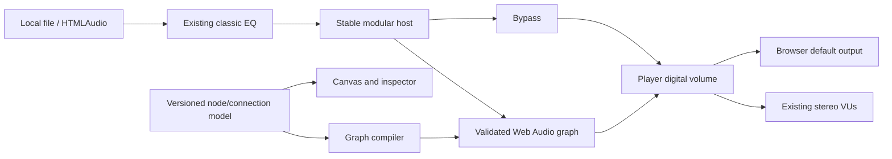

# Vynamp — Skin Requirements and Interactive HTML/SVG/JS MVP (GPT / Codex)

Document version: 1.3 · Updated: 2026-10-28 · Original baseline: 2026-10-23 · Language: English (UI string examples shown in en and pt-BR where i18n matters) · Audience: GPT / Codex working on an **existing HTML + SVG + JavaScript MVP**, plus visual design agents.

> **Filename note:** the file name keeps "v1.2" deliberately (other documents and STATE reference this path); the document version is **1.3**.

> **Changelog 1.3 (2026-10-28):** integrates the DSP/EQ access-and-controls contract **DSP-UX-01..21** (§5.10.1–5.10.5), the acceptance scenarios **DSP-UX-AC-01..12** (§12.14.1), the VU meter integration contract **VU-INT-01..06** (§5.13.11, §12.9.1), the modular graph prototype contract and the real-capabilities table (§12.8.1–12.8.7), new traceability rows MVP-15..MVP-18 (§13.2) and the **status honesty** vocabulary (reading conventions). Unifies the DSP/EQ/Vitrola/meter label to `[DEMO — no audio processing in this mode]`. **Lyrics note (2026-10-28, version unchanged):** integrates the summary lyrics component under the VU and the source/state contract **LYR-01..15** and the acceptance scenarios **LYR-AC-01..12** (§3, §4, §5.13.9, §5.16, §5.18, §8, §9, §12.4/§12.5/§12.12/§12.14.2, §13.2 MVP-09; canonical source docs/library/02-tags-lyrics-tools.md#letras-componente-resumido-sob-o-vu-e-fontes, decisions D-LYR-01..09 in docs/product/05-decisions.md, task TASK-E03-09). The component **adds** to the full lyrics panel and does not replace it; phases (M3) are unchanged. Any prototype evidence for lyrics is *reported evidence from the external reference, not verified in this repository*; native: nothing. Canonical sources: docs/design/05-dsp-panel.md (§6.1, §8, §9), docs/quality/05-dsp-test-matrix.md (§2.1, §2.2), docs/audio/03-dsp.md (graph: prototype × native), docs/audio/08-equalizers.md (§14), docs/audio/09-dsp-catalog.md, docs/audio/10-vitrola.md, docs/product/05-decisions.md (D-DSP-10..D-DSP-18).

> **NON-NEGOTIABLE MVP REQUIREMENTS / CONTRATO OBRIGATÓRIO — LEIA PRIMEIRO:** **TODOS os itens descritos nas seções 1–12 e na matriz da seção 13 são obrigatórios para a cobertura do MVP web** (HTML, CSS, SVG e JavaScript): telas, navegação, controles, estados, modos, temas, visualizadores, DSP, Vitrola, acessibilidade e testes. **Nenhum item pode ser omitido silenciosamente por ser difícil, complexo, "futuro", marcado M3–M5, P1/P2 ou [proposal].** Implementar interface e interação verificável agora, mesmo quando o processamento/driver nativo real não for possível no navegador: nesse caso, usar demonstração identificada e honesta, ou um estado indisponível com motivo explícito **sem remover o item da UI**. Apenas exclusões expressas em "What NOT to deliver" continuam proibidas. Não trocar telas completas por cards genéricos, listas de nomes ou placeholders sem configuração. Uma entrega com itens obrigatórios não cobertos é **INCOMPLETA**, não "concluída". Documentar a matriz item-a-item com evidências antes de finalizar.

> **PRIMARY EXECUTION REQUEST — READ THIS FIRST:** Inspect the repository and **improve the existing Vynamp web-based MVP** instead of merely producing drawings. Follow the complete visual specification in sections 1–11; apply the **implementation scope, preservation rules, interaction contract, demo-vs-real policy, delivery and testing requirements in section 12**. The HTML/SVG/JS MVP is a presentation/prototyping application, **not** the native Rust audio engine or a distributable `.vyntheme` package. Preserve all prior architectural decisions, particularly the previously planned **Vinyl Simulator + Tube Amplifier** (Vitrola) and the switchable VU meters.

> Reading conventions
> - Unmarked text comes from the product spec; the source is given in parentheses (file under `repo\docs\...` or `TASK-Exx-yy`).
> - **[proposal]** = the spec is silent; this document proposes. GPT/Codex may design or prototype the proposal but must list it in the deliverables as a proposal and must not contradict the spec.
> - **[MVP UI]** = a control/visual state required in the HTML/SVG/JS prototype; **[REAL]** = backed by actual working browser behavior; **[DEMO]** = clearly disclosed local simulation/mocked data; **[PLANNED]** = visible but disabled with a reason. The prototype must never confuse these.
> - **DSP demo label (single, exact string):** in every DSP / equalizer / Vitrola / meter context where audio processing is simulated or absent, the badge text is exactly `[DEMO — no audio processing in this mode]` (pt-BR rendering of the same i18n key: `[DEMO — sem processamento de áudio neste modo]`). No other variant ("Prévia interativa…", "[DEMO — no actual audio processing]", bare `[DEMO]`) is used in those contexts. Bare `[DEMO]` stays valid only for non-audio-processing fixtures (demo playlist, sample metadata). (docs/design/05-dsp-panel.md §5 table of messages)
> - **Status vocabulary (DSP/EQ/meters/VU-INT — D-DSP-16):** every DSP statement is tagged with one of four statuses, never merged: **specified** (this document and the canonical docs) · **implemented in the prototype (reported)** · **validated in the prototype (reported)** · **native (today: nothing)**. The reference prototype (HTML/SVG/JS rev. 14/15, made by Codex) is **external, outside the Vynamp repository**: every file or report cited (`interactive/*`, `*-validation.json`, `CONTROLES-DE-AUDIO.md`, `DSP-MODULAR-E-VU.md`) is *reported evidence from the external reference rev. 14/15, not verified in the Vynamp repository*; no path is linked as existing in the repo. Web evidence (Chrome/Windows, controlled fixtures) is neither native-engine proof, nor sound-quality measurement, nor WCAG certification.
> - **MUST** = obrigatório na interface executável do MVP. **MAY / [proposal] / fases M1–M5** = podem continuar representando escolhas futuras do PRODUTO, mas **não autorizam omitir elementos da interface do protótipo nesta tarefa**. Quando algo proposto entra em conflito com requisito canônico, registrar o conflito e manter o canônico. **MUST NOT** = proibido.
> - Units: DIP (desktop) and dp/sp (Android). 1 DIP = 1 logical dp. Base grid 4 DIP.
> - "Skin" and "theme" are the same concept: a `.vyntheme` package (docs/extensions/01-themes.md). There is NO compatibility with Winamp/AIMP/Poweramp skins (docs/product/01-vision-scope.md).
> - Source docs are written in Portuguese; terms are translated here. Keep UI strings keyed (en + pt-BR).

---

## 1. Goal, audience and how to use this document

### 1.1 Goal
Specify, unambiguously, **everything the Vynamp skin design and working HTML/SVG/JavaScript MVP must cover**: screens, areas, controls, states, behaviors, measurements, themes and variations. Sections 1–11 remain the full **product/design reference**. For this task, GPT MUST **inspect, adjust and test the existing interactive MVP** following section 12, using existing HTML/CSS/SVG/JavaScript files whenever possible. Do not create only static mockups, and do not replace the native engine roadmap with browser-specific limitations. This document is a specification and does not itself contain the application implementation.

### 1.2 What Vynamp is
A local-first, cross-platform **audio** media player (Windows 11 x64, Linux x64, macOS Intel, macOS Apple Silicon, Android 10+ arm64). Works without an account for local files and public radio; default UI is the classic three-panel layout (transport, equalizer, playlist), with an expandable library, radio/podcasts, DSP (EQ, ReplayGain, effects), transparent/hi-res output, visualizers and own themes (docs/product/01-vision-scope.md). It does **not** play video (no video screen) and does not import legacy skins.

### 1.3 Audience (affects density and vocabulary)
Audio enthusiasts and DAC owners; local-library users (target 100k tracks); radio and podcast listeners; theme/visualizer creators (docs/product/01-vision-scope.md).

### 1.4 How to use
1. Read sections 2, 3 and 8 (principles, window formats, skin system) before designing.
2. For each screen/area (section 4) follow section 5 (controls, states, behaviors). Section 6 is a cross-check table; section 7 lists shortcuts.
3. For design-only work, deliver what section 10 asks and run section 11. For an **HTML/SVG/JS MVP update**, implement **all applicable screens and interactions** from sections 4–10 and satisfy the mandatory section 12–13 compliance matrix.
4. When in doubt: accessibility and spec semantics > fidelity to the "classic" look > novelty.
5. Keep product/native milestone labels; do not downgrade web UI coverage because of milestones.
6. When implementing the MVP, examine its actual structure first. Preserve working code, paths, and behaviors and use a small, reversible improvement plan; do not replace the current project with an unrelated new app.
7. Distinguish **fully implemented production features** from **functional HTML demo controls** and **future features**. Product milestone labels (M1–M5) are not permission to invent a real native DSP, output driver, or plugin host in the browser.
8. Verify **every section 5.x (5.1–5.26)** in the browser and record exact files, steps and result per item.
9. Never report the task as finished with unverified, missing, skipped or substituted mandatory requirements; mark the delivery incomplete with an exact blocker list instead.
10. Items tagged M1…M5 describe the **native product roadmap, not permission to defer the HTML/SVG/JS MVP representation**. Every specified screen, configuration and meaningful UI state must be present and navigable in this prototype. For native-only capabilities (DSD, CD, VST3, casting, driver APIs, hardware output) implement **complete, labelled UI previews** with explicit availability limits; never claim that native audio functionality works. **Exception for 64-band graphic EQ: its complete interactive visual editor is mandatory NOW in the HTML/SVG/JS MVP**, while native DSP support remains at the milestone documented elsewhere.

### 1.5 Interface honesty principles (apply everywhere)
- Never show a badge the real audio chain does not justify (e.g. "bit-perfect" only when verified; "Transparent mode active" lists conditions). (docs/audio/04-outputs-hires.md)
- Every audible transformation is identifiable (EQ, ReplayGain, resample, dither, effects). (docs/product/01-vision-scope.md)
- State and quality never rely on color alone: always an icon or text label too. (docs/design/01, 03)
- No stack traces or crate names in the normal flow; technical detail goes in an optional "Details" panel. (docs/design/02-layouts.md)
- A moving knob, a lit wire or a configurable node is not proof of changed sound: a control that is not wired to a validated audio path carries `[DEMO — no audio processing in this mode]`. A limiter that is not true-peak is never called True Peak; a soft-saturation waveshaper is never called the Tube Amplifier. (docs/product/05-decisions.md D-DSP-16, D-DSP-17)

---

## 2. Visual and brand principles

### 2.1 Visual direction: "Classic Graphite" (default theme)
Graphite/dark-blue cabinet, cool metallic details, black display with lime green, amber and cyan meters. Three stacked modules, short title bars, **square** transport buttons, compact tracks, dense playlist. Faithful to the classic feel and hierarchy; **all illustration, icons, geometry and tokens are original** — do not copy existing skins, sprites or fonts. (docs/design/01-visual-system.md)

### 2.2 Mandatory semantic tokens (Classic Graphite)
Components use tokens, never arbitrary RGB. (docs/design/01-visual-system.md; canonical JSON `assets/design-tokens.json`)

| Token | Hex | Use |
|---|---|---|
| background | #11131B | Outer area |
| chassis | #252936 | Panels |
| panel-raised | #333A4D | Buttons and headers |
| panel-inset | #191D2A | Recesses |
| display | #080D0B | Time, spectrum, classic list |
| border-light | #677086 | Top/left lit edge |
| border-dark | #090C14 | Bottom/right edge |
| text-primary | #F1F3F7 | Control text |
| text-secondary | #B8C0CF | Metadata and labels |
| text-muted | #8D97AB | Disabled / secondary info |
| lime | #B8F35A | Time and playing item (playback) |
| cyan | #66D9EF | Focus and tool selection |
| amber | #FFBF69 | RMS/VU and edit actions |
| danger | #FF6B7A | Error/clip |
| selection | #32453A | Selected row |

Rules: lime = playback/time; cyan = focus/tools; amber = VU/edit; danger = error/clip. The brand (amber #FFBF69 / white #F0F2F5 / graphite #11131B) is **separate** from semantic tokens: brand white does not replace text-primary. (docs/design/04-brand-identity.md)

### 2.3 Bundled themes (each needs Classic, Library and Mini layouts)
(TASK-E06-04; docs/design/01; docs/extensions/01-themes.md)
1. **Classic Graphite** (default): 1 DIP bevel (border-light/dark), radius 2.
2. **Midnight Modern**: same color family, **less bevel**, radius 8, larger display.
3. **Copper**: amber as accent.
4. **[proposal] Light variant** of each theme (see 2.4).
All keep token names, states and accessible layout identical. None copies an existing skin.

### 2.4 Light and dark themes
- The spec guarantees that "dark/light variants preserve contrast" on mobile (docs/design/04-mobile-tablet.md) but only defines the dark palette on desktop. **[proposal]** Deliver for each bundled theme a **Dark (default)** and a **Light** pair with identical token names; in light, the time/spectrum `display` MAY stay dark (instrument window) to keep lime legible, provided contrast is measured.
- Following the OS theme is an option in Preferences > Appearance (default: Classic Graphite dark regardless of OS) **[proposal]**.
- "Dynamic system colors" (Material You) on Android is an **option**; the canonical palette is the default. (docs/design/04-mobile-tablet.md)
- OS High Contrast and Reduced Motion **take precedence** over skin colors and animation; design a High Contrast variant (black/white/yellow or system colors, 2 DIP borders, no reliance on bevel). (docs/design/03-accessibility-i18n.md)

### 2.5 Typography
- UI: system sans or Noto Sans (license bundled). Metadata 13–14 DIP; actions 14; section 16; title 18. (docs/design/01)
- Display: own monospace or reviewed free font; **30 DIP for time**, 13 DIP for codec. "Digital/LED" letterforms are a visual option only, **never the sole accessible representation** (equivalent semantic text). (docs/design/01)
- Android: 14–16 sp; time 28 sp; 200% font scale must reflow without clipping. (docs/design/04-mobile-tablet.md)
- Desktop font scale 100–200% independent of DPI; on the classic display 200% MAY grow the height without clipping. (docs/design/03)
- Brand wordmark/lettering as paths (no installed-font dependency). (docs/design/04-brand-identity.md)

### 2.6 Grid, spacing, radius, borders
4 DIP grid; padding 8/12/16; gap between modules 8; radius classic 2 / modern 8; outline 1; inner bevel 1. (docs/design/01)

### 2.7 Density
- **Compact**: list row 24 DIP, buttons 28 DIP.
- **Comfortable**: row 36 DIP, buttons 40 DIP.
- **Touch mode**: minimum target 44×44 DIP (desktop touch) and 48×48 dp (Android). Minimum desktop mouse target: 24×24 DIP. **Never shrink below minimums to imitate legacy pixels.** (docs/design/01, 04-mobile)
- Mini-player: 8 DIP visual seek with **24 DIP interaction area**. (docs/design/02)

### 2.8 Iconography
- **SVG path** icons, original (no icon fonts, no external refs, sanitizable). Grids: 16, 20, 24 (desktop), 24 dp (Android). Uniform stroke (suggested 1.5–2 DIP); square terminals in Classic, rounded in Midnight Modern.
- The **brand icon (V + play triangle) MUST NOT be used as the play button** and does not replace controls. (docs/design/04-brand-identity.md; TASK-E02-02)
- Every icon-only control has a **tooltip and accessible name**. State is never color only.
- Brand: horizontal, stacked, symbol-only and monochrome lockups; clear space 20% of symbol height; symbol with text from 24 DIP; below that use the simplified optical version (16/20 px: keep triangle and gap). Tray/menu bar: monochrome/alpha glyph, no wordmark; macOS menu bar = alpha template (18 pt / 36 px). (docs/design/04-brand-identity.md)

### 2.9 Component states (default for EVERY control)
(docs/design/01-visual-system.md)

| State | Mandatory treatment |
|---|---|
| Normal | "Raised" (bevel) / subtle elevation in Modern |
| Hover | Cyan border and +8% luminosity |
| Pressed | "Inset" look |
| Checked/active (toggle) | Lime dot + accessible label/state (not color only) |
| Disabled | text-muted, **no** hover effect, not opacity-only (add struck icon or label) |
| Focus-visible | Cyan ring 2 DIP with 2 DIP gap, visible in ALL themes |
| Error | Icon + label + danger (not color only) |
| Playing (current track) | Triangular icon + lime; **selection ≠ current track** |
| Loading | Action label + bounded spinner (cancellable for long operations) |

Draw every control in all these states in the component sheet (section 10).

### 2.10 Contrast (WCAG as design reference)
- Normal text ≥ 4.5:1; large text and essential indicators ≥ 3:1. Measure **real pairs** (including selected/disabled/hover). A preview is not proof. (docs/design/01, 03)
- Brand amber on white is not for essential controls (use monochrome graphite). (docs/design/04-brand-identity.md)
- Deliver a measured-contrast table per theme and state (section 10).

### 2.11 Motion
- Hover 80 ms; expand 160 ms; modals 120 ms; **no blocking animation**. (docs/design/01)
- Interactive UI 60 Hz; visualization 30 Hz default, 60 optional (foreground), 10 in power-saving; minimized window suspends drawing (audio continues). (docs/design/01; extensions/04-visualizer-contract.md)
- **Reduced Motion**: no transitions, marquee or animated visualizer; meters static or slow-updating (see 5.13). No flash > 3/s; no automatic high-contrast animation. (docs/design/01, 03)
- Long titles: ellipsis + tooltip; marquee optional **only on hover**, off in Reduced Motion.

### 2.12 Rendering and DPI
References at 100/125/150/200% DPI, both themes, all states. Layout in DIP; the renderer handles DPI (do not multiply pixels manually). Text never clips an essential control in PT-BR/EN. (docs/design/01–02)

---

## 3. Platforms and window formats

### 3.1 Mode matrix per platform
(docs/design/02-layouts.md, 04-mobile-tablet.md; docs/platforms/*)

| Mode | Windows | Linux | macOS (Intel/Silicon) | Android |
|---|---|---|---|---|
| Classic Stack (default) | yes | yes | yes | no (phone/tablet profile) |
| Library Workspace | yes | yes | yes | adapted (expanded tablet) |
| Mini | yes | yes | yes | sticky mini-player + notification |
| Full-screen visualizer | yes | yes | yes | yes (landscape/immersive) [proposal] |
| Phone / Tablet | — | — | — | yes |

The same skin delivers common tokens; **geometry depends on the host** (never shrink desktop to phone).

### 3.2 Desktop — main window (Classic Stack)
(docs/design/02-layouts.md)
- Initial usable window **600×760**, minimum **480×660**. Outer padding 12. Panel width W = usable width − 24 (W=576 at initial size).
- Regions (origin top-left of usable area), x/y/w/h:
  - Main header 12/12/576/28
  - Player 12/40/576/184
  - EQ 12/232/576/180 (hidden → returns space to playlist)
  - Playlist 12/420/576/328
  - Gaps 8 between modules.
- Player inner regions (local origin), x/y/w/h:
  - Display (time, title, spectrum/meter, quality) 12/12/352/78
  - Optional cover 376/12/72/72
  - Source actions (Local / Radio / Library) 460/12/104/32
  - Seek 12/102/552/20
  - Transport (Previous, Play, Pause, Stop, Next, Open) 12/140/264/32
  - Volume/pan 288/140/164/32 (volume + mute; pan in popup)
  - Modes (Shuffle/Repeat) 464/140/100/32
- Player header: menu left, name ("Vynamp") center, minimize/close right.
- Display: time takes 100 DIP width; title takes the rest; codec and resolution on a second line; **bottom spectrum/VU strip 28 DIP, never covering text**.
- EQ: titlebar 24, toolbar 28, preamp + ten bands = 100, footer 16.
- Playlist: titlebar 24, tabs 28, flex list, footer 32 (add/remove/sort + count/duration).
- **Width < 560 DIP**: cover removed; source buttons become a menu; volume moves to a second row; player grows 32 DIP and playlist loses 32. Even at minimum, keyboard and adequate targets.
- **Lyrics under the VU (LYR-01, LYR-15; D-LYR-09)** [specified; proposal for the exact slot]: in the approved extended layout the summary lyrics component sits **immediately below the VU**, integrated into the skin surface with no extra frame or box. It adapts to the available space **without shrinking or distorting the 12 stereo VUs or covering playback controls**; its presence is **not imposed** where space is lacking. It never takes the 28 DIP display strip (that strip is the compact meter; no text is covered). Canonical: docs/library/02-tags-lyrics-tools.md#letras-componente-resumido-sob-o-vu-e-fontes; docs/design/02-layouts.md#letras-sob-o-vu-2026-10-28.
- Advanced graphic EQ opens a larger editor (do not squeeze 31 bands into the classic panel).
- Snap docking at 12 DIP; Alt ignores snap; detachable modules only in M3 (TASK-E02-08). Positions persisted **per monitor** and clamped to the visible area on restore (a removed monitor must not strand the window).
- Resizing: free width/height between minimum and monitor maximum; panels stretch in width; the playlist absorbs extra height. **[proposal]** Max usable Player width before centering: 960 DIP (above that, side margins; do not stretch transport).

### 3.3 Desktop — Library Workspace
(docs/design/02-layouts.md)
- Initial **1280×800**, minimum **960×640**.
- Topbar 56; sidebar 200 (collapsible to 56); central panel flex ≥ 480; optional right inspector 280; bottom now-playing 96.
- Sidebar: Library, Folders, Playlists, Radio, Podcasts, Favorites, Downloads, Themes/Plugins.
- Width < 1152: inspector becomes a drawer; sidebar may collapse to 56.
- Opening the library as a workspace **preserves playback and previous geometry**.
- **Lyrics (LYR-01, LYR-15)**: wherever the large VU is shown (now-playing bar or inspector "Meter" card), the summary component may sit below it under the same rule as §3.2; the Lyrics inspector/panel (§5.16) stays the full view. If there is no room, the summary component is omitted and the inspector remains the access (D-LYR-09).

### 3.4 Desktop — Mini
(docs/design/02-layouts.md)
- Minimum **420×112**. Contents: title/time, play and next, volume/mute, expand; 8 DIP seek with 24 interaction area.
- Always-on-top **optional** with a **clear indicator** (active pin icon + tooltip).
- "Close to tray" **off by default**; when on, the first close shows a notice saying where to reopen.
- Switching mode keeps audio (never restarts).
- **[proposal]** Mini may be resized horizontally only (420 → 640 DIP); at wider sizes it shows a mini meter and a 56×56 cover.
- **Lyrics**: the three-line summary component is **not imposed in Mini** when space is lacking (D-LYR-09; the three-line rule applies only where the component is shown). A Mini lyrics presentation, if any, is a separate [proposal] and must not reduce the minimum targets.

### 3.5 Title bar, tray and menu bar
- **Windows/Linux**: skin-drawn title bar (28 DIP header with menu, name, minimize, close [and maximize in resizable Library mode]). Dragging the header moves the window; double-click on the Library header maximizes/restores. When the window uses OS decorations, the skin still draws the 28 DIP inner header **[proposal]** for consistency. Respect window controls under Wayland. (docs/platforms/03)
- **macOS**: native traffic lights at left, app menu bar at the top of the screen; inner header omits duplicate window buttons **[proposal]**. Menu bar icon = alpha template, 18 pt.
- **Tray (Windows/Linux)**: Vynamp glyph (monochrome 16/20/24/32 px), context menu: Open Vynamp, Play/Pause, Previous, Next, Mini-player, Quit; paused/error via badge, not another mark. Click restores window. Tooltip "Artist — Title" **[proposal]**. (docs/design/04-brand-identity.md; docs/extensions/03)
- **Windows taskbar**: playback progress (taskbar progress) and thumbnail buttons (Previous/Play-Pause/Next) **[proposal]**; SMTC with cover, title, artist. (docs/extensions/03)
- **OS media controls**: Windows SMTC/media keys; Linux MPRIS; macOS Now Playing/media keys; Android MediaSession. The skin only supplies cover art and labels; the controls belong to the OS. (docs/extensions/03; docs/platforms/03)

### 3.6 Android
(docs/design/04-mobile-tablet.md; docs/platforms/02-android.md)
- Phone reference **400×880 dp**; minimum 360 dp; flexible height; real system insets (never constants).
- Now Playing vertical structure (phone): app bar 48; display 64; cover up to 208; controls height 56; seek 48; tabs 56 (**Queue / EQ / Lyrics / Info**); flex panel; bottom navigation 64. Margins 16; gap 8/12; targets 48×48 dp.
- Play/pause center 56; previous/next 48; volume in an accessible **sheet** (physical volume follows the OS route; label "Device volume" vs "Vynamp digital volume").
- Bottom navigation: **Library, Playlists, Radio, Podcasts**.
- **Sticky** mini-player above bottom navigation outside Now Playing, ≥ 48 dp; not to be confused with the notification.
- Expanded player opens by tap; **Back returns to previous navigation and does not stop sound**.
- **Portrait**: layout above. **Compact landscape**: reduced cover + two columns (controls/cover left; queue/EQ/lyrics right), without hiding controls.
- **Lyrics on Android**: the **Lyrics** tab remains the full lyrics access. The addendum specifies the summary component only for the approved extended layout; its Android placement is **not specified** (open item, no value invented). If a narrow-screen version exists, the prototype reported 30 dp line height (reported, external reference, not verified in this repository) as a starting point subject to tokens, text scale and 48 dp targets.
- **Tablet/foldable (breakpoints by usable width)**: compact < 600 dp; medium 600–839 dp (navigation rail + player/queue); expanded ≥ 840 dp (library + playback/EQ inspector in 2–3 panes). Consider hinge/posture; resizing does not restart the engine.
- External keyboard/mouse accessible; tablet does **not** become desktop windows.
- **Media notification** (foreground service mediaPlayback): cover, title, artist, actions Previous / Play-Pause / Next (+ close/stop **[proposal]**), progress bar where the OS allows; notification icon: own 24 dp white/alpha symbol (no colored tile). Mirrors the Rust engine state. (docs/platforms/02; brand-identity)
- **Lock screen**: standard OS media controls with cover; the skin does not draw the lock screen, it only supplies metadata and cover.
- **Widget [proposal]**: resizable 4×1 (cover 48 dp, title/artist, previous/play-pause/next) and 4×2 (+ progress bar). Not in the spec; tag as proposal, M4+.
- Adaptive icon: 108×108 dp, V/play inside the central 66 dp circle; monochrome layer (themed icons). (docs/design/04-brand-identity.md)
- Gestures: always with a button alternative; **swiping an item never deletes a file without confirmation**.

### 3.7 Consolidated breakpoints

| Context | Breakpoint | Change |
|---|---|---|
| Desktop Classic | width < 560 DIP | cover hidden, sources → menu, volume on 2nd row |
| Desktop Classic | height < 660 | not allowed (minimum) |
| Library | < 1152 DIP | inspector → drawer; sidebar collapsible to 56 |
| Library | < 960 | not allowed (minimum) |
| Mini | 420×112 minimum | see 3.4 |
| Android | < 600 dp / 600–839 / ≥ 840 | compact / medium with rail / expanded multi-pane |
| Font | 100–200% | reflow/height growth, never clipping |
| Lyrics summary component | narrow screen / enlarged text | one visual line per position, no horizontal page scroll, full text available on demand; omitted rather than shrinking the VUs (LYR-03, D-LYR-09) |

---

## 4. Screen and area inventory

Master list (each has a section 5.x). Phase in brackets.

| # | Screen/Area | Where it appears | Phase |
|---|---|---|---|
| 5.1 | Player: display, transport, source actions | Classic, Mini, Now Playing | M1 |
| 5.2 | Track info and cover | all | M1/M2 |
| 5.3 | Seek / progress bar (incl. A-B, LIVE) | all | M1 |
| 5.4 | Volume, mute, pan, balance | all | M1 |
| 5.5 | Queue and playlist (tabs, drag-and-drop, undo) | Classic, Library, Android | M1–M3 |
| 5.6 | Library (views, search, filters, sort, inspector) | Library, Android | M2 |
| 5.7 | CUE and virtual tracks, chapters | playlist/library/inspector | M2 |
| 5.8 | Track technical details and audio chain | inspector, dialog, display | M2/M3 |
| 5.9 | Equalizer: graphic + advanced/parametric editor + presets | EQ panel, advanced window, Android | M1–M3 |
| 5.10 | DSP: ReplayGain, crossfade, gapless, dynamics, tone, tempo/pitch, channels | Preferences > DSP | M1–M3 |
| 5.11 | Vitrola effects (vinyl + tube) | DSP/Effects panel | M3 (after E04-03) |
| 5.12 | Audio output / devices / transparent mode / hi-res | display popup + Preferences > Output | M3 |
| 5.13 | **Visualizers and switchable VU meter** | display, Mini, full screen, Android | M2/M3 |
| 5.14 | Radio and streams | Library/Classic/Android | M2/M3 |
| 5.15 | Podcasts and audiobooks | Library/Android | M2–M4 |
| 5.16 | Lyrics: full panel (plain/synced) **plus summary component under the VU** (LYR-01..15; library/02#letras-componente-resumido-sob-o-vu-e-fontes) | Lyrics tab, inspector, and below the VU in the extended layout | M3 |
| 5.17 | Recording, sleep timer, scheduler/alarm | dialogs | M3 |
| 5.18 | Preferences | 880×680 window | M2 |
| 5.19 | Themes (gallery/preview/editor) and Plugins (manager) | Library sidebar | M2/M3 |
| 5.20 | Job manager (scan, convert, download, record) | 800×520 window | M2/M3 |
| 5.21 | Track details / batch tag editor | 800×640 window | M3 |
| 5.22 | Notifications, errors, toasts, dialogs | cross-cutting | M1 |
| 5.23 | Onboarding, first run, empty states | cross-cutting | M1 |
| 5.24 | About, splash, safe mode | dialog | M1 |
| 5.25 | Menus (main, context) | cross-cutting | M1 |
| 5.26 | Android: navigation, sheets, gestures, notification | Android | M1+ |

Mandatory screen states for EVERY data screen (docs/design/02-layouts.md; TASK-E02-10): **Empty (with CTA)**, **Loading (cancellable)**, **Populated**, **Partial error (valid items kept)**, **Offline (local content not erased)**, **Unsupported (with reason)**, **Permission denied**, **Conflict**, **Recovery**. Dialogs: focus the first safe action, Escape cancels, focus returns to the invoker.

---

## 5. Per-screen specification

Control format: **Name** · suggested icon · action · shortcut · tooltip · specific states (beyond the 2.9 defaults). Shortcuts marked "[proposal]" are not in the spec; spec ones cite (docs/product/04-user-journeys.md).

### 5.1 Player: display, transport and source actions

**Display content (352×78 in Classic)**: elapsed time (30 DIP, lime, display font) with elapsed/remaining toggle (click the time); title; artist/album (2nd line, text-secondary); technical line (codec, rate, bits, channels, bitrate; e.g. "FLAC · 24 bit · 96 kHz · stereo"); badges (HI-RES SOURCE, TRANSPARENT, LOSSY, LIVE, gapless, RG); engine state (Opening… / Buffering… / Reconnecting… / Device lost / Error); **meter/visualizer on the 28 DIP bottom strip** (section 5.13). (docs/design/02; docs/audio/04)

**Player states (state machine)**: Idle → Opening → Buffering → Playing ↔ Paused; Seeking; Stopping; Reconnecting; DeviceLost; Error. Each needs a visual state in the display (text label + icon). Buffering does **not** show fake progress. (docs/audio/01-engine.md; docs/product/04)

**Transport (264×32; square buttons)**

| Control | Icon | Action | Shortcut | Tooltip | Extra states |
|---|---|---|---|---|---|
| Previous | |◀◀ | Previous track (if > 3 s played, restarts the track **[proposal]**; second press goes back) | Alt+Left (spec); media Prev | "Previous" / "Anterior" | disabled with empty queue |
| Play | ▶ | Play / resume | Space (when focus is not a text field) (spec) | "Play" / "Reproduzir" | loading during Opening |
| Pause | ❚❚ | Pause, keep position | Space | "Pause" / "Pausar" | active when paused; live radio: resumes at live edge with notice |
| Stop | ■ | Stop and go Idle | S **[proposal]** | "Stop" / "Parar" | disabled in Idle |
| Next | ▶▶| | Next in queue (beats repeat) | Alt+Right (spec); media Next | "Next" / "Próxima" | disabled at queue end without repeat |
| Open | ⏏/folder | Open file(s) | Ctrl+O (spec) | "Open file…" / "Abrir arquivo…" | opens native dialog/picker |

Note: Classic Graphite shows Play and Pause as **separate buttons** (spec); in other layouts (Mini/Android) a single toggling play/pause button is allowed, with its accessible name switching. Either way the current state is announced to screen readers.

**Source actions (104×32)**: Local (open file/folder), Radio (open URL; Ctrl+L), Library (opens Library Workspace). Below 560 DIP they collapse into a "Source" menu.

**Modes (100×32)**
| Control | Icon | Action | Shortcut | States |
|---|---|---|---|---|
| Shuffle | crossed arrows | toggle shuffle without replacement per cycle | H **[proposal]** | on (lime dot + text "Shuffle: on") / off |
| Repeat | circular arrows | cycles: off → sequence → track | R **[proposal]** | 3 states with distinct icon (plain / loop / loop with "1"); text label |

**Extra accessible player controls (menu "Playback" or popover)**: Stop after this track; Stop after queue; A-B loop (set A, set B, clear); Speed (podcast); Skip +30 s / −15 s for podcast/audiobook (configurable); Sleep timer. (docs/product/04; docs/library/02; TASK-E01-05)

**Behaviors**: dropping files on the player **replaces the source after explicit intent** (drop zone labeled "Drop to play now" + confirmation if a queue exists); double-click on the display toggles Library/Classic **[proposal]**; right-click opens the player context menu (copy title, show in folder, details, open audio chain).

### 5.2 Track info and cover
- Optional cover 72×72 (Classic), 56 (wide Mini), up to 208 dp (Android), large in the inspector and full screen. Priority: embedded > folder > online cache (opt-in) > original Vynamp fallback. PNG/JPEG/WebP. (docs/library/02)
- **Cover placeholder** (no art): neutral note glyph — do NOT use the logo as a cover.
- Fields shown: title, artists, album, year, track/disc no., genre (inspector), rating, favorite, play count, file name/URL (no token), current chapter (CUE/M4B).
- Behavior: long title → ellipsis + full tooltip; optional marquee on hover only (off in Reduced Motion); click cover opens enlarged cover (lightbox) **[proposal]**; click on artist/album filters the library.
- States: no metadata (show file name), loading cover (skeleton), cover error (placeholder, no intrusive warning), live/radio (station name + ICY title; **no fake duration**, show "LIVE").
- Display text MUST exist as **semantic text** (not canvas only).

### 5.3 Seek / progress bar
- Horizontal slider 552×20 (Classic), 8 DIP visual + 24 interaction (Mini), 48 dp (Android). Shows: elapsed and duration/remaining; **buffered range** (lighter section) for network sources; chapter/CUE track ticks; A and B markers.
- Hover: tooltip with timestamp under the pointer. Dragging the thumb previews time; release → seek. Click: jump. Keyboard: ←/→ ±5 s, Shift+←/→ ±30 s, PageUp/PageDown ±1 min, Home/End start/end **[proposal for values]**; on focus announces "position X of Y".
- States: normal; hover; dragging; **disabled** when the source is live without DVR (replace with **LIVE** badge + buffer time, **no** fake slider); live with timeshift: slider only within the window (30 min/512 MiB) with a "Go live" button; seek unavailable on remote file without Range (disabled + reason tooltip); Buffering (activity indicator without fake %).
- **A-B loop**: buttons A, B, Clear; highlighted region (translucent cyan/amber); A<B; exits on track change. (TASK-E01-05)
- Android: seek announces position via accessibility and moves through accessibility actions (increments).

### 5.4 Volume, mute, pan
- Volume: horizontal slider (164 DIP including mute) with numeric value (0–100%) in tooltip/hover; keyboard step ↑/↓ 2% or 5% **[proposal]**; Mute (speaker-with-waves / struck-through icon) toggle, shortcut M **[proposal]**; mouse wheel over slider adjusts volume. Pan/Balance in a popup: centered slider with center mark, readout "L 30 / C / R 30", double-click to reset.
- States: normal/hover/dragging/muted (struck icon **and** text "Muted")/disabled (transparent mode with hardware volume — show volume type: **digital** vs **hardware**; distinct labels; unity indicated).
- Visual warning when digital gain exceeds 0 dB (possible clip) **[proposal]**.
- Android: physical volume controls the OS; in-app sheet with "Device volume" and "Vynamp volume".
- Output change (DAC) → never raise volume silently (no misleading visual warning). (docs/audio/03)

### 5.5 Queue and playlist
(docs/library/01-library-playlists.md; docs/product/04-user-journeys.md; TASK-E02-04)

**Structure (Classic)**: titlebar 24 · tabs 28 (multiple playlists + **Queue** tab) · virtualized list · footer 32.
**List columns (configurable)**: playing indicator (▶ lime), no., title, artist, album, duration, format/bitrate, rating, year, genre, path; compact (24) / comfortable (36) density. **Current** track distinguished from **selected** (selection #32453A for selection; lime + icon for current). Unavailable items (missing file, offline root, revoked grant) show an alert icon + text "Unavailable" (not removed).
**Footer**: Add (file/folder/URL), Remove, Sort (menu), Misc/Options, item count and total duration.

| Control | Icon | Action | Shortcut |
|---|---|---|---|
| New playlist (+ tab) | + | creates tab | Ctrl+T **[proposal]** |
| Play now | ▶ | starts new sequence | Enter / double-click (spec) |
| Play next | ⤵+ | inserts after current | Alt+Enter **[proposal]** |
| Add to queue | + queue | appends | Shift+Enter **[proposal]** |
| Remove from playlist | trash | removes item(s) | Delete (spec; never deletes physical media) |
| Move item | handle ⋮⋮ | reorders (no audio restart) | Alt+↑/↓ **[proposal]** |
| Sort/Group | ↕ | menu: title, artist, album, duration, year, path, random | — |
| Undo/Redo | ↶ ↷ | ≥ 100 operations per session | Ctrl+Z / Ctrl+Shift+Z |
| Lock playlist | padlock | blocks editing (not playback) | — |
| Remove duplicates | — | explicit command, never changes queue unasked | — |
| Save/Export | floppy | M3U/M3U8/PLS/XSPF/CUE; UTF-8; no token | Ctrl+S **[proposal]** |
| Import | arrow in | M3U/M3U8/PLS/XSPF/CUE | — |
| Select all | — | — | Ctrl+A |
| Search in list | magnifier | filters | Ctrl+F (spec) |

**Keyboard**: ↑/↓ navigate; Home/End; Enter plays; Delete removes; multi-select with Shift/Ctrl; screen reader announces the playing row.
**Row context menu**: Play now · Play next · Add to queue · Remove from playlist · Remove from library (≠) · Delete file… (confirmation + recycle bin) · Track details · Edit tags… · Show in folder · Copy path · Favorite · Rate (1–5) · Stop after this · Identify online (opt-in) **[M3]**.
**Drag-and-drop**: dragging files/folders onto the playlist adds **at the end**; dropping on the **marker between rows** inserts there (cyan insertion line); reorder by dragging the handle. Folders expand in the background. Invalid files do not block; errors are grouped in one notice.
**Queue**: separate tab (snapshot independent from the edited playlist) with an ordered "Up next"; actions Clear queue, Save queue as playlist; shuffle seed only in advanced. Crash restore: banner "Resume where you left off" (no autoplay).
**Smart playlists (M3)**: rule editor (field/operator/value, sort, limit); distinct icon; no free-form SQL.
**States**: empty (CTA "Add files / folder / open radio"); loading (import with cancellable progress); partial error; missing file; locked.
**Android**: virtualized list with handle reordering; actions in a **bottom sheet**; optional side swipe (add to queue / remove from list **with Undo**, never delete file); long-press selects.

### 5.6 Library
(docs/library/01; TASK-E02-05, TASK-E03-05)

**Library Workspace**: topbar (56): back/forward, **global search** (title, artist, album, folder; Ctrl+F; cancellable, does not alter queue), breadcrumb, filters button, view toggle (grid / list / folders), sort, Settings button. Sidebar (200): Library (Songs, Albums, Artists/Album Artists, Genres, Years, Folders, Recent, Favorites, Hi-res, Streams), Playlists, Radio, Podcasts, Downloads, Themes/Plugins, + "Sources" area with status (online/offline/NAS unavailable). Center: album grid (cover, title, artist, year), track list (configurable columns, safe-template grouping, stable sort, virtualized — 100k rows without a widget per row), or folder tree. Inspector (280): cover, credits, tags, lyrics, audio chain. Bottom now-playing (96): cover, title/artist, full transport, seek, volume, queue button, visualizer button, EQ button.

**Filters**: codec, resolution (incl. Hi-res), genre, year, rating, unplayed, origin (local/radio/podcast/NAS). Removable chips. Save filter as smart playlist (M3).
**Sort**: title, artist, album, year, duration, recently added, most played, rating, random; asc/desc. Sorting while playing does not alter the queue.
**Item actions**: Play, Play next, Add to queue, Add to playlist ▸, Favorite, Rate, Details, Edit tags, Show in folder, Remove from library (≠ Delete file, with confirmation and recycle bin).
**Import**: "Add folder…" with a **count preview** and cancellable progress; incremental scan with a discreet sidebar indicator; offline roots become **unavailable (dimmed + icon), never removed**.
**States**: empty library (onboarding), indexing (progress + usable partial), search with no result (message + suggestion to clear filters), source error, permission denied, offline.
**Android**: Library/Playlists/Radio/Podcasts in bottom navigation; denied media permission → explanatory screen offering the file picker (SAF) or continuing with radio; sticky mini-player.

### 5.7 CUE and virtual tracks
(docs/library/01; docs/audio/02-formats.md; TASK-E03-06)
- CUE virtual tracks (and M4B/Matroska chapters) appear as **child** items of a parent file (disc/CUE icon and indent), referencing a range of the same file — no duplicated media. Show index, title, performer, start (mm:ss:ff, 75 frames/s) and duration.
- Seek bar shows track ticks; display shows "Track 3/12 · CUE" and current chapter.
- Actions: Extract CUE tracks (M3 tool), Show source file, Open .cue.
- States: invalid/missing CUE (alert "CUE media file not found"), explicit gaps/offsets.

### 5.8 Track technical details and audio chain
(docs/audio/04-outputs-hires.md; docs/audio/01; TASK-E02-07)

**Technical line on display**: codec, valid bits, rate, channels, bitrate (approx. for streams).
**Badges** (text + icon, never color only):
- **HI-RES SOURCE**: lossless PCM source >16 bits and/or >48 kHz (definition in tooltip; no implied audible improvement).
- **LOSSY** (lossy source; lossy at 192k does not become lossless).
- **TRANSPARENT** ("Transparent mode active"; tooltip lists conditions; **"bit-perfect verified" only for tested combinations**).
- **EXCLUSIVE / SHARED / ASIO**.
- **GAPLESS**, **RG** (ReplayGain track/album applied), **EQ**, **FX**, **RESAMPLE**, **DITHER**.
- **LIVE**, **OFFLINE** (downloaded), **Bluetooth** (show known output; never assume codec/bit-perfect).
**"Audio chain" inspector** (linear diagram with nodes): Source → Decode → Gain/ReplayGain/Preamp → EQ/Tone/Effects → Mixer/Crossfade → Master gain → Resampler → True-peak guard → Dither/Conversion → Output. Each node: name, on/bypass (icon + text), key parameters, declared latency. **SOURCE** block (rate/bits/channels/codec) vs **OUTPUT** block (**negotiated** real rate/valid bits/channels, backend, device). FLAC 24/192 on a 16/48 output shows "resample + quantization". A 32-bit container with 24 valid bits is not a 32-bit source. State "output transport" when driver/hardware transformation is not observable.
**Tap/limiter latency readout** (visible increase); **underrun** counter; **clipping** indicator detected per block.
**Behavior**: turning EQ on in transparent mode → dialog "Leave transparent mode?" (confirms intent and updates the badge); opening a lossy file in transparent → "processing disabled; lossy source".
**States**: no track (empty), partial data (show "—"), unsupported profile/decoder (reason), loading.

### 5.9 Equalizer
(docs/audio/03-dsp.md; TASK-E04-01/04/09; TASK-E02-07)

**Classic panel (576×180)**: titlebar 24; toolbar 28; preamp + 10 bands area 100; footer 16.
- Toolbar controls: **On/Off** (toggle), **Auto** (applies preset per track/genre/device), **Reset** (flat), **Presets ▾** (menu: load, save as…, rename, delete, import, export), mini response curve.
- **Preamp**: vertical slider −24..+12 dB. **10 bands**: 31/62/125/250/500/1k/2k/4k/8k/16k Hz, gain ±12 dB (fixed frequency label below, dB value on drag/focus). Mini curve computed from the real filters (not decorative).
- Keyboard step: ↑/↓ 0.5 dB, Shift 2 dB, Home/End min/max, double-click = 0 dB. Value/unit announced ("62 hertz, plus 3.0 decibels"). Decimal follows locale.
- States: on/off (bands dimmed but editable **[proposal]**), modified preset (asterisk "*"), **locked by transparent mode** (notice and "Leave transparent mode" button), loading preset, preset error.
**Advanced editor (960×600)**: **MANDATORY interactive selectors for 10 / 20 / 31 / 64 graphic bands plus Parametric (up to 32 independent filters) in the HTML/SVG/JS MVP**. Selecting a mode must actually rebuild/rebind the correct number of controls, the displayed response curve, numeric readouts and per-mode presets/state; preserve values independently per mode (no silently discarded edits). The 31-band mode uses standard third-octave center frequencies; 64 bands use a clearly specified dense/log-spaced center-frequency scheme (do not label 64-band as "1/3 octave"). Provide horizontal scrolling, zoom/virtualization or responsive grouping so 64 bands remain legible and operable with keyboard and pointer. A browser DSP audio path must disclose which modes are audibly processed and which are UI demonstrations. The native product's milestone for 64-band support remains M5. Large graph (log frequency 10 Hz–40 kHz limited to 0.45×Fs; gain dB), real curve, draggable points; **band table** (type, frequency, gain, Q, channel, slope, enabled); 10/20/31/64 graphic band modes (gain ±15 dB for the advanced graphic editor) **with interactive MVP controls for all four**; parametric up to 32 filters in the MVP (additional/native expansion can retain M5 milestone), with add/remove/enable/filter-type/frequency/gain/Q/slope/channel controls. Types: peaking, low/high shelf, low/high pass, notch, band pass. Freq 10 Hz–min(40 kHz; 0.45×Fs); gain −24..+24; Q 0.1..18; channel Both/Left/Right (multichannel M5). Frequencies above Nyquist **unavailable** (disabled with tooltip), no hidden readjustment. Preset **per device** (tab). Import AutoEQ/headphone correction: explicit, origin/license identified, never assume the headphone model. Precedence shown: session > track > genre > device > global.
**Android**: 10 bands in a page with **explicit horizontal scroll**, fixed labels, presets and preamp always visible; advanced graphic 20/31/64 modes in scrollable full-screen editor and parametric in a fullscreen editor with table; touch changes interpolated. All these modes are required in the responsive HTML MVP preview, even if the final Android native app follows a later milestone.

#### 5.9.1 Equalizer under the DSP access/controls contract (DSP-UX; D-DSP-15)
(docs/audio/08-equalizers.md §14; docs/design/05-dsp-panel.md §8.5; docs/quality/05-dsp-test-matrix.md §2.1)
- The **EQ shortcut** (DSP-UX-02) opens the advanced editor (960×600) directly; the compact Classic 10-band panel remains. Both read the **same canonical state** (no second copy of band values).
- **Graphic sliders per band stay real sliders** (DSP-UX-07) with all required bands editable in 10/20/31/64; knobs may be used for preamp/Q/frequency of parametric filters (DSP-UX-06) but **never replace the band editor**. Parametric keeps up to 32 filters with independent state per mode.
- A value between gesture steps loaded from a valid preset (for example −23,5 dB where allowed) is preserved in state, readout and export (DSP-UX-14, AC-05).
- Status (kept separate): *specified* — all five modes (docs/audio/08-equalizers.md); *implemented/validated in the prototype (reported)* — Classic 10-band with web-audio adaptation in the old editor (reported, external reference rev. 15, not verified in the Vynamp repository); EQ10/20/31/64 and PEQ32 **real audio only inside the modular graph** (§12.8.2) (reported, external reference rev. 15, not verified in the Vynamp repository); the other modes of the old advanced editor keep `[DEMO — no audio processing in this mode]` when not wired; *native* — nothing today; EQ-64 native stays **M5** (unchanged).

### 5.10 General DSP (Preferences > DSP and shortcuts)
(docs/audio/03-dsp.md; docs/audio/01-engine.md; TASK-E04-01/03/07/08)
Each item needs control + state + tooltip:
- **ReplayGain**: mode Off / Track / Album; preamp with tag (−24..+12) and preamp for untagged files; peak guard (on/off); show applied gain ("RG −6.2 dB") in inspector/display. No automatic scan on playback; "Analyze loudness…" opens a job (M3).
- **Crossfade**: duration 0–12 s (slider), equal-power curve (default), **separate** for manual vs automatic advance; off by default; note: crossfade off does not affect gapless.
- **Gapless**: toggle (default on); notice when a sample-rate change in exclusive mode breaks gapless (visible limitation).
- **True-peak limiter**: toggle, default ceiling −1 dBTP, announced lookahead, visible latency.
- **Compressor**: threshold, ratio, attack, release, knee, makeup + **gain-reduction meter** (downward bar).
- **Tone**: bass/treble. **Balance/pan**, **mono**, **channel routing**, **fades**, **downmix** (with declared headroom).
- **Tempo** 0.5–2× with pitch preservation; **Pitch** ±12 semitones; independent speed (podcast per category; music does not inherit 1.5×).
- **Creative effects (M3)**: reverb, echo, chorus, flanger; silence trim (visible indicator when on); exploratory "Voice remover" (M5, warning that it is not professional separation).
- **Dither** (TPDF, only when reducing to integer, never in DSD/float/transparent) and **Resampler** (balanced / high quality) as advanced options with latency/CPU.
- Each node can be switched on/off; off node = real bypass; plugin declares latency/channels/cost. Node failure → disabled with visible diagnostic (NaN/Inf).
- States: default/custom; unavailable in transparent; unavailable by channels/rate; node error.

#### 5.10.1 DSP access and navigation by families (DSP-UX-01..05)
(docs/design/05-dsp-panel.md §8.1 "Acesso visível e navegação por famílias"; docs/product/05-decisions.md D-DSP-11, D-DSP-13)
Origin: user feedback on the existing prototype — "too many inputs", preference for "round buttons and slides", DSP items hidden too deep. Interpreted as **circular knobs, sliders and switches suited to each parameter**, keeping precise numeric entry on demand. Not every action becomes a round button, and graphic-EQ sliders are never replaced by knobs.
- **DSP-UX-01 — Main entry:** an **"Áudio e efeitos"** entry in the extended-layout header, with icon and visible label. Keep the existing access via transport/preferences and the compact EQ panel; the user must not hunt for DSP in a deep menu.
- **DSP-UX-02 — Contextual shortcuts:** next to the instrument area offer **EQ**, **Dinâmica**, **Estéreo** and **Vitrola**. EQ opens the advanced editor; the others go straight to the matching module/family (reference destinations: compressor, stereo width, vinyl). **Do not duplicate parameter state across entry points** (single state — D-DSP-13). The Vitrola shortcut leads to the existing area; Vinyl and Tube stay independent (no fusion).
- **DSP-UX-03 — Categories:** show at the top of the panel **eight recognizable families: Ganho/EQ, Dinâmica, Acústica, Estéreo, Tempo/formato, Criativos, Vitrola, Saída**. Keep the full searchable module list and access to the advanced equalizer. Families are **navigation, not processing switches**, do not cap the catalog at eight effects and do not change chain order. **Meters is its own area**, outside the eight families (docs/product/05-decisions.md D-DSP-11).
- **DSP-UX-04 — Coherent selection:** selecting a category keeps the current module if it already belongs to it, otherwise opens an appropriate starting module. Highlight current category and module, scroll the selected item into view, and make sure a previous search filter never hides the destination.
- **DSP-UX-05 — Space and focus:** adapt navigation to supported resolutions without hiding essential parameters or shrinking targets; on narrow supported screens the module navigation can be opened/closed. Closing the panel returns focus to the trigger; if it is not visible, to the main entry.
The reference prototype reports 39 modules and 198 verified fields: numbers of the prototype only; they neither exclude catalog modules nor freeze the native architecture (docs/audio/09-dsp-catalog.md "Famílias v1.4 e estado no protótipo (rev. 15, relatado)").

#### 5.10.2 Control choice by parameter (DSP-UX-06..10)
(docs/design/05-dsp-panel.md §8.2 "Escolha do controle conforme o parâmetro"; D-DSP-15)

| ID | Control | Application and contract |
|---|---|---|
| DSP-UX-06 | Vector circular **knob** | Gain, frequency, Q, intensity, drive, ratio and other continuous parameters. Label, unit, position and value legible. Prefer a **vertical gesture**; never require the pointer to travel around a circle. |
| DSP-UX-07 | **Slider** | Times, dry/wet mix, stereo width, balance/pan and parameters with clear linear comparison. Graphic equalizers keep per-band sliders with every required band editable. |
| DSP-UX-08 | **On/off switch** | Binary options with accessible name and state. "Enabled" is not "bypass"; the text must make the effect of the action unambiguous. |
| DSP-UX-09 | **Text field or selector** | Names, metadata, filter types, channels, models and discrete options keep appropriate components. Reducing inputs does not forbid necessary controls. |
| DSP-UX-10 | **Clickable value + exact editor** | A discreet readout below/next to the knob or slider; clicking the value opens numeric editing with unit, range and validation. No permanent grid of numeric inputs. |

Use the parameter metadata (type, unit, min, max, step, default, scale, availability) as the source of the component; appearance never changes meaning, range or stored precision, and technical limits are not inferred from how a knob looks. **Visual reference:** knobs use a **88×88 DIP** area and a **270° arc** — a visual reference to consolidate into existing tokens, not a fixed size on every platform. Group related parameters by function with a logical reading order and aligned labels/units.

#### 5.10.3 Interaction, precision and validation (DSP-UX-11..17)
(docs/design/05-dsp-panel.md §8.3 "Interação, precisão e validação"; D-DSP-14)
- **DSP-UX-11 — Mouse/touch:** vertical drag on the knob and drag on the slider set the value; **Shift = fine adjustment** on desktop; double-click on the knob restores the default, with an equivalent keyboard/touch-accessible restore action (never gesture-only).
- **DSP-UX-12 — Keyboard:** continuous controls take focus and adjust with arrows, Home/End and larger steps where applicable; Shift = fine step. Global playback shortcuts are not captured while editing text/number. The exact editor confirms with **Enter**, cancels with **Escape**, and restores focus on close.
- **DSP-UX-13 — Scale:** logarithmic mapping for frequency and for other parameters when technically appropriate, announcing the real value and unit; normalized position is never the serialized value. Document the mapping and interaction steps.
- **DSP-UX-14 — Imported precision:** a valid preset may hold a value between gesture steps. **Preserve it on load and display; never round or quantize silently when rendering the control.** The interaction step is not automatically a validity constraint of the file or engine.
- **DSP-UX-15 — Exact editor:** validate finite numbers, range, unit and relations between parameters. On rejection keep the editor open, explain the problem and **preserve the last valid state; never show visual acceptance of a rejected value**; cancel leaves the parameter untouched; no success confirmation for a refused value.
- **DSP-UX-16 — Joint validation:** crossovers and other dependent parameters are validated as one consistent configuration. Example: if the rule demands lower crossover strictly below the upper one, equality or inversion is rejected without overwriting the previous value with a default. Readout, knob/slider, graph and persisted state show the same effective value.
- **DSP-UX-17 — Defaults and presets:** keep bypass, reset, presets, import/export and independent state. Parameter reset ≠ module reset ≠ whole-chain reset. Changing theme, category or entry point never reinitializes settings.
The prototype uses native `range` controls bound to the SVG presentation and a single canonical state. That is a *web implementation reference, not a technology mandate for the native interface*; the final spec requires the same observable, accessible contract.

#### 5.10.4 Hierarchy, accessibility and feedback (DSP-UX-18..21)
(docs/design/05-dsp-panel.md §8.4 "Hierarquia, acessibilidade e feedback")
- **DSP-UX-18 — States:** distinguish hover, focus, drag, active, bypass, disabled, error and incompatible. State the reason for unavailability in accessible text (not only color or hover tooltip). The overall chain state cannot be inferred only from one switch's position.
- **DSP-UX-19 — Accessibility:** each control announces name, value, unit and limits; visible focus, sufficient contrast, design-system targets, text enlargement, mouse-free navigation and a numeric alternative to drag. Respect reduced motion and high contrast. Screen readers must be validated on the final platform; a visual test is not a WCAG certification.
- **DSP-UX-20 — Harmonization:** skin tokens for surfaces, typography, icons, states and spacing. Avoid decorative boxes around every parameter, excess emphasis or many colors competing with the music. **Do not shrink the space reserved for the original stereo VUs to fit permanent DSP controls.**
- **DSP-UX-21 — Feedback and performance:** reflect the change immediately without reopening the module; update only what is needed. Audio integration stays subject to smoothing, thread safety and click-free rules; a smooth knob animation does not prove a smooth signal transition.
Principles applied: Jakob, Fitts, Hick, Gestalt, Nielsen, accessibility (see §12.11).

#### 5.10.5 Limits of the adjustment and scope continuity
(docs/design/05-dsp-panel.md §8.5 "Limites do ajuste"; docs/product/05-decisions.md D-DSP-10, D-DSP-11, D-DSP-12)
1. Preserve **Classic 10-band**, **graphic 10/20/31/64** and **parametric up to 32 filters** with counts, computed curves, validation and independent persistence; knobs do not replace the band editor.
2. Preserve all planned modules and the **Vinyl/Vitrola** and **Tube Amplifier** simulators with their own settings, presets, priorities and bypass; the Vitrola shortcut is an entry, not a merge.
3. Keep Basic/Advanced views, A/B comparison and undo. Their absence in the prototype does not authorize removing them from the specs or marking them implemented.
4. Modules without audio adaptation stay `[DEMO — no audio processing in this mode]`; check code/evidence before recording a capability; the new finish is not a promise of native DSP.
5. Categories do not change chain order and do not enable **free reordering — not promised for the native product (D-DSP-10; D-DSP-12 remains an open maintainer decision)**; EQ-64 native stays **M5** unless formally decided otherwise.

### 5.11 Vitrola effects (vinyl + tube) — CONTROLS ONLY
(..\vitrola\docs\superpowers\specs\2026-10-23-vitrola-design.md — §3: Vitrola is **audio simulation only**; **do not draw a turntable, platter, tonearm, stylus, tubes or any illustration of the device**.)

Location: Preferences > DSP > "Vitrola" **and** a shortcut in the EQ/chain inspector ("Vitrola" button) **[proposal]**. Use only standard Vynamp components (sliders, toggles, menus).

**Level 1 — Main intensity control (macro)**
- One large control: **"Vitrola intensity" slider/knob** 0–100% (default **subtle**, e.g. 25% **[proposal]**) that moves all parameters coherently (the `macro` map). **On/Off** toggle (bypass with crossfade, no click). Text label of the value ("Subtle / Medium / Strong" **[proposal]** besides the number).
- Status indicator: Active / Automatically disabled ("disabled: bit-perfect path / native DSD / transparent") — vitrola **auto-disables** in those cases; show reason and a "Leave transparent mode" button.
- Multichannel: notice "Vinyl disabled in multichannel; tube per channel" (spec §2).

**Level 2 — Advanced panel (per element; parameter layout is the designer's decision, spec §9)**
*Vinyl section*
- Position on track → disc radius: toggle "Simulate end of side (inner-groove)"; HF loss/distortion intensity.
- A/B sides: "Album in order" vs single-track mode; show current side (A/B, disc n) as text; "Flip side A→B" option.
- Surface noise / crackle / pops: intensity, density, "respect the music (mask)".
- Rotation: speed **33⅓ / 45 rpm** (selector), wow, flutter, warp.
- Rituals: "Needle drop at start", "Run-out groove loop" (until stopped, or 30 s + fade, configurable), "Side flip". **Rituals change duration** (short notice).
- Cartridge: resonance/roll-off, rumble.
- **Aging**: per-disc (album) wear (read-only wear bar), **"Buy new record"** button (resets that album; confirmation); play counter.
*Tube section*
- Warm-up (a few seconds; text indicator "Warming up… / Ready").
- Profile: **Warm pre-amp / Classic push-pull / Single-ended** (menu; no brand names).
- Saturation (dynamic), light compression, power-supply **sag**, transformer (LF/HF roll-off).
- Advanced option **"Couple to volume"** (tube opens up at high volume).
*Footer*: "Restore defaults", Vitrola presets (Subtle / Warm / Rustic **[proposal]**), optional CPU meter, "Sound guide" link.
**States**: off; on; automatically disabled (reason); radio/stream without album context: "virtual 20-min side, rituals off"; node error (safe bypass).
**Forbidden in the design**: any image of a turntable, stylus, spinning disc, tonearm, glowing animated tubes.

#### 5.11.1 Vitrola in the DSP panel (DSP-UX-02, DSP-UX-03; D-DSP-13, D-DSP-17)
(docs/audio/10-vitrola.md; docs/design/05-dsp-panel.md §8.1, §8.5)
The **"Vitrola" shortcut** and the **Vitrola family** open the existing area; Vinyl Simulator and Tube Amplifier remain separate, with independent configuration, presets, priority and bypass, and share the single parameter state. In the reference prototype (reported) **both have complete catalog configuration and no processing**: their UI carries `[DEMO — no audio processing in this mode]`. The "Soft saturation" node (tanh waveshaper, 2× oversampling) **is not the Tube Amplifier**; the chain preset "Vinyl" loads an unavailable-for-processing configuration without simulating a record. Native: nothing today; phases and priorities unchanged.

### 5.12 Audio output, devices, transparent mode and hi-res
(docs/audio/04-outputs-hires.md, 05-platform-backends.md; TASK-E04-05/06)

**Quick selector** (popover from the display or now-playing bar): device list with type icon (speaker, headphones, USB DAC, Bluetooth, HDMI), name, current backend, "following system default" (mark), **exclusive-busy** indicator. Refresh never blocks the UI; a hung driver shows "Device not responding".
**Preferences > Output**:
- Backend: Shared (WASAPI/PipeWire/PulseAudio/CoreAudio/AAudio) · Exclusive (WASAPI exclusive; direct ALSA; CoreAudio hog) · ASIO (Windows, if installed) — options unavailable on the platform hidden or disabled with reason.
- Rate policy: Follow system · Follow source (exclusive) · Fixed (rate selector) · Auto highest compatible (opt-in).
- Format/bits, channels, buffer (conservative / advanced low-latency with underrun counter), fallback (ask/fail).
- **Per-device profile** (stable ID; persists while absent for reconnection): rate, format, channels, buffer, EQ, volume.
- **Transparent mode / bit-perfect** toggle: on selection, a dialog lists the effects that will be disabled (DSP, RG, fades, limiter, resampling, digital volume) and confirms **once**; condition checklist with ✓/✗ (exact lossless decode, same rate, same channel map, compatible valid bits, unity volume, exclusive-capable backend, no known OS mixer). Exclusive warning text: "occupies the device; other apps may lose sound".
- "Follow default output" (explicit preference).
**Failures (banners/dialogs)**: DAC removed → pause, keep position, **Reconnect** button (never redirects to speakers by default); exclusive busy → offers Shared (does not apply on its own); format rejected → ask for fallback or fail; sleep/resume renegotiates; underruns.
**States**: empty list (no devices), loading, absent device (profile preserved), permission denied (Android: audio/Bluetooth).

### 5.13 Visualizers and switchable VU meter  ★ EXPLICIT MAINTAINER REQUIREMENT

Sources: docs/extensions/03-visualizations-integrations.md; docs/extensions/04-visualizer-contract.md; TASK-E06-05, TASK-E06-06; docs/design/01-visual-system.md.

#### 5.13.1 Principle
The display meter is **switchable**: the user chooses which instrument occupies the space (the 28 DIP classic display strip and the other slots). It is not decoration: technical meters have units (dBFS/dBTP) and a visible scale; decorative effects are labeled as such. A visualizer is **never** presented as an acoustic measurement of the room. **Off** always exists.

#### 5.13.2 How the user switches (all must exist; the spec requires a way to disable and does not prescribe gestures — the rest is [proposal])
1. **Click the meter itself** (left click) → advances to the next mode in the cycle; **Shift+click** → previous mode. [proposal]
2. **"Meter" button (needle/bars icon)** on the display's bottom row next to the meter, opening a **selection menu** with all modes (radio group) + configuration submenus. [proposal]
3. **Right-click the meter** → same menu. [proposal]
4. **Keyboard shortcut: `V`** (next), `Shift+V` (previous) when focus is not a text field; `Ctrl+Shift+V` opens the menu; `Alt+V` toggles Off ↔ last mode. [proposal]
5. **Main menu > View > Meter** and **Preferences > Appearance > Visualization** (default mode per layout). [proposal]
6. Android: **tap** the meter cycles; **long-press** opens a selection sheet; also in Preferences. [proposal]
7. Accessible: the meter is a focusable control (Tab) with a toggle-button role and name "Meter: <current mode>. Press to change"; on change the screen reader announces the new mode name once (no per-frame values).
Tooltip: "Meter: Analog VU — click to switch (V)" / "Medidor: VU analógico — clique para alternar (V)". Mode transition: fade ≤ 120 ms (none in Reduced Motion).

#### 5.13.3 Available modes (default cycle in this order)
| # | Mode | Origin | Visual description |
|---|---|---|---|
| 1 | **Analog VU** (needle) | spec: "stereo VU/RMS" (E06-05) | Two gauges (L and R) with needle, −20…+3 VU scale, red zone above 0 VU, label "VU". Amber for needle/scale (token amber), danger on overload zone. |
| 2 | **Digital peak / PPM bars** | spec: "peak/sample/true-peak" | Horizontal (vertical on Android) L/R bars, dBFS scale (−60…0), peak hold, clip lamp. |
| 3 | **True-peak (dBTP)** | spec: "true-peak" | Like 2, dBTP scale with ceiling mark (−1 dBTP) and numeric readout; aligned with the final guard. |
| 4 | **RMS** | spec: "RMS" | Smooth (average) bars, same aesthetic as 2 in amber. |
| 5 | **Loudness LUFS** (momentary/short-term/integrated) | [proposal] (the spec has a *batch* loudness analyzer and meters for reduction/true-peak; real-time LUFS is a proposal) | Large numeric + horizontal bar, markable −14/−23 LUFS target; **LUFS is never mixed with ReplayGain dB** (distinct labels). |
| 6 | **Spectrum** (log and linear) | spec | Frequency bars 20 Hz–20 kHz (FFT 2048/4096, Hann, smoothing/hold/decay), dB scale, Hz axis consistent with sample rate. |
| 7 | **Oscilloscope / waveform** | spec ("oscilloscope/waveform") | Real-time waveform trace (L/R overlaid or separate). |
| 8 | **Spectrogram** | spec (M3) | Time × frequency cascade. |
| 9 | **Phase / correlation / goniometer** | spec (visualizer-contract) | Lissajous goniometer + correlation bar (−1…+1). |
| 10 | **Scenes / discrete particles** | spec (M3) | Decorative visual, labeled "decorative effect". Normally full screen only. |
| 0 | **Off** | spec (disabling is mandatory) | The 28 DIP strip shows discreet text "Meter off" + icon; zero render cost. |

Modes 1–4 plus 6–7 form the **default short cycle** for the 28 DIP display (VU, PPM, Spectrum, Oscilloscope, Off) **[proposal]**; the rest live in the menu and full screen. Show only modes the build/GPU supports (real capabilities); an unavailable mode appears disabled with a reason (e.g. "requires GPU"). Without GPU: CPU bar fallback or off, never interrupting audio.

#### 5.13.4 Ballistics (visual behavior per mode) — values are [proposal] unless stated
(the spec requires "smoothing/hold/decay in real units"; numbers below are the visual target to design/annotate)
- **Analog VU**: ~300 ms integration (needle takes ≈ 300 ms to reach ~99% of a steady tone), overshoot ≤ 1–1.5%, symmetric return (~300 ms). Reference 0 VU = −18 dBFS (adjustable in Preferences: −14/−18/−20 dBFS). Needle rests at the left when stopped.
- **PPM / sample peak**: **instant** rise (≤ 1 render frame), fall ≈ 20 dB in 1.5 s; **peak hold** 1.5 s (thin marker stays then falls), configurable 0/1/2/5 s/∞.
- **True-peak (dBTP)**: same ballistics as PPM; fixed −1 dBTP ceiling tick.
- **RMS**: ≈ 300 ms window (smooth rise/fall ~300 ms).
- **LUFS**: momentary 400 ms window, short-term 3 s, integrated accumulating; "Reset integrated" button (this mode only).
- **Spectrum**: fast rise (~50 ms), ~300–500 ms decay per band, optional peak (hold) line 1 s; smoothing/persistence configurable.
- **Oscilloscope**: updated in sync with the consumed clock; no persistence by default.
- **Spectrogram**: continuous scroll; configurable speed.
- All: **tap latency** is corrected by the consumed clock (visuals never lead the sound). A slow renderer drops visual frames, never audio. Render rate: 30 fps default, 60 optional (foreground), 10 in power-saving; minimized/background suspends.

#### 5.13.5 Stereo L/R and multichannel
- **Stereo**: two channels labeled "L" and "R" (letters always visible, not just position). Optional "M/S sum" **[proposal]** in advanced.
- **Mono**: a single "M" meter; the second disappears (or mirrors, labeled "mono").
- **Multichannel (up to 8 channels in M3)**: one meter per channel labeled by layout (5.1: L R C LFE Ls Rs; 7.1: L R C LFE Ls Rs Lb Rb); analog VU with more than 2 channels shows only L/R (or downmix) and offers "Show all channels" opening bars (PPM). In the 28 DIP space: thin PPM bars side by side.
- Channel selection (All / L / R / M / S) as a submenu **[proposal]**.
- Selectable tap source: Source / Pre-EQ / Post-EQ / **Final (default)** (Preferences > Appearance > Visualization; unit and Fs always visible in the tooltip). In transparent mode the meter receives a copy and is allowed (does not alter output).

#### 5.13.6 Clip / peak hold
- **CLIP lamp** per channel (rectangle with text "CLIP", danger color + icon/text — never color only). Lights when a sample/true-peak ≥ 0 dBFS (or above ceiling in dBTP mode); **latches for 3 s** or until clicked (clear) **[proposal]**; Shift+click clears all. Clip count in tooltip.
- **Peak hold**: thin marker that stays for the configured time and falls with the release ballistics; double-click "clears peaks".
- ARIA/announcement: on the first clip in a track, a single rate-limited announcement ("Clipping detected") — never per frame.
- Transparent mode does not silently fix clipping; it only indicates it. (docs/audio/01-engine.md)

#### 5.13.7 Paused / stopped / no track / buffering
- **Pause**: needle/bars fall to rest with normal release ballistics and **stay at rest**; peak hold falls/remains 1.5 s then disappears; spectrum falls to zero; oscilloscope shows a flat center line. On resume it returns smoothly (no jump).
- **Stopped/Idle/No track**: meter at rest, scale visible, no animation; optional discreet text "—∞ dB".
- **Buffering/Seeking**: meter at rest (does not freeze at the last value). Stale frames from another *generation* are discarded.
- **Minimized window / app in background / screen off (Android)**: render suspended (zero cost); on return, current state with no "catch-up" animation.
- **Device lost / error**: rest + alert icon on the display.
- **Reduced Motion**: meters **static or slow-updating (2–4 Hz) showing a numeric value**; no animated needle or dancing spectrum; oscilloscope/spectrogram/particles off by default with manual opt-in. No flash > 3/s; CLIP lamp does not blink (lit steady).
- **Accessibility**: one accessible element "Meter: <mode>" with a short description; current value **on demand** (user query), never hundreds of events per second; coalesced snapshot. Units and scale also in text.

#### 5.13.8 Persistence of the choice
- The chosen mode is remembered **across sessions** and per context: **global default** + **per-layout override** (Classic, Mini, Library now-playing, full screen, Android) **[proposal]**. When the layout changes, the meter takes that layout's choice; "Sync with other layouts" (toggle, default on) **[proposal]**.
- Mode settings (VU reference 0 VU = −18 dBFS, hold time, FFT, channel, tap, linear/log, scale) persist **per mode**.
- Per-theme: a theme may suggest an initial mode, but **the user's choice wins**; a theme cannot hide the Off option or the switch control.
- **Off** persists. A power-saving profile (battery/Android background) temporarily overrides without changing the saved preference.

#### 5.13.9 Where it appears in each layout
| Layout | Position / size | Available modes | Notes |
|---|---|---|---|
| **Classic Stack — Player** | bottom strip of the display, 28 DIP tall, display width (352 DIP), not covering text | short cycle: VU (compact version with 2 mini needles), PPM, Spectrum, Oscilloscope, Off | Analog VU in the 28 DIP slot uses **compact horizontal gauges** (L and R side by side) or miniature needles; "Enlarged VU" opens the large meter (popover/instrument window 360×160 DIP **[proposal]**). |
| **Library Workspace** | now-playing bar (96 DIP): 120×40 DIP block beside the seek **[proposal]**; inspector: "Meter" card 280×120 | short cycle + full menu | Can be hidden in preferences. |
| **Mini 420×112** | mini meter of **~64×24 DIP** (two-bar PPM or compact spectrum) beside the time **[proposal]**; analog VU does **not** fit (falls back to PPM) | PPM, compact Spectrum, Off | Click cycles only among these; hideable. |
| **Full screen** (visualizer) | fills window/monitor; discreet overlay with mode name, controls and title | all modes (incl. spectrogram, goniometer, scenes/particles, large VU) | Entered by "Visualizer" button / `F`; **Escape exits** returning focus and position; **does not hijack playback shortcuts** (Space, arrows keep working); no second engine; HUD hides after 3 s idle and reappears on mouse move. |
| **Android Now Playing** | 64 dp strip ("display") + optional immersive full screen | VU/PPM/Spectrum/Oscilloscope/Off | Zero render with screen off or in background; tap cycles; long-press selection sheet. |
| **Android sticky mini-player** | no meter (48 dp) | — | Thin progress bar only. |

Floating/detached visualizer windows (M3, docking): the same selector appears in the window header.

**Lyrics below the VU (LYR-01, LYR-15; D-LYR-09)** — spatial integration only: the summary lyrics component (§5.16) sits immediately below the VU in the extended layout. **Independent states**: switching or turning off the meter never erases the lyrics preference or source; turning lyrics off never turns the instrument off. The 12 original stereo VUs are neither replaced, shrunk nor distorted to make room (VU-INT-01..03 stay intact). Canonical: docs/library/02-tags-lyrics-tools.md#letras-componente-resumido-sob-o-vu-e-fontes. Status: *specified*; the prototype layout is *reported* (external reference, not verified in this repository); native: nothing.

#### 5.13.10 Presets/scenes and extensibility
Scenes are declarative JSON presets (ID, renderer family, tap, channels, FFT, motion, palette, bounded parameters). No arbitrary shaders/code in 1.0. A skin may **style** meters (palette, frame, scale, needle shape) via tokens and assets, but does **not** change measurement logic. A scene referencing an uninstalled effect falls back explicitly.

#### 5.13.11 Visual integration of the 12 stereo VU meters (VU-INT-01..06)
(docs/design/05-dsp-panel.md §6.1 "Integração visual dos VU meters (VU-INT)"; docs/product/05-decisions.md D-DSP-18; docs/quality/05-dsp-test-matrix.md §2.2)
Audit finding (reported, external reference rev. 15, not verified in the Vynamp repository): 10 instruments share a common cabinet, one has a wood cabinet and one champagne; the main conflict was the fixed contrast of the outer cabinet against each skin's surface — the host never needed another box. Three presentations were compared: **Original**, **Adaptive metal** and **Integrated to panel**. **Integrated to panel is the default**: it uses surface tokens to bring the common cabinet closer to the panel while keeping subtle outlines. *Adaptive metal* keeps a discreet skin-conditioned gradient. *Original* restores the file's own look. The preference lives in **Appearance** and persists. Wood and champagne keep their own materials in every mode.
- **VU-INT-01:** preserve the **12 approved SVG files byte for byte**. Do not edit scales, needles, glass, LEDs, markings, coordinates, proportions or instrument identity.
- **VU-INT-02:** adapt only the **outer cabinet presentation, its joint/outline and external labels** in the displayed DOM copy. Do not delete elements, crop instruments or simplify drawings.
- **VU-INT-03:** no competing frame, shadow or container background; the host supplies size, focus and interaction, the SVG supplies the instrument.
- **VU-INT-04:** use skin **semantic tokens**; never recolor LEDs, scale or needles to make them match the theme artificially.
- **VU-INT-05:** keep natural responsive size from the `viewBox`, the *Enlarge* option, click to switch and right-click to choose among the 12 models; finishing must not alter the order or operation of that menu.
- **VU-INT-06:** validate all **144 combinations (12 skins × 12 VUs)**, light/dark themes, mobile and restoration of the original; small details rely on enlargement — never distort the drawing to simulate legibility.
Status: *specified* — here and in the canonical docs; *implemented/validated in the prototype (reported)* — runtime DOM adaptation, not embedded as script in `.vyntheme` packages (reported: `interactive/meter-finish.js/css`, `comparacao-acabamentos-vu.html`, `meter-finish-validation.json`, external reference rev. 15, not verified in the Vynamp repository); *native* — nothing today.

### 5.14 Radio and streams
(docs/streaming/01-client.md; TASK-E05-03/07/08; docs/product/04)
- **Open URL**: URL field (Ctrl+L), paste, validate protocol, Connect button; inline warning for unencrypted `http://` (no credentials); supports M3U/PLS/Icecast/SHOUTcast/HLS.
- **Station favorites** (bookmarks): list with name, logo (optional), genre, bitrate, country **[proposal]**; add/remove/rename; drag to playlist.
- **Live playback**: **LIVE** badge, station name, current ICY title (encoding selectable in advanced preferences; markup sanitized), approximate bitrate indicator ("~128 kbps (estimated)"), buffer time and **estimated live latency**; **no fake duration**, seek disabled without DVR.
- **Connection states** (text + icon): Connecting → Buffering → Playing; **Reconnecting (attempt n/5, backoff 1/2/4/8/16 s)**; Recoverable vs terminal failure (401/403, unsupported codec, invalid TLS → no blind retry, clear message and action); "Station ended — Resume" (explicit).
- **Rebuffer**: short fade/mute, resumes without repeating old audio.
- **Timeshift (M3)**: pausing live with up to 30 min window: "Go live" button, limited timeline; without timeshift, pause resumes at live edge and **informs of the jump**.
- **Record** (M3): REC button (danger red + text "Recording"), size, free space, source; optional split on title change (with CUE); safe abort; only when permitted. Content-responsibility notice.
- **HLS quality (M3)**: Auto / manual (variant list); manual does not switch by itself except on error with confirmation.
- Radio screen states: empty (CTA + suggested stations **[proposal]**), loading, offline (local favorites not erased), network error, permission denied (Android).
- Stream health ("Details" panel): startup time, bitrate, rebuffer count, live latency; **private URLs redacted**.

### 5.15 Podcasts and audiobooks
(docs/streaming/02-podcasts-recording.md; TASK-E05-05, E08-09)
- Subscribe by **RSS/Atom URL**; feed list (cover, title, unplayed count); episode list with **unplayed / in progress (progress bar) / completed** states; download: queued / downloading % / paused / verifying / completed / failed; quota and metered-network limits (Android).
- Specific controls: **speed** (0.5–2×, per category), **skip −15 s / +30 s** (configurable), chapters (list), bookmarks (add, name), trim silence (visible indicator when on), mark as completed, delete download (keeps bookmarks).
- Audiobooks (M4): M4B, per-book progress, current chapter, named bookmark; separate from the music queue.
- States: no subscriptions (CTA), feed error, offline (downloaded episodes keep working), no space, rights/expiry ("Available offline until …").

### 5.16 Lyrics
(docs/library/02-tags-lyrics-tools.md; TASK-E03-09)
- **Lyrics** tab/panel (Android: tab; desktop: inspector or window/overlay). Plain or **synced (LRC/SYLT)**: current line highlighted (lime + weight), previous/next in text-secondary, auto-scroll following the **consumed clock**.
- Controls: **Pause auto-scroll** (toggle; re-enabled by tapping "Back to current line"), **Offset** (−/+ 100 ms, reset, value in ms), text size, search lyrics (opt-in provider, with credit/license), edit (M3), copy.
- Clicking a synced line = seek to that line's time **[proposal]**.
- States: no lyrics (CTA "Search" opt-in), loading, error, offline (no involuntary attempt). Screen reader reads the current line on demand, not on every automatic line change.

**Summary component under the VU (LYR-01..15; D-LYR-01..09).** Canonical: docs/library/02-tags-lyrics-tools.md#letras-componente-resumido-sob-o-vu-e-fontes; TASK-E03-09. IDs `LYR-*` / `LYR-AC-*` are canonical until an official mapping (D-LYR-01). The component **adds** a summary presentation and the source priority; it **does not replace** the full panel above, whose controls (pause auto-scroll, back to current line, offset −/+100 ms with value and reset, text size, opt-in online search with credit/license, edit, copy, assistive on-demand reading) stay mandatory and **pending** — three working lines do not promote them to done. Line-click-to-seek stays a **[proposal]** (D-LYR-02).

*Status levels (never merged, D-LYR-08):* **specified** — all LYR-01..15 and LYR-AC-01..12 · **implemented in the prototype (reported)** — rev. 14 of the external HTML/SVG/JS reference · **validated in the prototype (reported)** — its tests/results in Chrome/Windows · **native (today: nothing)**. Everything attributed to the reference is *reported evidence from the external reference, not verified in this repository*; no file of it is linked. It does not certify the native app, all browsers, all existing tags, full WCAG conformance, or the whole MVP.

| ID | Requirement (summary; full text in the canonical doc) |
|---|---|
| LYR-01 | Immediately below the VU in the approved extended layout, integrated into the skin surface, no extra frame or box. |
| LYR-02 | Three positions: previous above, current centered, next below. Adjacent ones dimmer but legible; the current one has higher weight and contrast. |
| LYR-03 | One visual line per position; long text neither breaks the grid nor causes horizontal page scroll; full text reachable without truncation. |
| LYR-04 | On a normal advance during playback the set moves up and the next line takes the center. Pause freezes following (this is **playback** pause, distinct from the full panel's "Pause auto-scroll"). |
| LYR-05 | The effective playback position is the single time source. Seek, track change, Stop and restart recompute the line; no independent accumulating clock. Native: the consumed clock. |
| LYR-06 | Reduced motion or position jumps: update immediately, without walking intermediate lines; animation never changes the instant used to choose the line. |
| LYR-07 | Automatically read lyrics embedded in the local file when container, field and encoding are supported; no manual import when a usable source exists. |
| LYR-08 | Text without timestamps never authorizes estimating what is sung. Show "Lyrics are in the metadata but not synchronized" and offer "View full lyrics". |
| LYR-09 | Import a local LRC and explicitly return to the metadata source. An invalid LRC shows an understandable error and keeps the previous valid source. |
| LYR-10 | Options menu beside the lyrics title: Show lyrics, Turn lyrics off, Instrumental / no lyrics, Import LRC, Use lyrics from metadata. No permanent select needed. |
| LYR-11 | Turning off is a **global** display preference, not equal to marking a track instrumental; survives track change and reopening. |
| LYR-12 | Instrumental/no-lyrics is a reversible per-track choice, never inferred from missing tags; Show lyrics removes the mark from that track. |
| LYR-13 | Distinct states: synchronized, plain text, searching metadata, no lyrics found, instrumental, off, error, unsupported format. Absence, read failure and unsupported format are different states. |
| LYR-14 | Discreet origin: metadata/field, local LRC or demo. Sample data is labelled with the generic `[DEMO]` badge per the reading conventions; the long label `[DEMO — no audio processing in this mode]` (D-DSP-04) applies only to DSP/EQ/Vitrola/meter contexts and never suggests real singing in a silent demo. |
| LYR-15 | Lyrics and VU have independent states: turning lyrics off does not turn the instrument off; switching/turning off the visualizer never erases the lyrics preference or source. |

- **Edge states:** before the first timestamp show a discreet waiting state and do not repeat the first line as if sung; at the ends the missing previous/next position stays empty; an empty synchronized segment may indicate an instrumental gap without marking the whole track instrumental.
- **Source order (D-LYR-03):** LRC explicitly imported for the track in the session → embedded metadata → informative no-usable-lyrics state. Initial read uses metadata; importing LRC overrides; "Use lyrics from metadata" removes the override and retries. No silent discovery of auxiliary files or providers (a separate requirement); online search stays opt-in. Pick the last timestamp ≤ the current position, honoring the effective offset.
- **Tag families (D-LYR-06):** ID3v2.3/2.4 (USLT, SYLT in milliseconds), FLAC and Ogg/Opus (Vorbis comments, LRC content), M4A/MP4 (`©lyr`), WAV/RIFF (ID3 block) and local LRC (line and multiple timestamps, offset) are the **reported baseline of the prototype, not native support**; native depends on TASK-E03-04 and plan 04 of the private `vynamp-decode`. Having a lyrics field does not guarantee timestamps; never write "universal support". SYLT with MPEG-frame timestamps is not converted by the reference: show unavailability with the reason and an LRC alternative; a native product may convert correctly with its own tests.
- **Persistence and concurrency (D-LYR-04, D-LYR-05):** the global display preference and the instrumental mark persist by stable library track identity (a bare filename is not enough); tags are never modified by them. In the reference only session cache + light preferences exist; persisting imported LRC files in the product is **not specified** (D-LYR-07). An async read belongs to the track that started it and may not place its lyrics on another track; a pending read/import may not re-enable display after a later Turn off, nor override a later source choice (stale results are discarded or stored only in the correct track's cache). The no-lyrics state offers a useful action (import LRC); network failure never affects local reading.
- **Visual values (reported, rev. 14; tokens win):** line height 26 DIP desktop / 30 DIP narrow; current text 14 DIP, adjacent 13 DIP; upward shift 260 ms. These are starting values, not fixed sizes that authorize clipping. Limits reported by the reference: 16 MiB per read, 32 MiB read budget, 512 KiB of text; the product defines its own (D-LYR-07). Lyrics are inserted as text, never executable HTML.
- **MVP honesty:** in the web MVP the component is **[REAL]** only for what actually runs (local file tags read by the browser, local LRC import, on-screen state); anything not wired is **[DEMO]** (sample lyrics labelled DEMO) or **[PLANNED]** with a reason. Never claim native implementation. Acceptance scenarios: §12.14.2 (LYR-AC-01..12).

### 5.17 Recording, sleep timer, scheduler/alarm
(docs/library/02; TASK-E08-05)
- **Sleep timer**: popover with presets (15/30/45/60 min, End of track, End of queue), custom field, optional fade out, visible countdown in the player (chip "Sleep 12:30"), Cancel. Android: closes playback, does not power off the phone. Powering off the OS is an option disabled by default, with confirmation.
- **Scheduler/alarm (M3, desktop)**: schedule list (play playlist/station, stop, pause, fade, start/stop recording, alarm), time/duration/recurrence, **explicit time zone**, visible next run, alarm volume ceiling, quiet hours; states active/inactive/executed/failed. No wake-from-sleep promise (show real capability).

### 5.18 Preferences (880×680 window)
(docs/design/02-layouts.md)
Side navigation (vertical list, keyboard ↑/↓): **Playback · Output · DSP · Library · Streaming · Appearance · Shortcuts · Plugins · Privacy · Advanced**. Footer: Restore defaults (per section, confirmation), Close. Settings search at the top **[proposal]**. Non-modal when possible; changes apply immediately (no "Apply" button) except those that restart output (Apply button with countdown).

Minimum content per section:
- **Playback**: resume queue on open (no autoplay), gapless, crossfade, ReplayGain, stop after track/queue, Previous behavior, podcast skip, history (clear), "stop on close".
- **Output**: see 5.12.
- **DSP**: see 5.10/5.11, presets, per-device profiles.
- **Library**: watched folders (add/remove, online/offline status), scheduled scan, cover rules (embedded > folder), safe naming templates, duplicates, recycle bin on delete, tags (configurable backup), search language.
- **Streaming**: buffers (VOD 3 s / radio 8 s; 2–30 s), disk cache (2 GiB default limit, can be disabled), timeout/retry, proxy, HLS quality, ICY encoding, recording (folder, passthrough/FLAC/WAV/Opus format, split), downloads (2 GiB quota, Wi-Fi only).
- **Appearance**: theme (gallery), density (Compact/Comfortable), touch mode, font scale (100–200%), reduced motion (follow OS / force), High contrast, language (pt-BR/EN), visualization (meter mode, FPS 10/30/60, tap, FFT, VU reference), show cover, show EQ by default, Mini always-on-top, close to tray, follow system theme **[proposal]**; **Lyrics** (LYR-10, LYR-11, LYR-15): global "Show lyrics / Turn lyrics off" display preference (persists across track changes and reopening; independent of the meter mode and of the per-track "Instrumental / no lyrics" mark, which is kept by stable library track identity and never edits file tags). Canonical: docs/library/02-tags-lyrics-tools.md#letras-componente-resumido-sob-o-vu-e-fontes; D-LYR-04.
- **Shortcuts**: table (action, local shortcut, global shortcut) with **conflict detection**, rebind (key capture), restore, export/import **[proposal]**; global shortcuts disabled by default **[proposal]**; notice about Wayland lacking global hotkeys.
- **Plugins**: see 5.19.
- **Privacy**: no mandatory telemetry; scrobblers (opt-in/revoke), Discord rich presence (opt-in; never send local paths), online cover/lyrics providers (opt-in), local history, diagnostics (.vyndiag: manual export). **Lyrics privacy (D-LYR-03, LYR-07, LYR-09):** embedded lyrics and an imported LRC are read locally; no audio, lyrics or local path goes to any service without explicit opt-in; network failure never affects local reading; no silent discovery of auxiliary files or providers (that needs a separate requirement); provider licence/credit stays mandatory. Imported-LRC persistence in the product is not specified (D-LYR-07).
- **Advanced**: safe mode, logs, reset settings, OS integration (file association **by consent** with extension selection; open system default-apps settings), single instance, CLI, remote control (M4: disabled by default; pairing), available formats (from the real build registry; shows Required/Conditional/Unavailable).

### 5.19 Themes/skins (gallery, preview, editor) and Plugins
(docs/extensions/01-themes.md, 02-plugins.md; TASK-E06-02/07/08; TASK-E07-07)
- **Gallery (Library > Themes)**: cards with **app-generated** thumbnail, name, author, version, license, tags (Dark/Light/High contrast), badges "Bundled", "Installed", "Active". Actions: **Preview**, **Apply**, Duplicate to edit, Export (.vyntheme), Remove, Install from file (.vyntheme; drag and drop). Install: staging → validation → preview → apply; an invalid theme **keeps the previous one** with errors shown by JSON pointer; ID conflict shows version/author (no silent overwrite). Online registry (M4) only with a "future" mark.
- **Preview**: side-by-side view of the 3 layouts (Classic/Library/Mini) with sample data and states (normal/hover/pressed/focus/disabled), DPI selector (100/125/150/200%) and density; applying does not affect audio; "Cancel preview" restores immediately.
- **Theme editor (M3)**: tokens (color with contrast meter), position/constraints, import assets, preview across DPI/density/states, validate contrast (failure alert), undo/redo, export. Errors by JSON pointer.
- **Safe mode**: restores the bundled theme and ignores user packages without deleting; entered by a key at startup.
- **Plugin manager**: list (name, author, version, origin, permissions, signature, status active/disabled/error/circuit open), details, granted permissions (network, files) with revocation, enable/disable, update/rollback, remove, install from file (.vynplug). Installing does **not** grant network/files automatically.

### 5.20 Job manager (800×520)
(TASK-E08-01)
Job table: type (scan, conversion, ReplayGain/loudness/BPM, download, recording, dedupe, organize, tag write), target, progress (bar + %), status (queued/running/paused/completed/failed/cancelled), time, actions **Cancel / Pause / Resume / Retry / Open result / Clear completed**. Cancelling removes temporaries and preserves the source. Errors with useful text + "Details" panel. Summary indicator (count chip) in sidebar/status bar; job completion uses a rate-limited accessible announcement. Converter: limited worker queue; overwrite off by default.

### 5.21 Track details and tag editor (800×640)
(docs/library/02-tags-lyrics-tools.md)
Tabs: **Info** (read-only technical) · **Tags** (editor; batch with preview before write; mixed fields = "different values"; "empty" ≠ "do not change"; title, artists, album artist, album, genre, date, track/disc/totals, composer, comment, copyright, BPM, key, rating, ISRC, RG track/album and peak) · **Cover** (replace, extract, remove; PNG/JPEG/WebP) · **Lyrics** · **Chapters**. Footer: Cancel / Preview changes / Write. Writing: temp file + rename, configurable backup, report; file in use: wait for release; Android: warn if the provider lacks atomic write. Online identification: opt-in, confidence (%), never auto-rewrite low confidence.
States: read-only file, in use, write error, no changes.

### 5.22 Notifications, errors, toasts and dialogs
(docs/design/02-layouts.md; docs/design/03)
- **Toasts** (4–6 s, accessible via live region, rate-limited): action confirmation ("Added to queue"), with **Undo** where applicable.
- **Persistent banners** at the top of the area: offline, device lost, permission denied, queue restore, scan in progress.
- **Modal dialogs**: focus on the first safe action (e.g. "Cancel"), Escape cancels, focus returns to the invoker. Delete file: confirmation + recycle bin. Leave transparent mode. Apply theme. Close to tray (first time).
- **Errors**: short title, plain-language cause, **useful action** (Try again, Choose another file, Open Settings, See details). Collapsed "Technical details" panel. Partial error keeps valid items.
- Types to design: file not found; unsupported format (UnsupportedFormat/Profile — "no decoder for this profile", never retried as AAC-LC); corrupt file; permission denied; network/DNS/TLS; stream ended; device busy/removed; disk full; theme/ID conflict; plugin failed (circuit open); license/rights expired (never silently delete).
- States: info, success, warning, error (icon + text, not color only).

### 5.23 Onboarding, first run and empty states
(docs/product/04-user-journeys.md; docs/product/01-vision-scope.md)
- First run: opens in **Classic Graphite**, Idle, **volume 50%**, ReplayGain on when tags exist, EQ flat/off, crossfade off. **No** account prompt, **no** disk indexing, **no** autoplay.
- Empty home screen with three actions: **Open file**, **Add folder**, **Open radio**; drag-and-drop accepted. Folder import is optional, with count preview and cancellable progress.
- Light, dismissible tips (first time): main shortcuts, Mini mode, library. **No mandatory tour.**
- Empty states with CTA for: playlist, queue, library, favorites, radio, podcasts, downloads, lyrics, jobs, plugins, themes, history.
- Android first run: permission screen **explaining** (media, notifications) with alternative (SAF picker / radio); denied permission does not block radio.

### 5.24 About, splash, safe mode
- About: logo (lockup), name Vynamp, version, build, third-party licenses, guide link, "Copy diagnostic info" button. Splash and About use the C — Pulso brand; image with alt text "Vynamp". The symbol next to the name is decorative.
- Safe mode: banner "Safe mode: bundled theme and extensions disabled" + Exit safe mode button.

### 5.25 Menus
**Main menu (hamburger icon / macOS menu bar)**: File (Open file Ctrl+O, Open folder, Open URL Ctrl+L, Open playlist, Save playlist, Import, Quit Ctrl+Q) · Playback (Play/Pause, Stop, Previous, Next, Shuffle, Repeat, A-B, Stop after track/queue, Speed, Sleep timer) · Audio (EQ, DSP, Vitrola, Output, Transparent mode, Audio chain) · View (Meter ▸ modes, Full-screen visualizer, Show EQ, Show playlist, Show cover, Mini-player, Library, Always on top) · Library (Add folder, Rescan, Manage sources) · Tools (Jobs, Converter, ReplayGain, Dedupe, Rename, Scheduler) · Themes and Plugins · Help (Shortcuts, About, Diagnostics, Safe mode). **All items show their shortcut; icons have accessible names.**
**Context menus**: track/row, cover, meter (modes), seek slider (add A/B marker/bookmark), title bar (layout modes), tray, sidebar (rename/remove source), stations, episodes, playlists (tab: rename, duplicate, lock, close).

### 5.26 Android — navigation, gestures and notification
(docs/design/04-mobile-tablet.md; docs/platforms/02-android.md)
- **App bar 48 dp**: screen title, search, overflow. **Bottom nav 64 dp**: Library / Playlists / Radio / Podcasts.
- **Now Playing** (phone): app bar (minimize/back, overflow), display 64 dp (multi-line limited title/artist, elapsed/remaining time 28 sp, badges), cover ≤ 208 dp, seek 48 dp, controls: Shuffle, Previous 48, **Play/Pause 56**, Next 48, Repeat; row: Favorite, Queue, Volume (sheet), Output (device/Bluetooth), Sleep timer, Share, Overflow (EQ, Details, Audio chain). Tabs 56: **Queue · EQ · Lyrics · Info**.
- **Gestures [proposal, always with an equivalent button]**: swipe down on Now Playing minimizes; horizontal swipe on cover = previous/next; double-tap cover = play/pause; swipe a queue item sideways = actions (add to queue / remove from list with **Undo**; **never** deletes file); long-press = multi-select/reorder via handle; pull-to-refresh in library/podcasts. System back gesture returns to navigation (does not stop sound).
- **Notification / lock screen / Bluetooth / headset**: mirror engine state; Previous/Play-Pause/Next buttons; headset unplug (noisy) pauses without playing through the speaker.
- **Audio focus**: textual indication when paused by another app ("Paused: another app is using audio") with a Resume button.
- Accessibility: TalkBack and Switch Access; consistent focus order; value/unit on sliders; name of each EQ band; seek moves via accessibility actions.
- Specific states: permission denied, expired SAF grant (item marked unavailable, playlist preserved), metered/battery (downloads), airplane mode (offline), screen off (no render).

---

## 6. Summary table of controls

State legend: N = normal, H = hover, P = pressed, F = focus, D = disabled, A = active/toggle on, C = loading, E = error. "default" = all 2.9 defaults. Shortcuts marked [proposal] carry ‡.

| Area | Control | Action | Shortcut | States |
|---|---|---|---|---|
| Header | Menu | opens main menu | Alt+M‡ / F10 | N H P F |
| Header | Minimize | minimizes | — | default |
| Header | Close | closes/tray | Ctrl+Q (quit) | default |
| Header | Maximize/Restore (Library) | toggles | double-click header | default |
| Header | Pin (always on top, Mini) | toggles | — | A indicated |
| Player | Previous | previous track | Alt+← | default (D empty queue) |
| Player | Play | play | Space | C/A |
| Player | Pause | pause | Space | A |
| Player | Stop | stop | S‡ | D in Idle |
| Player | Next | next | Alt+→ | D at end |
| Player | Open | open file | Ctrl+O | N |
| Player | Source Local/Radio/Library | opens source | Ctrl+O / Ctrl+L / L‡ | N |
| Player | Shuffle | toggle | H‡ | A |
| Player | Repeat | 3 states | R‡ | off/seq/track |
| Player | Time (click) | toggles elapsed/remaining | T‡ | text |
| Player | Meter (click / menu) | switches mode | V‡ / Shift+V‡ | 11 modes |
| Player | Cover | enlarges | — | N D (no cover) |
| Seek | Slider | position | ←/→ ±5 s‡ | N H dragging D LIVE |
| Seek | A / B / Clear | A-B loop | [ ‡ / ] ‡ / \ ‡ | A |
| Seek | Go live | live edge (timeshift) | — | D outside window |
| Volume | Slider | volume | ↑/↓‡ | N H D |
| Volume | Mute | mute | M‡ | A (struck + text) |
| Volume | Pan/Balance | popup | — | N |
| Playlist | Tab / New | switch/create | Ctrl+T‡ | A |
| Playlist | Row | plays/selects | Enter, double-click | current/selected/unavail. |
| Playlist | Add / Remove / Sort | management | Delete | default |
| Playlist | Undo / Redo | history | Ctrl+Z / Ctrl+Shift+Z | D no history |
| Playlist | Save / Import | file | Ctrl+S‡ | C E |
| Playlist | Lock | padlock | — | A |
| Playlist | Search | filters | Ctrl+F | N |
| EQ | On/Off | enable | E‡ | A |
| EQ | Auto | auto preset | — | A |
| EQ | Reset | flat | — | N |
| EQ | Presets ▾ | menu | — | N |
| EQ | Preamp (slider) | −24..+12 dB | ↑/↓ | default |
| EQ | 10 bands (sliders) | ±12 dB | ↑/↓ Home/End | default |
| Adv. EQ | Mode 10 / 20 / 31 / 64 bands | changes editable band count and graph | Tab / arrows | A |
| Adv. EQ | Graphic band sliders 10/20/31/64 | individual gain and freq | ↑/↓ Home/End | A |
| Adv. EQ | Parametric 1–32 filters | add/remove/edit, freq/gain/Q/type | Tab / arrows | A |
| EQ | Open advanced editor | 960×600 window | Ctrl+E‡ | N |
| Adv. EQ | Band: type/freq/gain/Q/channel | edit | Tab / arrows | N D (>Nyquist) |
| DSP | ReplayGain mode | Off/Track/Album | — | N |
| DSP | Crossfade (slider) | 0–12 s | — | N |
| DSP | Gapless | toggle | — | A |
| DSP | Limiter/Compressor/Tone/Tempo/Pitch | parameters | — | N D |
| DSP | "Áudio e efeitos" (header entry) | opens DSP panel (DSP-UX-01) | — | N H F A |
| DSP | Shortcuts EQ / Dinâmica / Estéreo / Vitrola | go to editor / module / area (DSP-UX-02) | — | N H F A |
| DSP | Family navigation (8 families + search + module list) | selects family/module (DSP-UX-03..05) | Tab / arrows | A D |
| DSP | Knob / Slider / Switch / Selector | by parameter metadata (DSP-UX-06..09) | arrows, Home/End, Shift = fine | N H F P D E incompatible |
| DSP | Value readout (click) → exact editor | numeric edit; Enter confirms, Esc cancels (DSP-UX-10, 12, 15) | Enter / Esc | N F E |
| DSP | Parameter reset (double-click knob or accessible action) | restores default (DSP-UX-11, 17) | — | default |
| DSP | Modular flow (graph) view | nodes, ports, wires, inspector (§12.8) | Delete, Ctrl+D, Ctrl+Z / Ctrl+Shift+Z | N A D E |
| Vitrola | On/Off | bypass | — | A / D auto |
| Vitrola | Intensity (macro) | 0–100% | ←/→ | N |
| Vitrola | Advanced panel (items of 5.11) | per element | — | N |
| Vitrola | Buy new record | resets wear | — | N (confirm) |
| Output | Device selector | switch | — | N C E |
| Output | Backend / Rate / Buffer | config | — | N D |
| Output | Transparent mode | toggle with confirmation | — | A |
| Meter | Switch mode | see 5.13 | V‡ | — |
| Meter | Clear clip/peaks | reset | click / Shift+click | — |
| Meter | Full screen | visualizer | F‡ / Esc exits | A |
| Meter | VU finish (Appearance): Original / Adaptive metal / Integrated to panel | cabinet presentation (VU-INT) | — | A (default: Integrated) |
| Library | Global search | filters | Ctrl+F | C |
| Library | Filters / Sort / View | refine | — | A |
| Library | Add folder / Rescan | imports | — | C E |
| Library | Favorite / Rate | metadata | F‡ (favorite)/1–5‡ | A |
| Radio | URL / Connect | opens stream | Ctrl+L | C E |
| Radio | REC | records | — | A E |
| Radio | HLS quality | Auto/manual | — | N |
| Podcast | Speed / ±15/30 s / Download | long-form | ‡ | C |
| Lyrics | Auto-scroll / Offset | reading | — | A |
| Sleep | Timer | popover | — | A (chip) |
| Jobs | Cancel/Pause/Resume | jobs | — | D C |
| Prefs | Navigation / Apply / Restore | config | Ctrl+P | N |
| Themes | Preview / Apply / Install / Remove | skins | — | C E |
| Plugins | Enable / Permissions / Update | plugins | — | A E |
| Android | Play/Pause 56 dp, Prev/Next 48 dp, Seek 48 dp | transport | media buttons | default |
| Android | Tabs Queue/EQ/Lyrics/Info; Bottom nav; Sheets | navigation | — | A |
| Notification | Prev / Play-Pause / Next | MediaSession | media buttons | C |

---

## 7. Keyboard shortcuts

### 7.1 From the spec (docs/product/04-user-journeys.md; docs/design/03)
Space play/pause (when focus is not an editor) · Ctrl+O open · Ctrl+L URL · Ctrl+F search · Ctrl+P preferences · Ctrl+Q quit · Alt+← / Alt+→ previous/next · ↑/↓ navigate list · Delete removes from playlist (never deletes physical media) · Tab/Shift+Tab traverse groups · Enter activates · Escape closes popup/dialog/full screen · Home/End start/end of list. Global shortcuts (TASK-E08-06): configurable, with conflict detection and rebind; OS media keys.

### 7.2 Proposals [proposal] (to be validated; no known conflict with the spec)
Window-local: S stop · H shuffle · R repeat · M mute · T toggle time · E EQ on/off · Ctrl+E EQ editor · V / Shift+V next/previous meter · Alt+V meter on/off · F full-screen visualizer · Ctrl+T new playlist · Ctrl+S save playlist · Alt+Enter play next · Shift+Enter add to queue · Alt+↑/↓ move item · ←/→ seek ±5 s, Shift ±30 s, PageUp/PageDown ±1 min · ↑/↓ on volume focus ±2% · `[` `]` `\` set A, set B, clear loop · Ctrl+Z / Ctrl+Shift+Z undo/redo · F (favorite) and 1–5 (rating) in lists · Ctrl+1/2/3 switch Classic/Library/Mini · F1 shortcut help · F10 focus menu.
Global (disabled by default): Play/Pause, Next, Previous, Stop, Volume ±, Mute. Show detected conflicts.
Rules: no app shortcut captures keys inside text fields; **the full-screen visualizer does not hijack playback shortcuts**; shortcuts appear in menus and tooltips; all are rebindable (Preferences > Shortcuts).
macOS: Cmd instead of Ctrl; Opt instead of Alt **[proposal]**. Android: external keyboard maps the same local shortcuts.

---

## 8. The skin system

### 8.1 Format and package (from the spec: docs/extensions/01-themes.md)
- **`.vyntheme`** package: ZIP with `manifest.json`, `tokens.json`, `layouts/*.json`, `assets/`, `license.txt`.
- **Forbidden in an actual `.vyntheme` package**: JS, arbitrary shaders, executables, DLLs, WASM, remote fonts. **This does not forbid JavaScript in the external HTML/SVG/JS MVP application**, where JS implements user interaction and sample audio behavior. Never package this JS as theme content. Budgets: 20 MiB unpacked, ≤ 200 files, images ≤ 4096 px per dimension, decode ≤ 64 MiB, manifest ≤ 256 KiB. SVG is sanitized (no scripts/external refs) or rasterized.
- Manifest: `schema_version` 1, `id` reverse-domain, `version` SemVer, `name`, `author`, `license`, `min_app_version`, `layouts`, `assets`; SHA256 hashes; optional v1 signature.
- Install in staging, full validation, atomic commit per version, restore previous if the renderer fails. Unknown optional fields warn; an unknown schema major is rejected.
- Layout nodes: `panel`, `text`, `icon`, `button`, `slider`, `list`, `image`, `visualizer`; constraints min/max/anchor/gap; **no loops or unbounded expressions**; cycles = error.
- Allowed bindings: `playback.state/title/time`, `volume`, EQ summary, queue count; actions: `play/pause/seek/open-url/show-library`. **No** arbitrary bindings.
- The skin **never** changes audio, network or security settings.
- Codex's design MUST be expressible in these nodes/constraints. Avoid effects needing code (per-skin particles, custom shaders). Any "animation" is a simple declarative transition.

### 8.2 What a skin MAY customize
Colors (tokens), declarative geometry within constraints, assets (images/SVG frame, textures, buttons, display background, meter needle/scale, icons), typography (free fonts bundled with license; no remote fonts), radius/bevel/elevation, position and size of regions respecting minimums, visualizer/VU palette (via scene), **lyrics component styling (LYR-01, LYR-02, LYR-14; canonical library/02#letras-componente-resumido-sob-o-vu-e-fontes): semantic tokens for the current line (weight + contrast, never color alone), adjacent lines (dimmed but legible, contrast validated after any transparency), origin/state text, menu and focus ring; one slot below the VU on the skin surface with no extra frame; line height and sizes (reported rev. 14 starting values 26/30 DIP, 14/13 DIP, 260 ms shift) come from tokens and text scale; no fixed colors that only work in one theme**, default density, Classic/Library/Mini layouts (or inherit fallback), optional Android phone/tablet profiles (mandatory builtin fallback; mapped to accessible Compose components).

### 8.3 What is FIXED (a skin cannot change)
- Semantic structure and accessibility: names, roles, values, focus order, visible focus ring, tooltips.
- Mandatory controls that **cannot be hidden**: **Stop, Mute**, play/pause, volume, seek (or LIVE), menu access, the meter switch/off control, window controls and access to Preferences/Themes/safe mode; transparent-mode/quality indicator when active; error/offline notices.
- Minimum targets (24×24 DIP desktop, 44 touch, 48 dp Android), minimum contrast (4.5:1 / 3:1), Reduced Motion / High Contrast / font scale (take precedence).
- Measurement logic, ballistics, meter units and quality badges.
- **Lyrics (LYR-02, LYR-05, LYR-11..13, LYR-15):** line selection by the playback clock, the distinct state vocabulary, the options menu content (LYR-10), the lyrics Off preference, the instrumental mark and the independence from the VU. The skin styles the component; it does not change these.
- Safety and legal text (licenses, unencrypted http notice, deletion confirmations).
- The Vynamp brand in About/splash/installers follows the identity guide.

### 8.4 Runtime switching
Apply a theme without interrupting audio or restarting the engine; an invalid theme keeps the previous; preview (Library > Themes) applies in a "provisional" mode with an "Apply / Cancel" bar and automatic revert on exit; theme version update/rollback without losing compatible settings; **safe mode** returns to the bundled one.

### 8.5 Default skin and alternatives
- Default: **Classic Graphite** (dark).
- Bundled by the spec: **Midnight Modern**, **Copper**.
- **[proposal]** Minimum alternatives to design beyond the 3 bundled: (a) **Classic Graphite Light**; (b) **High Contrast** (pure black/white/yellow, 2 DIP borders); (c) optionally **VU Retro** (a Copper variant that puts analog needle gauges prominently in Classic) as a demo skin emphasizing the analog VU. Codex should prioritize (a) and (b).

### 8.6 Skin preview
App-generated thumbnail; comparative preview of the 3 layouts with fake data and states; DPI/density/language (pt-BR/EN) selector; preview of the main meter modes; contrast report; export as .vyntheme.

---

## 9. Accessibility and internationalization

### 9.1 Semantic tree and screen readers
(docs/design/03-accessibility-i18n.md)
- **All** controls have a stable name, role, value and state; sliders expose value + unit and accept keyboard ("Volume, 50 percent"; "Band 1 kilohertz, plus 3 decibels"). A custom theme does not remove semantic structure.
- The display (time/title/quality) is **semantic text**, not canvas only. Time is **not** announced per frame: only on track change/event or on query. Errors and job end: live announcements with rate limit. The playing row is announced in the playlist.
- Target tests: Narrator and NVDA (Windows), VoiceOver (macOS), Orca (Linux), TalkBack/Switch Access (Android).
- The visualizer/VU is a single accessible element with an option to disable (see 5.13).

### 9.2 Keyboard
Tab/Shift+Tab traverse predictable groups (Header → Player → Seek/Volume → EQ → Playlist); arrows move selection; Enter activates; Escape closes popup/dialog/full screen; Home/End navigate lists. Focus **does not vanish** when a panel is hidden. Full flow **without a mouse**: open → play → seek → queue → output → theme (TASK-E02-10). Visible focus (cyan 2 DIP ring, 2 gap) in all themes, including High Contrast.

### 9.3 Color, contrast, motion, scale
State and audio resolution never color only; high contrast and reduced motion prevail; font 100–200% (200% zoom without inaccessible actions); visualizer without aggressive flashing.

### 9.4 i18n
- **pt-BR and en** complete at first beta; EN fallback; keyed strings; pluralization ("1 track / 2 tracks" · "1 faixa / 2 faixas"); dates, numbers and decimal separator by locale (EQ respects decimal). Contracts use decimal point and UTC.
- pt-BR text is typically **20–40% longer** than EN (German/Russian more): buttons and labels need elastic width or truncation with tooltip; **no essential control may clip**. Short alternative labels for 24–32 DIP slots (e.g. "Shuffle"/"Embaralhar" → icon + tooltip).
- Example pairs to show in mockups: "Play now" / "Tocar agora"; "Add to queue" / "Adicionar à fila"; "Transparent mode active" / "Modo transparente ativo"; "Stop after this track" / "Parar após esta faixa"; "Device not responding" / "Dispositivo não responde".
- User data preserves Unicode: combining characters, emoji, **CJK**, **RTL** (render correctly from M2; fully mirrored layout is an M5 target — design the skin with logical start/end margins and alignments, not left/right). Search normalization is for comparison only.
- Fallback fonts for CJK/Arabic/Hebrew/emoji.
- Show in mockups: very long titles, CJK, RTL, emoji, accents.

### 9.5 Lyrics: accessibility and i18n (LYR-02, LYR-03, LYR-06, LYR-10, LYR-13, LYR-14)
(docs/library/02-tags-lyrics-tools.md#letras-componente-resumido-sob-o-vu-e-fontes; docs/design/03-accessibility-i18n.md#letras-acessibilidade-e-localização)
- The current line never depends on color alone (weight/marking too); in High Contrast the hierarchy is kept by weight/marking; dimming of adjacent lines is validated for contrast after any transparency.
- The options menu (LYR-10) works by keyboard with clear labels, visible focus and **focus return to the trigger on close**; no hover needed to discover actions.
- Verse changes are **not** announced automatically to screen readers; reading is on demand; action/error feedback is a separate channel. Source and state (LYR-13, LYR-14) are available as text, not color/icon only.
- Reduced motion: no upward transition, immediate update (LYR-06). Position jumps never walk intermediate lines.
- Enlarged text (100–200%) and compact layouts: one visual line per position, no page horizontal scroll, full text always reachable (LYR-03); no essential action clipped.
- i18n: all state/menu strings are keyed (en + pt-BR; e.g. "Lyrics are in the metadata but not synchronized" / pt-BR "A letra está nos metadados, mas não tem sincronização"; "View full lyrics" / "Ver letra completa"); lyrics keep Unicode (CJK, RTL, emoji) and use logical start/end alignment; insertion is plain text, never HTML.
- Status: *specified*; accessibility/contrast checks in the prototype are *reported* (external reference, Chrome/Windows, not verified in this repository) and are not WCAG certification; native: nothing.

---

## 10. Full design/reference deliverables (Codex; also a reference for GPT)

### 10.1 Format
For a **separate full visual-design assignment**, supply design files (Figma-like exportable as PNG + SVG; or static HTML/SVG), organized in folders per theme. Each mockup at **1x and 2x**, with measurement annotations in DIP and tokens used. Naming: `<theme>/<variant>/<screen>_<state>_<dpi>.png`.

**For this GPT HTML/SVG/JS MVP update, sections 12 and 13 require the entire enumerated interface scope to be navigable and accounted for in executable files**, including M3–M5 UI representations. Asset exports/PNG sets are secondary to functional prototype coverage, but they are **not a pretext to omit any screen, state, theme, DSP control, meter mode, Vitrola element or documented behavior**. Native-only integrations must be represented honestly rather than falsely implemented. If a required item cannot be completed, explicitly declare the whole task incomplete and cite the item ID, reason and evidence.

### 10.2 Screens/mockups to deliver (per bundled theme: Classic Graphite, Midnight Modern, Copper; dark and light [proposal]; plus High Contrast)
Reference resolutions: Classic 600×760 (plus minimum 480×660, and <560 DIP); Library 1280×800 (plus 960×640, and <1152 with drawer); Mini 420×112 (plus 640×112 [proposal]); Phone 400×880 dp (plus 360 dp); Tablet medium 720×1024 dp, expanded 1280×800 dp; Android landscape 880×400 dp.

1. **Classic Stack**: empty Idle; playing (FLAC 24/96, hi-res); paused; buffering; live radio; device error; transparent mode; with/without EQ; with/without cover; width <560; 200% font; full/empty playlist.
2. **Library Workspace**: album grid; track list; folders; search results; empty; indexing; offline; inspector open/drawer; collapsed sidebar.
3. **Mini**: playing; paused; mini meter; always-on-top active; error.
4. **Full-screen visualizer** (all modes in 5.13.3) with HUD visible/hidden.
5. **Meters — dedicated sheet**: each mode (VU, PPM, True-peak, RMS, LUFS, Spectrum log/linear, Oscilloscope, Spectrogram, Goniometer, Off) in stereo, mono and 5.1; states: playing, peak, **CLIP lit**, peak hold, paused, stopped, off, Reduced Motion (static with numbers), High Contrast; slots 28 DIP (Classic), Mini 64×24, now-playing 120×40, card 280×120, full screen; the **meter selection menu** and click feedback.
6. **EQ panel** (on/off/modified preset/locked by transparent) + **advanced EQ 960×600 with live 10/20/31/64 graphic modes and parametric up to 32 filters** + Android editor including all modes.
7. **DSP / Preferences > DSP**, **Vitrola** (macro + advanced; states: off/on/auto-disabled/warming up/no album context) — **no turntable illustration**.
8. **Output**: quick selector, preferences, transparent-mode dialog with checklist, DAC-removed banner, exclusive busy.
9. **Audio chain/inspector** (source → output; with resample/dither; EQ active; transparent).
10. **Radio** (favorites, connecting, reconnecting, live with ICY, timeshift, recording, TLS/401 error), **Podcasts** (feeds, episodes, downloads, chapters), **Lyrics** (synced, auto-scroll paused).
11. **Preferences 880×680** — all 10 sections; **Shortcuts** with conflict; **Jobs 800×520**; **Details/tags 800×640** (mixed values); **Sleep timer/Scheduler**.
12. **Themes**: gallery, side-by-side preview, editor, validation error, safe mode; **Plugins**: list, detail/permissions, error.
13. **Dialogs and feedback**: toasts (with Undo), banners, confirmation dialogs (delete file, leave transparent, close to tray), typed errors (5.22), onboarding/first run, About/splash.
14. **Android**: Now Playing (portrait/landscape; tabs Queue/EQ/Lyrics/Info), sticky mini-player, bottom nav, Library (compact/medium/expanded), Radio, Podcasts, sheets (volume, item actions, output), EQ 10 bands with horizontal scroll, permissions (denied/explanation), **media notification** (expanded/collapsed), **widget [proposal]**, lock screen (metadata/cover reference only), adaptive icons.
15. **Tray/menu bar/taskbar**: light/dark icons, context menu.

### 10.3 Mandatory variations
- Themes: Classic Graphite, Midnight Modern, Copper (+ light [proposal], + High Contrast).
- DPI: 100/125/150/200% (Windows/Linux), 1x/2x (macOS), mdpi–xxxhdpi densities (Android).
- Density: Compact/Comfortable; touch mode.
- Languages: pt-BR and EN (and stress: long text/CJK/RTL).
- Font scale: 100% and 200%.
- Reduced Motion and High Contrast.

### 10.4 Components (design system)
Deliver a component sheet with all states (2.9): transport button (square), icon button, text button, toggle, chip, segmented (radio group), horizontal/vertical slider (seek, volume, EQ), knob (Vitrola, [proposal]), list row (normal/current/selected/unavailable/dragging), column header, tab, menu and submenu, popover, dialog, toast, banner, tooltip, text field (search/URL), select (dropdown), table, job progress bar, badge (HI-RES, LOSSY, TRANSPARENT, LIVE, RG, EQ), meter (each mode), time display, cover/placeholder, scrollbar, focus ring, divider, drawer/sheet, folder tree, album grid, theme/plugin card.

### 10.5 Assets
- **SVG icons** (paths, no external refs, `currentColor`, 16/20/24 grids): transport (previous, play, pause, stop, next, open), shuffle, repeat (3 states), volume/mute, A-B, EQ, DSP, Vitrola (a generic 24 dp "disc/tube" glyph only, **no illustration**), output/devices (speaker, headphones, USB, Bluetooth, HDMI), meter/visualizer (per mode), library, folders, playlists, radio, podcast, favorites, downloads, themes, plugins, search, filter, sort, trash, edit, add, remove, menu, close, minimize, maximize, pin, full screen, alert, error, success, offline, padlock, CD/CUE, REC, sleep, clock, lyrics, info, hamburger, overflow.
- Vector badges and seals; cover placeholders; skin frames/textures (SVG or PNG ≤ 4096 px, 20 MiB total per theme).
- Brand: lockups, symbol, monochrome per the guide (only use `assets/branding` assets; do not redraw the logo).
- Tray/menu bar/notification icons (monochrome).
- `tokens.json` per theme (token names from 2.2 + extras: `meter.needle`, `meter.scale`, `meter.clip`, `meter.hold`, `viz.palette.*`), with contrast table.

### 10.6 Measurement specs
For each mockup: grid, rectangles x/y/w/h in DIP, paddings, gaps, typography (family/size/weight/line), colors by token, radii, borders/bevel, icon sizes, hit targets, states and transitions (duration/easing). Annotate interaction area where it differs from the visual (e.g. Mini seek).

### 10.7 What NOT to deliver
- **No drawing of a turntable, platter, tonearm, stylus, spinning disc or tubes** for Vitrola (spec §3: controls only).
- No assets, sprites, layouts or fonts copied from Winamp, AIMP, Poweramp or commercial skins; nothing "imported" from legacy skins.
- No **video** screen, DVD, paid store/marketplace, commercial DRM, system-wide EQ, iOS, Android Auto (outside 1.0).
- No shaders/executable code inside the skin.
- No change to the brand (logo/symbol) beyond permitted use; no gradient/shadow/glow/metal on the logo master.
- No play button using the logo; no dependence on an installed font for the brand.
- No mandatory login/account screen; no blocking onboarding.
- No new functionality that contradicts the spec; proposals must be marked.

---

## 11. Final design acceptance checklist (full design scope)

**General**
- [ ] All screens in section 4 have mockups in the 3 bundled themes (+ High Contrast) and in the mandatory states (empty, loading, populated, partial error, offline, unsupported, permission denied, conflict, recovery).
- [ ] Every control in section 6 appears in all 2.9 states on the component sheet.
- [ ] Semantic tokens used; no stray RGB; contrast ≥ 4.5:1 (text) and ≥ 3:1 (indicators) measured on real pairs, including selected/disabled/hover.
- [ ] Targets ≥ 24×24 DIP (desktop), 44 (touch), 48 dp (Android); none shrunk to imitate legacy pixels.
- [ ] Geometry matches the spec: Classic 600×760/min 480×660; Library 1280×800/min 960×640; Mini 420×112; Prefs 880×680; Advanced EQ 960×600; Details 800×640; Jobs 800×520; Android 400×880/min 360.
- [ ] Layout <560 DIP, <1152 DIP, and Android 600/840 breakpoints designed.
- [ ] Nothing relies on color alone; icons have tooltip and name; focus visible in all themes.
- [ ] Reduced Motion, High Contrast and 200% font designed; pt-BR/EN, long, CJK, RTL and emoji text exercised in mockups.
- [ ] Stop and Mute never hidden; the meter off control always present.

**VU / visualizers (maintainer requirement)**
- [ ] Switching mechanism designed (click/Shift+click, button with menu, right-click, V shortcut, Android tap/long-press) and annotated.
- [ ] All modes (analog VU, PPM, true-peak, RMS, LUFS [proposal], spectrum, oscilloscope, spectrogram, goniometer, scenes, off) in stereo, mono and multichannel with channel labels.
- [ ] Ballistics annotated per mode; peak hold; CLIP lamp (color + text); clip clearing.
- [ ] Paused/stopped/buffering/minimized/Reduced Motion/High Contrast meter states.
- [ ] Where it appears: Classic (28 DIP), Library, Mini (64×24), full screen, Android; persistence (global + per layout) documented.

**Audio chain and honesty**
- [ ] HI-RES, LOSSY, TRANSPARENT, EXCLUSIVE, GAPLESS, RG, EQ, RESAMPLE badges designed; "bit-perfect verified" only in a verified context; leave-transparent dialogs.
- [ ] Source → output chain with negotiated output block.

**Vitrola**
- [ ] Main intensity control + advanced panel (vinyl and tube) + states; **no turntable drawing**.

**DSP access and controls (DSP-UX) — design scope**
- [ ] "Áudio e efeitos" entry and the four shortcuts (EQ, Dinâmica, Estéreo, Vitrola) designed in the extended header; eight families as navigation (not switches); Meters as its own area.
- [ ] Control-choice rule shown on a component sheet: knob (88×88 DIP reference, 270° arc), slider, switch, field/selector, clickable readout + exact editor, in default/hover/focus/drag/active/bypass/disabled/error/incompatible states, with a non-color, non-hover reason for unavailability.
- [ ] Error state of the exact editor (rejected value, joint crossover rule) and preserved-precision value (for example −23,5) drawn; `[DEMO — no audio processing in this mode]` badge designed once and reused.
- [ ] VU-INT: the 12 SVGs untouched; three presentations (Original / Adaptive metal / Integrated to panel — default) per skin; space for the original stereo VUs not reduced by permanent DSP controls.

**Platforms**
- [ ] Tray/menu bar/taskbar; SMTC/MPRIS/Now Playing referenced; Android notification, lock screen, sticky mini, tablet, landscape; widget marked as proposal.

**Skins**
- [ ] Design expressible with the nodes/constraints/bindings of 8.1, no code; runtime switching and preview designed; default skin + 2 alternatives.
- [ ] `tokens.json` per theme + contrast table delivered; sanitizable SVG icons; assets within budgets (20 MiB, 200 files, 4096 px).

**Brand**
- [ ] Lockup/symbol per the guide; brand never used as a button; below 24 DIP use the optical version; alt text "Vynamp".

**Proposals**
- [ ] Every item marked **[proposal]** is listed in the deliverables for the maintainer to approve/reject.

---

## 12. GPT implementation brief — improve the EXISTING HTML + SVG + JavaScript MVP

> **Task type:** edit the current executable **web prototype** in the repository. **Not** a request to build the production cross-platform player, invent an audio engine, or generate screenshots in place of running UI. This section is a practical delivery contract; the requirements in sections 1–11 stay applicable as the design source of truth. **The user specifically wants GPT to adjust the MVP in HTML, SVG and JavaScript.**

### 12.1 Mandatory repository reconnaissance and change control

1. Locate the actual MVP entry point(s) (`index.html` or equivalent), linked `.css`, `.js`, `.svg`, images, `package.json` if present, tests, documentation and preview instructions. **Use discovered paths, never assume a folder name.**
2. Read the app markup, styles, event handlers, UI state, data fixtures, visualizer implementation, DSP/Vitrola screens, navigation, asset loading, any build command and the existing `README` before editing. Trace existing interactions end-to-end.
3. Inspect reusable tokens/assets under `assets/design-tokens.json` and `assets/branding` if present; otherwise use the documented tokens in section 2.2 and clearly report the missing source. Do not fabricate or redraw the Vynamp logo if the canonical asset exists.
4. Produce a short internal gap matrix: **present & working / present but broken / missing / deliberate future placeholder**, for the UI regions below. Fix real regressions before adding decoration. Preserve established naming, theme look, localization, paths, and previous work.
5. **Modify the current files** with focused edits; split into modular CSS/JS only when this improves maintainability and still works with the existing runtime. Do not migrate frameworks, replace the project with React/Vue, add a bundler, change dependencies or erase user work unless already established by the repo and clearly necessary.
6. Review unrelated changes before editing; preserve them. Do not overwrite pre-existing Vinyl Simulator and Tube Amplifier specifications, priorities, or behavior; the UI should extend what already exists.
7. If browser tooling or a local dev server is available, **open and exercise the MVP** at real target viewports, inspect runtime errors, and correct the bugs you discover. If unavailable, clearly report which checks are unverified. **Never claim visual/browser tests that were not run.**

### 12.2 MVP boundaries: real browser functions vs prototypes vs native-only features

| Classification | Expected treatment in the HTML MVP | Examples |
|---|---|---|
| **[REAL] browser interaction** | Actual JS handler, meaningful state transition, visible feedback, keyboard parity and persistence where appropriate | Play/pause of a user-selected browser-compatible file (if existing audio pipeline allows), volume/mute, queue editing, search/filter, tabs, dialogs, theme selection, EQ sliders, meter selection |
| **[REAL] Web Audio, if already available or safely feasible** | Use `HTMLAudioElement` / `AudioContext`, `GainNode`, `BiquadFilterNode`, `AnalyserNode` where appropriate; accurately name the processed data and audio tap | Real file playback, working basic gain and 10-band browser EQ, genuine waveform/FFT/level information |
| **[DEMO] UI fixture or visual simulation** | Clearly visible `Demo`/`Prévia` label (when audio processing is simulated or absent, exactly `[DEMO — no audio processing in this mode]`); deterministic, local data; no fictional hardware support or quality badges | Demo playlist, sample album metadata, visualizer preview without a real audio tap, vitrola UI preview |
| **[PLANNED] native/platform feature** | Disabled or read-only explanatory state with the reason and phase; no clickable dead-end claiming completion | WASAPI/ASIO/exclusive, verified bit-perfect, real DAC detection, native DSD, device-specific output, background notifications, plugin host, production convolution |

**Important:** a functional JS control is **not** proof of audible DSP. A browser's `DynamicsCompressorNode` is not a verified true-peak limiter; plain EQ is not AutoEQ; a WaveShaper is not a validated tube circuit; animated needles are not metrological VU measurements unless driven and calibrated accordingly. **Never badge source/output as 24/96, bit-perfect, transparent, ASIO, DSD, true-peak controlled, or DAC-verified without evidence.** The demo may use explicit synthetic sample data **labelled demo**; it must not quietly forge measurements.

When no files/media are loaded, show a useful empty state with "Open audio" / "Abrir áudio" and optionally a clearly tagged demo mode. Do not force autoplay, solicit external services or silently send local data to the network.

### 12.3 Layout and visual fidelity — mandatory polished coverage of all views

- Start with **Classic Stack** as the hero composition, reusing the 600×760 reference, minimum 480×660 and exact panel hierarchy in section 3.2. Reconcile the dimensions against existing markup rather than blindly applying fixed positions: no overlap, stretched controls, clipped titles or inaccessible overflow. The playlist absorbs remaining height.
- Ensure the same coherent visual language in **Library Workspace**, **Mini**, advanced EQ and DSP/Preferences. For browser viewports narrower than the native desktop minimum, provide a sensible **responsive preview adaptation** rather than a broken clipped fixed-size frame. Do not falsely call that an approved native platform breakpoint.
- Reuse Classic Graphite tokens (`background`, `chassis`, `panel-raised`, `panel-inset`, `display`, `lime`, `cyan`, `amber`, `danger`, etc.), 4-DIP grid, proper inset/raised borders, 28-DIP display strips, rich instrument visual quality and measured contrast. **SVG meters and controls must feel like real instruments without copying commercial skin assets.**
- Keep the two additional bundled theme concepts (**Midnight Modern**, **Copper**) selectable in the prototype where a theme system exists. If absent, implement token-based visual previews without pretending the `.vyntheme` packaging and validation logic already ship. Light/high contrast may be implemented as presentation variants or clearly reserved states.
- Cover art: show a real local cover only when loaded and safe; otherwise an original SVG placeholder. Use original, license-safe visual assets. Do not download or hotlink imagery by default.
- Polish the small details: precise alignment, custom but accessible sliders, hover/focus/pressed/disabled/active states, clear clipping/overflow handling, consistent typography, smooth non-blocking feedback, menu layering, readable track columns, graceful empty/error states.
- Avoid gratuitous "AI dashboard" cards and generic SaaS visuals; **Vynamp is a compact, tactile, professional audio-player UI** (Classic Graphite), with Midnight Modern as its less-beveled alternative.

### 12.4 MANDATORY implementation scope — no delivery tiers or silent deferrals

**ALL OF THE FOLLOWING ARE REQUIRED IN THIS HTML/SVG/JS MVP PASS.** No P0/P1/P2 split can excuse omission. Product M1–M5 milestones remain unchanged for the *native* player only. A feature unsupported by the browser must still receive a complete, navigable, interactive configuration/demo interface with an explicit `[DEMO — no audio processing in this mode]` (audio processing) or `[DEMO]` (other fixtures) / `[PLANNED]` / `[UNAVAILABLE]` label, a reason, and a discoverable path back. A dead button or a generic placeholder card is **not** adequate coverage. Do not turn native-exclusive operations into fake real capabilities.

1. **Player and playback (5.1–5.4):** transport (Prev/Play/Pause/Stop/Next/Open), playlist-aware navigation, time, actual media playback when technically possible, seeking, volume, mute, pan/balance, shuffle/repeat, A–B, source picker, states, feedback, shortcuts, track metadata/cover, technical badges that report only verified facts.
2. **Playlist, library and metadata (5.5–5.8):** queue, playlists, row selection vs currently playing, add/remove/reorder, drag/drop, search, sorting/filtering, folders/albums/artists, empty/loading/error/offline, CUE/chapters preview, inspector, signal-chain diagram and correct source/output distinctions.
3. **Every equalizer mode (5.9):** classic 10-band; **advanced graphic 10/20/31/64-band**; **parametric up to 32 filters**; preamp, band frequencies and dB readout, enable/bypass, presets/import/export UI, reset, auto/device preset options, log-frequency curve, editable control points/filter table, keyboard access, invalid input and transparent-mode interaction. All **64 graphic sliders must really exist as interactable UI**, whether shown with scroll, responsive grouping or a zoomed graph; never render just a decorative 64-column image.
4. **Complete DSP catalog (5.10 + 12.8):** each module, its controls, units, toggle/bypass, warning/incompatible state and preset/restore behavior; actual Web Audio DSP only where implemented and tested. No hiding Dynamic EQ, Convolution, Room Correction, Spatial/HRTF, channel routing, resampling, time/pitch, loudness or limiter merely because their engines are future work.
5. **Both Vitrola simulations (5.11):** Vinyl + Tube, a shared intensity macro, every listed advanced parameter, independent enable/bypass/presets, album sides/wear/rituals and tube warm-up/profiles/sag/transformer, with correct limits and **no turntable or physical tube illustration**.
6. **All visualizer/meter modes (5.13):** Analog VU, sample peak/PPM, true-peak view, RMS, LUFS view, spectrum FFT, oscilloscope, spectrogram, phase/correlation/goniometer, scenes and Off. Mode selection, SVG instrument visuals, sensible real-vs-demo readings, animations/rest/peak hold/clip/reduced motion, layout-specific sizing, keyboard and persistence. Modes without validated measurement remain explicitly `[DEMO — no audio processing in this mode]` and never invent measurements.
7. **Audio output/device UI (5.12):** device selector, negotiated-format inspector, shared/exclusive/ASIO options, transparent mode and its confirmation, fallback/error states, device profile UI; native-exclusive choices indicate `[PLANNED]` and platform restrictions, **but their UI is present**.
8. **Every other screen (5.14–5.26):** radio/streams, podcasts/audiobooks, lyrics (full panel **and** the summary component under the VU with all LYR-13 states, the LYR-10 menu and the LYR-01..15 contract of §5.16; M3 phase unchanged), recording/scheduler/sleep timer, preferences and all named sections, three themes and editor/preview, plugin manager, job manager, track/batch-tag editor, notifications/toasts/dialogs, onboarding/empty/safe mode/about, menus, Android preview layouts, adaptive states and OS-integration preview (tray/taskbar/notifications) with honest unsupported states where necessary.
9. **Every theme, density and target viewport:** Classic Graphite, Midnight Modern, Copper, light variants as documented proposals, High Contrast, Compact/Comfortable/Touch, Classic/Library/Mini/Fullscreen and mobile/tablet preview layouts. Implement token-driven theme selection and verify localization `pt-BR`/`en`, 200% zoom and Reduced Motion.
10. **Implementation quality and acceptance:** semantic HTML, original safe SVG, maintainable JS, one consistent state model, per-mode settings and presets, meaningful keyboard/focus behavior, no inert controls, no console-breaking errors, responsive layout checks, transparent demo labels and exhaustive acceptance evidence (see §§12.14 and 13).

**If a component has no browser-native engine:** build and wire its settings UI and meaningful UI-state simulation; mark the effect audibly unavailable (no misleading Active/Audible badge). For example, the real graphic EQ might use Web Audio only for supported modes while 64-band is an interactive editing preview; the UI must make that distinction immediately clear. The prohibition is against *lying about audio*, not against showing and operating all the planned controls.

**No premature "done":** The agent must keep implementing and fixing within the available execution until all matrix rows are checked. If execution is blocked by missing assets/APIs/environment, report **INCOMPLETE**, exact blocked item IDs and missing evidence; never silently drop them into an optional backlog or state "everything done".

### 12.5 Interaction/state contract — no "decorative-only" buttons

Every visible control in the complete mandatory MVP scope must have: semantic label, enabled/disabled reason, hover/focus/pressed state, keyboard path, state change, feedback and an accessible way to reverse it when applicable. Treat these as minimum end-to-end flows:

| Trigger | Observable result | Verification |
|---|---|---|
| Click Play / press Space | Starts or resumes the actual loaded track, or displays a truthful "Load audio first" state | Time/progress and transport state stay synchronized |
| Click Pause or Stop | Pauses without losing position / stops and resets appropriately | Meter releases to rest, correct disabled buttons |
| Load supported local audio | Metadata and duration populate when available; file stays local | Unsupported codec gives actionable message |
| Move seek / volume, use mute | Value changes; browser audio follows if audio is active | Mouse, keyboard and numeric feedback work |
| Add/select/remove/undo queue item | Correct order, selected/current distinction, count and toast update | Delete never removes media from disk |
| Switch Shuffle/Repeat | Active mode text/icon updates and next-track logic respects state | No conflicting states |
| Open EQ, change band / preamp, reset | Numbers, curve state and preset dirty state update; actual audio changes only when connected to audio nodes | Bypass does not falsely claim "applied" |
| Switch DSP/Vitrola on/off and tune intensity | Independent module state reflected in audio-chain/UI; `[DEMO — no audio processing in this mode]` remains visible if no DSP model | Presets survive reload when appropriate |
| Switch meter by click, menu or `V` | Current mode, icon, menu selection and visualization all match | Off stops drawing; previous mode restores |
| Switch Classic/Library/Mini or theme | Composition changes with preserved transport/queue/selection | No duplicated player state or audio restart |
| Open/close dialogs, Esc, click outside | Predictable close, preserved changes or explicit cancel, focus return | No trapped/invisible focus |
| Select future audio backend / bit-perfect | Visible explanation and disabled control; never claim availability | No mocked "verified" badge |
| Lyrics menu: Show / Turn off / Instrumental / Import LRC / Use metadata (LYR-10..12) | Off is global and persists; Instrumental is per track and reversible; Import LRC overrides, Use metadata restores; invalid LRC keeps the previous valid source | Reload and track-change checks; keyboard path; focus returns to the trigger; tags never edited |
| Seek / track change / Stop / pause with lyrics visible (LYR-04, LYR-05) | Line recomputed from the playback position; pause freezes; no leftover text from the previous track | Compare with the transport clock; no independent lyrics clock |

Preserve shortcuts in section 7, but only activate nonconflicting ones. **Shortcuts must not steal typing, numeric input, contenteditable or system/browser actions.** Avoid new dead-end buttons. For not-yet-implemented functionality, render it visibly as a planned item with a concise reason rather than pretending it works.

### 12.6 HTML, CSS and SVG implementation quality

- Semantic HTML: `<main>`, `<nav>`, `<section>`, buttons (not click-only `<div>`), labeled inputs, readable headings, logically grouped transport/EQ/DSP controls; dialogs/popovers accessible. Only wrap the compact chrome in necessary containers.
- CSS: theme CSS custom properties mapped to 2.2; small, reusable component/state classes; grid/flex for responsive sizing; avoid hardcoded per-element inline styles, arbitrary z-index wars, layout-shifting active states and fragile absolute positioning (except instrument internals/needle layers).
- SVG: original scalable `viewBox` geometry, clean reusable symbols or modular components, accurate line weights and bounds, no external references or script embedded in theme assets, accessible title/description where informative; decorative graphics hidden from screen readers when a semantic text equivalent exists.
- Create/edit icons as actual vector paths, not emoji substitutes for core transport controls. Reuse existing assets where they already meet the spec. Respect `currentColor` when feasible and token-driven SVG palette.
- **Analog VU meter quality:** needle with pivot, tick marks and calibrated-looking labels, L/R channels, amber/white scale and danger-zone indication, distinct background frame and shadow/highlights within Classic Graphite. Maintain technical honesty: decorative scale is allowed under `[DEMO — no audio processing in this mode]`, not a claim of measurement.
- Prevent SVG IDs (`gradient`, `clipPath`, `filter`, symbols) from colliding if multiple meters mount. Do not use inaccessible `<canvas>` alone to express track status, slider value, clipping count or mode.
- Prefer SVG for precise needles, tick rings and goniometer paths; use Canvas/WebGL only for graphs with enough data to justify it, with a DOM accessible alternative and a cheap fallback.
- Make interactions resilient to resizing/high DPI, use `requestAnimationFrame` only when required, clean up event listeners, observer subscriptions, object URLs, animation loops and AudioNodes when components close or change mode.

### 12.7 Browser audio adapter (implement browser-compatible playback; mandatory honesty on DSP)

**Implement or preserve browser-compatible audio playback wherever technically available, and keep every UI control operable even when a native-only DSP module cannot process real sound.** If the existing MVP already plays audio, preserve and improve it. Use the smallest feasible browser implementation (`<audio>` plus Web Audio where already appropriate). Connect an `AudioContext` only after a user gesture where required. Handle play promise failures, unsupported formats, decode errors, external-device limitations and paused audio context states. For user local files, use `URL.createObjectURL` and revoke unused URLs; do not upload media.

If a real Web Audio graph is used, an illustrative topology is `mediaElementSource → preamp/gain → selected available BiquadFilterNodes (10/20/31/64 as validated for this browser) → optional supported effects → master gain → analyser tap → destination`. **This is a browser MVP example, not the production DSP architecture/order.** Never create two MediaElementSource nodes for the same media element. Keep UI updates and audio graph as separate modules.

- EQ sliders must update the **real** linked BiquadFilters if an audio graph is active; reset and bypass must update the sound as well as the UI.
- Spectrum/oscilloscope and sample peak may consume actual analyser buffers; label units properly. For VU, approximate RMS and ballistics may be shown as a **prototype approximation**, not a certified VU or LUFS meter. A genuine LUFS/true-peak meter requires appropriate algorithms, **not** just an FFT or sample peak.
- Do not implement a fake true-peak limiter, bit-perfect verifier, room-correction engine, crossfeed or tube model merely to make toggles seem active. Keep these as meaningful configuration previews unless an actual validated algorithm is present.
- On Pause/Stop/no track, meters release to rest or show the reference empty state; do not run random bars as if the player were receiving sound.
- DSP audio work must not be done on every frame of the UI. Never block the main thread with unbounded loops, massive impulse response processing, or audio file parsing.

### 12.8 DSP settings UI — preserve every planned module, without overclaiming

The prototype **MUST** feature a complete, navigable **DSP workspace** (every listed module and every documented parameter in the respective spec, not merely a heading): left category navigation or clearly labeled tabs; `Enabled` toggle with bypass status; module-specific controls; presets; restore/reset; signal-chain summary; warnings for headroom/clipping/latency; visible distinction among **Active / Demo preview / Planned / Unavailable**. Use progressive disclosure: compact essentials first; Advanced expands technical parameters with units and help. Preserve the product catalog from the DSP documentation and these existing sections (5.9–5.11).

| UI category | Modules/controls to represent | MVP UI treatment |
|---|---|---|
| Gain & EQ | Input preamp; 10/20/31/64-band graphic EQ; parametric EQ (up to 32 filters); AutoEQ/headphone correction; Dynamic EQ; Loudness compensation; Bass Enhancer; Harmonic Exciter | **MANDATORY interactive 10/20/31/64 graphic EQ + ≤32-band parametric editor**; all other modules receive working settings/bypass/preset UI labelled `[DEMO — no audio processing in this mode]` where audio processing is unavailable |
| Loudness & dynamics | ReplayGain Track/Album; loudness normalization; compressor; multiband compressor; true-peak limiter; clip detection; experimental declipper | **Mandatory grouped toggles, editable detailed controls and state feedback for every module**; measurements may be labelled `[DEMO — no audio processing in this mode]` until verified |
| Acoustic correction | Convolution/FIR and impulse response, Room Correction | **Mandatory functional import picker/metadata/validation/demo state, plus invalid-input UI**; never pretend an IR was applied |
| Stereo & channels | Crossfeed; Stereo Width; Mid/Side; Balance/Pan; Phase/Delay; Channel Matrix / up/downmix; Bass Management; HRTF/spatial audio | **Mandatory editable controls, presets, bypass and channel-compatibility indicators**, honestly marked demo if no DSP backend |
| Timing & format | Time stretch, Pitch shift, Resampling, Dither, Output Gain/Format Conversion | **Mandatory editable settings, meaningful state changes, semantics/units and incompatible states**; browser support explicitly scoped |
| **Vitrola — Vinyl Simulator** | Main macro intensity; surface hiss/crackle/pops, wear, wow/flutter, 33⅓/45 RPM, rituals/album sides, cartridge and rumble controls per 5.11 | **Keep previous specs; fully navigable controls**; `[DEMO — no audio processing in this mode]` if no actual signal model (reference prototype: configuration only, no processing) |
| **Vitrola — Tube Amplifier** | Warm-up; Warm pre-amp / Classic push-pull / Single-ended; saturation, dynamic compression, sag, transformer, coupling to volume per 5.11 | **Keep previous specs; fully navigable controls**; `[DEMO — no audio processing in this mode]` if no actual tube simulation ("Soft saturation" is not the Tube Amplifier; reference prototype: configuration only) |

**The two Vitrola simulations already existed in the plan**. Do **not** delete, substitute, reclassify, or silently reprioritize them. The existing `vitrola/...design.md` remains the authority when available. Both effects must have separately addressable controls, bypass, presets and feedback, while preserving the previously planned shared **"Vitrola intensity"** macro and the behaviors in §5.11. Do not show an illustrated turntable, physical vinyl mechanism, valve glass, glowing tubes or spinning record: **controls only**. A tiny generic icon for an effect category is not an illustration of the device.

**Transparent mode UX:** DSP controls show the incompatibility with transparent/bit-perfect output, with a "Leave transparent mode?" dialog in the *prototype state machine*. Never claim the browser verified bit-perfect output. Preserve global/per-device preset scope conceptually; persist only valid lightweight prototype settings.

#### 12.8.1 Modular flow (graph) — prototype contract
(docs/design/05-dsp-panel.md §9 "Fluxo modular (grafo) — referência do protótipo" for the visual/graph reference; capabilities in §12.8.2; docs/audio/03-dsp.md "Grafo modular: protótipo × nativo"; docs/product/05-decisions.md D-DSP-12; docs/quality/05-dsp-test-matrix.md §2.2)
The **"Fluxo modular"** view, reached from "Áudio e efeitos", complements the traditional editor (the catalog and its previous controls stay available). Each graph instance has **its own parameters**; duplicating a node never shares values by reference; where relevant the inspector offers an explicit **"Copiar ajuste do catálogo"**. The old catalog does not silently control every instance and does not become real DSP because of the new editor. **This is a contract of the prototype, not a promise of native free reordering** (D-DSP-10; the native routing-vs-fixed-order question is the open decision D-DSP-12).



- **Canonical model** (`graph-model.js`, reported): version 1, nodes, connections, view and preferences. A node holds identity, type, position, enable/bypass, collapsed state, group/rack and parameters; a connection holds ID, source node/port and target node/port. Positions, parameters and connections survive serialization.
- **Ports:** stereo audio and CV control. Only output→input of the **same type** is valid. The LFO's CV output connects to the Gain node's modulation input; it is not MIDI, generic automation of every parameter, or audio. The graph rejects cycles, duplicate connections, missing ports, self-connections, invalid values and incompatible presets. The fixed **Audio Input/Output** nodes cannot be removed or duplicated. Fan-out and summing of parallel routes are allowed; gains may accumulate and need headroom.
- **Build order** is topological and deterministic. Only nodes on the applicable processing route are compiled (plus required terminals); control connections to an active route count. Disconnected nodes stay editable but do not process and show no active flow. An enabled chain with **no path from input to output yields silence**; there is no hidden dry connection bypassing the user's routing.
- **Editor/audio separation** (`graph-audio.js`, `graph-editor.js`, reported): moving nodes, pan, zoom, collapse and finish changes **do not rebuild the audio chain**. Common edits update AudioParams with smoothing; topology changes create a new route with a short transition and release old nodes/oscillators. No sample-by-sample JavaScript on the UI thread. Rev. 15 uses native Web Audio nodes, no AudioWorklet, no external dependency.

#### 12.8.2 Real capabilities and limits — do not omit this table
(This table is the full capability reference; docs/audio/09-dsp-catalog.md "Famílias v1.4 e estado no protótipo (rev. 15, relatado)" is the canonical summary; docs/design/05-dsp-panel.md §9 is only the visual/graph reference and omits several limits below; docs/product/05-decisions.md D-DSP-17)
Status column = *implemented in the prototype (reported)*, external reference rev. 15, not verified in the Vynamp repository.

| Family / nodes | State in reference 15 | Limits to document |
|---|---|---|
| Audio Input/Output, gain, pre-amplification, mixer | Real audio | Stereo; input after the classic EQ, output before volume. The mixer sums routes and can raise peaks. |
| Graphic EQ 10/20/31/64 | Real audio **inside the modular graph** | Peaking biquads in series, gain ±15 dB, preamp −24/+12 dB. EQ10 uses the classic centers; EQ31 uses 1/3-octave centers; EQ20 and EQ64 use a logarithmic distribution 20 Hz–20 kHz. Q and centers are shown in the inspector. |
| Parametric up to 32 filters | Real audio in the graph | Peaking, shelves, passes, notch, bandpass; Both/Left/Right, per-filter bypass, frequency/gain/Q. No arbitrary slope selector in this new view. |
| High-/low-pass filters, shelves/bell, tonal controls | Real audio | Web Audio filters; frequency above 0.45 × Fs blocks activation instead of being silently moved. |
| Compressor | Real audio | `DynamicsCompressorNode` with the browser's automatic makeup plus extra Makeup gain. Output level may rise; do not assume compression only attenuates. |
| Sample limiter | Real audio with limitations | Compressor 20:1 / knee 0; **it is not brickwall, not true peak, not dBTP and no guarantee of clipping protection**. It does not replace the previously required True Peak Limiter. |
| Stereo Width, Mid/Side, balance/pan/mono, phase/delay, crossfeed | Real audio | Width with mono bass has no adapter yet; pan supports the −3 dB law. Unimplemented options block activation instead of being ignored. Mono sources are explicitly expanded to stereo before the splitters. |
| Echo and Reverb | Real audio | Echo with limited feedback; Reverb uses a deterministic synthetic IR and does not represent a measured room or FIR import. Changing decay/damping generates a new IR, not a new graph. |
| Soft saturation | Real audio | tanh waveshaper with 2× oversampling, drive and dry/wet. **Not equivalent to the planned Tube Amplifier.** |
| LFO→Gain | Real control | Sinusoidal modulation limited to ±0.25 linear gain. No connection to audio ports. |
| Spectrum and peak/RMS | Real analysis | FFT of 1024 samples, sample peak/RMS in dBFS, before volume. **Not LUFS/dBTP.** No synthetic values for the demo collection. |
| Vinyl Simulator and Tube Amplifier | Full catalog configuration preserved; **no processing of these models in the graph** | They depend on their own adapters/algorithms and acoustic validation. Do not claim the Saturation node implements a valve. Do not change phases, priority or earlier criteria. |
| True Peak, LUFS, gate/expander and other catalog modules without adapter | Configuration nodes, explicitly unavailable for audio | Configuring does not run the effect. If one is enabled on the active route, the chain is not activated and the reason is shown. Explicit bypass lets the route through without claiming the effect. |

The modes of the **previous advanced editor** keep their labels and original audio binding. Real EQ (as reported) belongs to the **graph instances**; a disconnected editor is never retroactively marked audio-functional. In the roadmap **native 64 bands stay M5** unless formally decided. Slopes, global/per-device presets, auto-selection, FIR, LUFS and all earlier features remain in the contract even when not implemented here.

#### 12.8.3 Canvas and required interaction (graph)
(docs/design/05-dsp-panel.md §9)
- Nodes draggable by header; individual/Shift and rectangle multi-selection; groups/racks by name with side editing.
- Quick controls, reused knobs/sliders/switches, exact value, bypass, reset, duplicate, remove, collapse/expand. Inputs and outputs are fixed; binary controls do not change signal order.
- Connect ports by drag **or click**; a **no-drag alternative** with source/target selectors in the inspector. Show type/direction; reject incompatibilities with a message.
- Select/remove wires from the canvas, context menu or connection list. Delete removes the selection; Ctrl+D duplicates; Ctrl+Z / Ctrl+Shift+Z undo/redo; editing fields keep their own shortcuts.
- Zoom, pan by Space+drag/wheel, Fit, discreet grid, optional snap, auto-arrange and a minimap when content exceeds the view. Zoomed-out is an overview; properties and form-based connection remain available for precision.
- Context menus on background, modules and connections; searchable processor library and responsive navigation. The general DSP list stays and does not hide functions behind unconfigured names.
- Chain presets Clean, Warm Analog, Vinyl, Studio, Spatial, **loaded in bypass**. Vinyl loads a configuration unavailable for processing, without simulating vinyl sound. "Studio" is not mastering certification.
- A/B comparison of session settings, history of up to 60 changes, versioned JSON import/export, local persistence of positions/connections/parameters. Reopening and import start in bypass; no autoplay. A/B is not automatic loudness compensation.

#### 12.8.4 Wires, states and finishes
(docs/design/05-dsp-panel.md §9)
Bézier wires follow ports as nodes move. Audio = solid line; control = dashed, colored, square ports. Selection highlight, bypass state and invalid-connection preview. Removed connections cease to exist in model and audio. Gradients are configurable by cyan/violet, amber/green or theme-token palettes; glow can be reduced to zero and animation turned off. Palettes adapt luminosity to light/dark themes. Reported contrast check of the wire palettes (144 pairs, all above 3:1 against the canvas; `modular-contrast-validation.json`) is specific to wires and **not** a WCAG certification (reported, external reference rev. 15, not verified in the Vynamp repository).
Flow animation shows **only when local audio is playing, the chain is enabled and both ends of the connection belong to the compiled route, with no bypass at the ends**. The silent DEMO collection never fabricates processing (and carries `[DEMO — no audio processing in this mode]`). System or player reduced motion prevails. Glow is an optional visual layer that never changes level/measurement. Instruments and text keep contrast with animation off and in high contrast.

#### 12.8.5 Safety, performance, accessibility and recovery (graph)
Reference limits (reported): 64 nodes, 128 connections, preset up to 512 KiB, up to 512 EQ biquads, 32 MiB of synthetic IR buffers per compiled graph. Invalid values, incompatibilities and budget overruns give an explicit reason. **These are adapter limits, not proven native-engine capacity**; measure latency/CPU/platforms before setting product targets. Transitions may briefly overlap routes: never claim zero latency or certified click-free behavior on all devices.
Presets are validated atomically before replacing state; a late read never overwrites a newer edit. External names/data are inserted as text. Activation failure returns to bypass explicitly without trapping history. Incompatible settings are never executed partially nor given a real-processing badge. Visible focus, labels/values/units, exact editing, no-drag actions, keyboard menus, Escape, focus return, high contrast and reduced motion remain requirements; Space starts pan only where appropriate, preserving normal button activation; the inspector avoids horizontal overflow on sliders (200% font and narrow layout exercised, reported). Screen-reader verification and full WCAG/platform assessment remain necessary.

#### 12.8.6 Reported validation evidence (external reference rev. 14/15 — not verified in the Vynamp repository)
Chrome/Windows with controlled fixtures; not native audio devices, not all possible files. Reproducible scripts are reported in `interactive/tests/`. Nothing here says that every planned technical test (docs/quality/05-dsp-test-matrix.md §1) was executed.

| Reported evidence | Reported coverage |
|---|---|
| `audio-controls-validation.json`, `audio-control-regressions.json`, `audio-header-validation.json`, `v12-control-evidence.json` | Gestures, keyboard, exact editor, accesses; imported precision and rejected crossover; header and enlargement; fields/modules (rev. 14). |
| `modular-suite-validation.json` | Ten suites of the modular stage, all passed. |
| `modular-audio-validation.json` | Real offline render: gain, bypass, parallel sum, filter, EQ64, per-channel PEQ, dynamics compression; no rebuild by position or common parameters. |
| `modular-live-validation.json` | Local stereo WAV through the real chain; −12 dB measured; 12 rapid bypass switches and route release; no false flow in demo/disconnected branch. |
| `modular-ui-validation.json`, `modular-editing-validation.json` | Dragging modules/ports, CV, rejections, exact editor, duplicate/remove/context, history, presets/import, A/B, persistence, mobile; multi-select/racks/pan/minimap; real controls for 64 bands and 32 filters. |
| `modular-review-validation.json`, `modular-stereo-meter-validation.json`, `modular-layout-validation.json` | Independent-review regressions; peak = max L/R, RMS = joint energy, FFT = per-bin max of both channels (phase opposition does not cancel); inspector sliders without overflow at 200% font. |
| `meter-finish-validation.json`, `modular-visual-validation.json`, `modular-contrast-validation.json` | 144 skin/VU combinations, proportions and original fonts preserved, finish revert/persistence; 12 skins, 36 SVGs, light/dark/mobile; 144 wire-palette pairs above 3:1 (not WCAG certification). |
| `interactive-validation.json` | Player regression: transport, local audio, waveform, library/queue, 144 combinations, screen sizes and focus. |

#### 12.8.7 Delivery status and what stays pending (four statuses, kept separate)
- **Specified:** everything in §5.10, §5.13.11 and §12.8 of this document and in the canonical docs listed in the changelog.
- **Implemented in the prototype (reported, rev. 15):** reversible external VU integration, comparison of alternatives, editable/persisted graph, typed ports, cycle prevention, history, canvas navigation, configurable wires, per-instance controls, Web Audio compilation/processing of the families declared real in §12.8.2.
- **Validated in the prototype (reported):** the evidence in §12.8.6 only, in Chrome/Windows.
- **Native (today: nothing):** no module is implemented or tested in the native engine; native free reordering is not promised (D-DSP-10; D-DSP-12 open); EQ-64 native stays M5; phases and milestones unchanged.
- **Partial / present with limits:** modular DSP as a complete subsystem; the wide catalog keeps configuration-only modules without adapters; measurement does not cover LUFS/true peak; chain is stereo; IR import stays in the earlier flow without graph application; A/B is session-only; no latency compensation between branches nor A/B loudness compensation.
- **Pending (do not omit, do not replace by a generic effect):** custom/native processors and their sound quality, full Vinyl/Tube, gate/expander, certified true peak, LUFS/BS.1770, remaining catalog features without adapter, native output/driver, full MVP v1.2 coverage. **The existence of a configurable node does not prove processing.**

### 12.9 Switchable visualizers and meters — SVG quality and correct behavior

Implement a **single meter selection model** shared by Classic/Library/Mini/full screen; a smaller slot can render a compact representation without changing the selected mode or causing random resets. Follow all section 5.13 requirements and implement every listed meter mode; the following are minimum quality requirements:

1. **Analog VU stereo:** instrument-grade original SVG gauges, independent L/R needles, −20…+3 VU face, 0 VU mark and red zone. Needle animates with the suggested ~300 ms integration behavior when given real level values; when no real audio, mark `[DEMO — no audio processing in this mode]` and use a repeatable test signal only when the user explicitly starts a "Meter demo" mode. Pause/Stop/Off must return to rest.
2. **Digital peak/PPM:** L/R dBFS bars, sample peak hold and CLIP indicator text, sensible attack/release. Never conflate sample-peak with inter-sample true peak.
3. **Spectrum FFT:** real analyser feed when available; logarithmic labels and coherent frequency order, smoothing/decay, compact display. If no analyser, label the preview/demo and allow it to be off.
4. **Oscilloscope:** centered stereo waveform, correct no-audio flatline; no random continuous motion when silent.
5. **Off:** stops all animation/render loops; retains selected-mode preferences and has a reversible return path.

Other modes from 5.13.3 (**true peak dBTP, RMS, LUFS, spectrogram, goniometer/correlation, scenes**) **MUST each have their own visible, selectable and deliberately rendered UI, plus a meaningful settings panel and honest demo/unavailable state**. A disabled placeholder entry alone is not sufficient, unless the entire rendering technology is genuinely unsupported and the fallback reason is shown. If already implemented, preserve and refine them instead of hiding/deleting. PPM/true-peak/RMS/LUFS **must not** show identical numeric readings under different labels as if all measured the same thing.

All switch gestures in §5.13.2 are mandatory interaction requirements where the input device supports them, including click, Shift+click, menu, right-click, keyboard `V`/`Shift+V`, and accessibility in the MVP. Support `prefers-reduced-motion`; when minimized or hidden, stop visual updates without stopping playback. Ensure 28-DIP Classic, 64×24 Mini and larger instrument dialogs **do not squeeze away labels, transport or controls**. No visualizer can cover song title/time.

#### 12.9.1 VU-INT in the MVP and the DSP/meter boundary
The 12 stereo VU models follow the **VU-INT-01..06** contract of §5.13.11 (SVGs byte-for-byte, only cabinet/joint/external labels adapted in the DOM copy, skin tokens, three presentations with **Integrated to panel** as the default, preference in Appearance and persisted, 12 skins × 12 VUs = 144 combinations validated (reported, external reference rev. 15, not verified in the Vynamp repository)). The permanent DSP controls of DSP-UX-20 never take the space of the original stereo VUs. Measurement as reported (rev. 15): peak = max(L,R); RMS = joint channel energy; FFT = highest level per bin; PPM/RMS/spectrum are **not** LUFS or dBTP, and the display instruments are never confused with DSP effects. Modes without a validated tap carry `[DEMO — no audio processing in this mode]`.

### 12.10 Presets, persistence, state synchronization and demo data

- Keep **a single source of truth** for playback, current track, playlist, EQ values, DSP effect enabled-state, Vitrola macro/per-effect settings, meter mode, theme, locale and layout. Cross-screen copies reflect the same state; opening/closing a panel must not reset them.
- Persist lightweight UI preferences via versioned `localStorage` keys with safe defaults and migration/reset handling if the repo has no state layer; never store media blobs or private absolute local paths. Prefer the repository's existing persistence mechanism when available.
- Ship a few **clearly marked demo fixtures** (tracks/album, now-playing, playlist, format indicators) **without inventing playback or hardware data**. Sample metadata values must never masquerade as decoded file metadata.
- Presets: load/save/rename/reset with duplicate name validation. Indicate unsaved changes. Never silently apply an EQ preset to a different device if the UI claims per-device scope.
- Include one-click recovery for invalid settings/theme and a way to leave any modal/theme preview. Settings actions must be reversible or require explicit confirmation where destructive.

### 12.11 UX rules the coding agent must actually apply

- **Jakob:** desktop media-player conventions, familiar transport symbols and predictable menus. **Fitts:** essential play/volume/meter interactions must have generous hit targets even with compact styling. **Hick:** advanced DSP belongs in grouped progressive disclosure, not an undifferentiated list of 30 effects.
- **Gestalt/proximity:** EQ frequency/value stay visually bound; Vinyl and Tube sub-panels remain distinct; related playlist actions are grouped. **Consistency:** the same state and badge terminology across Classic/Library/Mini. **Feedback:** every transition reflects action with visible state, not just a brief toast.
- **Error prevention:** no surprising autoplay, OS file deletion, audio output/device redirection, unconfirmed exit from transparent mode or disappearing unsaved preset changes. **Cognitive load:** Basic/Advanced display optional but clearly differentiated.
- Never trade precision for purely decorative spectacle; meter scales, numbers, frequency labels and status text should remain legible at the real target sizes.

### 12.12 Accessibility, localization, security and performance for the web MVP

- Keyboard-only navigation to every mandatory action, visible `:focus-visible`, correct ARIA labels and slider `aria-valuenow`/`aria-valuetext` with units; maintain proper `<button>` and `<input type="range">` usage. Do not make an SVG meter the sole interface for switching modes.
- Test `pt-BR` and `en`; store translations under stable keys. Locale-aware display of `33⅓`, dB values, duration and plural forms. Never cut off vital labels at 200% zoom or at narrow browser widths.
- `prefers-reduced-motion`, high-contrast/forced-colors and battery-friendly visualizers; do not flash CLIP or meters rapidly. Ensure minimum contrast and hit targets per §2.
- No unsanitized user-provided tags, radio titles, file names, playlist data or preset JSON injected through `innerHTML`; use `textContent` and safe DOM APIs. No `eval`, external scripts in `.vyntheme`, unrestricted SVG links, hidden telemetry or automatic network requests.
- Avoid excessive animation work and repeated SVG rebuilds per frame; update only needle transforms/visual geometry. Throttle expensive analysis, suspend offscreen visualizers and cancel animation frames on teardown.
- **Lyrics (LYR-07..09, LYR-13, LYR-14; D-LYR-03..05):** lyrics, LRC contents and tag text enter the DOM only as text (`textContent`), never HTML; no automatic network request, no silent provider or auxiliary-file discovery; read/import is bound to the track that started it and stale results are discarded; use the existing playback clock, update the DOM only when line/state changes, cancel obsolete transitions, never re-read the file per position update; bound sizes and validate offsets for malformed tags (reference limits 16 MiB / 32 MiB / 512 KiB are reported, the MVP states its own).
- Browser demo does not provide access to privileged local files, native audio drivers, platform media notifications or exclusive-mode guarantees. **Show limitations clearly.**

### 12.13 Suggested maintainable project organization (adapt; do not force)

Use **actual repository paths** first. If organization is needed without a bundler, a reasonable logical split is:

```text
index.html                 # existing entry point (or actual discovered path)
styles/
  tokens.css               # documented semantic design tokens and themes
  components.css           # chrome, buttons, sliders, lists, states
  layouts.css              # classic/library/mini + responsive adaptations
scripts/
  app.js                   # bootstrap and event wiring
  state.js                 # shared state and lightweight persistence
  player.js                # browser audio adapter, if present
  dsp-ui.js                # EQ/DSP/Vitrola controls (not false DSP claims)
  visualizers.js           # VU/PPM/FFT/meter-mode lifecycle
  i18n.js                  # en and pt-BR display strings
assets/
  icons/*.svg              # original sanitizable vector icons
  branding/*               # reuse canonical brand files, never redraw
```

These paths are **examples, not required new directories**. If the existing MVP is a single-file standalone HTML demo, keeping it standalone can be acceptable if well-structured and explicitly justified. Avoid breaking `file://` with unanticipated ES module/fetch/CORS dependencies: document how to run via a local HTTP dev server when required. Keep third-party dependencies absent unless already in use and justified.

### 12.14 Verification and MVP acceptance checklist (complete before calling this done)

**Mandatory coverage gate — NO omissions**
- [ ] All 26 sections (§5.1–§5.26) have implemented, navigable and tested MVP UI coverage, including their subcontrols/states; every row has a verifiable entry in the §13 traceability matrix.
- [ ] The four graphic EQ editors **10/20/31/64** show precisely that number of editable bands, with numeric frequency and gain, independent state/presets and graph/scale updates; parametric editor allows up to **32** configurable filters.
- [ ] **Every** DSP module, Vinyl/Tube advanced sub-control, meter mode, theme, screen, dialog, state and shortcut in this spec exists in the executable MVP or has a documented **native-only** interface preview with explicit reason.
- [ ] "Future milestone", "proposal", "P1", "P2", "too complex" or "not in browser" were **not** used to silently omit visual UI requirements.
- [ ] No dead controls, generic substitute cards, missing required modes, fake measurements or unsupported "fully implemented" claims.
- [ ] Compliance report includes **requirement ID, file/selector, interaction/test performed, actual outcome, REAL/DEMO/PLANNED classification and screenshots when possible**; unchecked items are reported as **INCOMPLETE**.

**Project / preservation**
- [ ] Existing HTML/SVG/JS file paths, behavior and branding were inspected; no unrelated change or full rewrite.
- [ ] Prototype opens/runs using the repo's documented procedure; no console-breaking JavaScript errors or missing local assets.
- [ ] No JS or executables inserted into a `.vyntheme` skin package; no false claim that native product functions are ready.

**Layouts / visual design**
- [ ] Classic at 600×760 and 480×660; viewport below 560; Library at 1280×800 and 960×640; Mini at 420×112; longer PT-BR texts/200% zoom checked for overlap, clipping and unusable scrolling.
- [ ] Graphite tokens, original SVG icons, player/EQ/playlist hierarchy, reasonable hover/pressed/focus/disabled states, sufficient contrast, visible Stop/Mute and meter Off/switch work.
- [ ] Theme switching and Classic/Library/Mini navigation preserve state; no missing assets after switch.

**Core flows**
- [ ] Play/Pause/Stop/Next/Previous, seeking, volume and mute work on real supported local audio when audio playback is included; empty/no-audio state remains honest.
- [ ] Playlist selection/current indicator, add/remove, shuffle/repeat and count update. Controls unavailable due to prototype scope explain why.
- [ ] Ten-, twenty-, thirty-one- and sixty-four-band graphic EQ + 32-filter parametric editor, preamp, bypass, reset and presets reflect state; real audio is affected **only if actually wired**; otherwise clearly marked demo.
- [ ] Both **Vinyl Simulator** and **Tube Amplifier** remain present, independent, navigable and consistent with original Vitrola macro/advanced controls. **No drawing of the hardware.**
- [ ] All mandatory buttons, menus, toggles, popovers, dialogs and shortcuts produce feedback or a reasoned disabled state; keyboard focus returns on close.

**Meters / integrity**
- [ ] Analog L/R VU in SVG, PPM/peak, spectrum, oscilloscope and Off work with honest real/demo labels, correct paused/stopped/rest/clip states.
- [ ] Switching by click/menu/`V` agrees with the selected mode; Off cancels animation; reduced motion avoids continuous animated meters.
- [ ] No fake LUFS/true-peak numbers, hi-res outputs, bit-perfect verification, device detection or audio DSP claims.

**Technical / validation**
- [ ] No errors under browser console, unsupported local files or repeated audio change; file object URLs and listeners are released.
- [ ] UI functions at mouse, keyboard, 200% zoom, reduced motion; desktop/mobile preview interactions have no focus traps.
- [ ] Compare **before/after screenshots** (if screenshot tooling available) for the hero layout and the main DSP/Vitrola/meter views; fix visible regressions.
- [ ] Report **what was verified in a browser vs what was not run**, with exact commands and files modified.

**Lyrics (LYR / LYR-AC)**
- [ ] LYR-01..15 covered per §5.16 and a row in §13.2 (MVP-09) with the four statuses kept separate (specified · implemented in the prototype · validated in the prototype · native: nothing).
- [ ] LYR-AC-01..12 (§12.14.2) executed; results recorded apart from native tests; all LYR-13 states have distinct messages; no involuntary online query; the 12 original VUs unchanged.
- [ ] Full-panel lyrics controls (§5.16) stay listed as pending/covered on their own evidence, not promoted by the summary component.

**DSP access, controls and graph (DSP-UX / VU-INT)**
- [ ] DSP-UX-01..21 are covered per §5.10.1–5.10.4 and each has a row in §13.2 (MVP-15) with the four statuses kept separate (specified · implemented in the prototype · validated in the prototype · native).
- [ ] DSP-UX-AC-01..12 (§12.14.1) executed; results recorded separately from the technical tests planned for the native product.
- [ ] The two regressions stay explicit: valid presets are **not quantized by the visual step**, and a value rejected by the canonical state is **never visually accepted**.
- [ ] VU-INT-01..06 verified (12 SVGs unchanged, 144 combinations, Integrated-to-panel default, restore original).
- [ ] The §12.8.2 capability table appears intact in the compliance report; Sample Limiter is never labelled True Peak; "Soft saturation" is never labelled Tube Amplifier; Vinyl/Tube show configuration with `[DEMO — no audio processing in this mode]`.

#### 12.14.1 DSP-UX acceptance scenarios (DSP-UX-AC-01..12)
(docs/quality/05-dsp-test-matrix.md §2.1 "Aceite de acesso e controles (DSP-UX-AC)"; local IDs may map to the official requirements)

| ID | Scenario | Required result |
|---|---|---|
| DSP-UX-AC-01 | Open from the header and from the four shortcuts. | Correct panel/editor, no deep navigation; shared state; focus returns on close. |
| DSP-UX-AC-02 | Walk the eight categories, search and switch modules. | Selected category/module identifiable, destination visible, full catalog reachable; a previous search does not hide the triggered shortcut. |
| DSP-UX-AC-03 | Adjust a knob by vertical drag, Shift and keyboard; adjust a slider and a switch. | Value, unit, position and effective state coherent; accessible names; not gesture-only. |
| DSP-UX-AC-04 | Open exact editing, confirm a valid value and cancel another change. | Confirm applies once; cancel keeps the previous value; focus returns to the trigger. |
| DSP-UX-AC-05 | Load a valid preset with a value off the gesture step, for example −23,5 where allowed. | Value preserved in state, readout and export; not quantized on render or theme change. |
| DSP-UX-AC-06 | Try equal/inverted crossover, then correct it. | Rejection keeps the editor open and the last valid value; message explains the relation; a valid correction confirms and syncs controls. |
| DSP-UX-AC-07 | Double-click/accessible reset, bypass, module reset and preset change. | Distinct scopes and documented behavior; no unwanted reinitialization of other modules/modes. |
| DSP-UX-AC-08 | Reload and open the same effect through another access. | Persistence and single state preserved; no divergent copies of parameters. |
| DSP-UX-AC-09 | Navigate with keyboard, enlarged text, high contrast and reduced motion at supported resolutions. | No essential control clipped; focus/value/unit legible; responsive navigation usable. |
| DSP-UX-AC-10 | Walk EQ10/20/31/64 and PEQ32 after applying the control design. | Counts and mandatory functions preserved; graphic sliders stay real and editable, not decoration. |
| DSP-UX-AC-11 | Check capability labels and the audio chain. | UI identifies DEMO / unavailable / proven processing (`[DEMO — no audio processing in this mode]`); it does not claim altered sound just because a knob moves. |
| DSP-UX-AC-12 | Test playback, queue, waveform, 12 skins/VUs and DSP open/close. | No playback or layout regression; original stereo VUs and proportions preserved. |

**Reported evidence of the existing reference (external, rev. 14/15 — not verified in the Vynamp repository):** `interactive/audio-controls.js`, `interactive/audio-controls.css` and the integration in `interactive/dsp-workspace.js` (history in `CONTROLES-DE-AUDIO.md`); `audio-controls-validation.json`, `audio-control-regressions.json`, `audio-header-validation.json`, `v12-control-evidence.json`; reproducible tests in `interactive/tests/` (plus category and focus-return tests). Validation happened in Chrome/Windows and is **not** accessibility certification, sound-quality measurement or completion of all requirements. In the compliance report list, per requirement, where it was incorporated and whether it is specified, demonstrated in the web MVP or implemented/tested in the native engine (today: nothing native).

#### 12.14.2 Lyrics acceptance scenarios (LYR-AC-01..12)
(docs/library/02-tags-lyrics-tools.md#letras-componente-resumido-sob-o-vu-e-fontes; TASK-E03-09; D-LYR-01: local IDs are canonical until an official mapping)

| ID | Scenario | Required result |
|---|---|---|
| LYR-AC-01 | Open a track with supported SYLT. | Embedded origin recognized, three positions visible, current line correct for the playback clock. |
| LYR-AC-02 | Play across a timestamp; pause; resume. | Next line rises to the center; pause keeps the line; resume continues without accumulated drift. |
| LYR-AC-03 | Seek forward/back, Stop, change track. | Line recomputed immediately; no text from the previous track. |
| LYR-AC-04 | Open USLT / plain text. | Absence of synchronization stated, full text available, no simulated singing follow. |
| LYR-AC-05 | Read valid fixtures of the declared families; test supported UTF encodings, LRC with offset and multiple times, truncated tags, unsupported timestamps. | Correct reading or a distinct error/unsupported state; results are *reported* when from the external reference. |
| LYR-AC-06 | Import a valid LRC, then an invalid one; return to metadata. | Valid LRC follows the track; invalid one does not destroy the previous source; "Use lyrics from metadata" restores the embedded choice. |
| LYR-AC-07 | Turn lyrics off, reopen/change track; mark Instrumental; open a track without tags. | Off persists globally; Instrumental affects only the chosen track and is reversible; missing tags never mark instrumental. |
| LYR-AC-08 | Artificially delay a read/import, change track or turn off. | No stale result changes the current track or preference. |
| LYR-AC-09 | Reduced motion; keyboard navigation; close the menu. | Correct following without upward transition; focus returns to the trigger. |
| LYR-AC-10 | Check the 12 original VUs and themes, tall/short desktop, narrow screen, enlarged text. | No distortion, essential clipping or page overflow; long text has a full alternative. |
| LYR-AC-11 | No lyrics, error and unsupported format. | Distinct messages, honest origin, possible recovery; no involuntary online query. |
| LYR-AC-12 | Regression: transport, local audio, waveform, VU switching, library/queue, DSP. | All keep working; lyrics never alter processing or playback. |

Status of these scenarios: *specified* here and in the canonical doc. Any execution or result from the external reference (rev. 14: lyrics metadata/UI/race/layout validations and `interactive/tests/lyrics-*`) is *reported evidence from the external reference, not verified in this repository* (Chrome/Windows; not native proof, not WCAG certification). Native: nothing.

### 12.15 Expected GPT deliverables and final response format

**Completion rule:** do not declare the task complete unless the requirements in §§1–13 are covered, tested and evidenced at least at their required honest `[REAL]`/`[DEMO]`/`[PLANNED]` fidelity. If anything is missing, say **"INCOMPLETO — requisitos obrigatórios pendentes"** and enumerate *all* known missing IDs. A polished main screen does not compensate for absent settings/modes/secondary screens.

1. **Working adjusted HTML/SVG/JS MVP**, modifying the real files already in the repository; do not answer only with a plan, concepts, or image mockups.
2. Clear separation between working browser features, UI demo behaviors and future native capabilities. Preserve original design/skin requirements and all previous Vitrola decisions.
3. If relevant, an updated short `README` or run instructions and minimal automated interaction checks (where the repo already supports tests); otherwise include a precise manual test checklist.
4. A concise implementation report in Portuguese containing: **actual changed file paths**, what was added/fixed, what visibly changed, which interactions work, known prototype limitations, validation commands/results, and follow-up items by priority.
5. Include `MVP-COMPLIANCE.md` (or update an equivalent existing report) with an **exhaustive per-requirement matrix**: ID, requirement, implemented path/selector, interaction, browser check, `[REAL]`/`[DEMO]`/`[PLANNED]`, outcome (`PASS`/`FAIL`/`BLOCKED`), evidence and follow-up. **No checkmark without proof.**
6. Do not say "implemented DSP", "real VU", "bit-perfect", "fully responsive" or "tested on every platform" unless the corresponding implementation and verification genuinely exist.

**Definition of done:** **All mandatory requirements have PASS coverage in the exhaustive matrix** (for native-only processing, honest functional UI preview with explicit unavailability counts as valid UI coverage, not real DSP). The existing Vynamp MVP opens as a coherent, polished, keyboard-accessible and actually interactive music-player prototype, with its planned DSP, Vinyl/Tube effects and switchable instrument-quality SVG meters represented honestly and consistently, without degrading existing functionality. It remains easy to iterate on and does not misrepresent future native audio features.


---

## 13. MANDATORY traceability and non-omission contract (GPT / Codex)

### 13.1 Hard execution rules — do not negotiate requirements away

- **Every item from §§1–12 MUST be represented in the executable HTML/SVG/JS MVP** according to what the browser can honestly support. This includes previously optional/proposed *UI examples*, all expected states and all 26 subsections of §5. Features forbidden in §10.7 remain forbidden; requirements from the existing repository/spec win over conflicting proposals.
- **UI coverage is not equivalent to real native signal processing.** Unsupported audio features must still expose real interactive configuration, validation, status, presets, bypass, warning/error screens and a meaningful demonstrative response where possible, with an unmistakable `[DEMO — no audio processing in this mode]` or `[PLANNED — native backend required]` badge. A mislabeled fake signal or a decorative control is a failure.
- **No silent shortcuts:** do not omit a screen, group twenty effects under one unlabeled checkbox, implement only the 10-band equalizer, hide 64 bands behind an unavailable option, show fake VU movement during silence, label a dynamic compressor "true peak limiter", replace vinyl/tube controls with an illustration, or mark features "done" that are only documented.
- **No stage-based waiver:** M1–M5 product phases, `[proposal]` annotations and historical P0/P1/P2 labels DO NOT weaken mandatory coverage in the **HTML prototype**. They continue to distinguish native product priorities and design provenance only.
- **No unsupported completion claims:** test real code in an actual browser when possible. A PASS requires the interaction work and evidence. When tools are unavailable, report NOT VERIFIED/BLOCKED and leave the overall job INCOMPLETE, even if the code was modified.
- **Preservation:** inspect the present repo first, reuse implemented functionality, do not reset progress, delete other screens or overwrite original Vitrola work. When changing an existing feature, regression-test before reporting success.
- **Task execution, not just a plan:** edit the actual HTML/CSS/SVG/JS, wire JS interactions, test, repair, and then prepare the conformance report. Delivering only design suggestions, an implementation roadmap, static screenshots, or a partial `index.html` is a failure.

### 13.2 Coverage IDs — mandatory check matrix

Create one row **for every control, state, theme variation and sub-item**, not just one checkbox per large area. The ID families below are MINIMUM grouping and do not limit finer requirements.

| ID | Mandatory scope | Browser proof (minimum) |
|---|---|---|
| MVP-01 | Classic player, metadata/cover, source, seeking, volume, pan, A–B, transport and state machine (§5.1–5.4) | Load supported local media, operate controls, inspect empty/error and keyboard states |
| MVP-02 | Playlist/queue, folders, library, filters, CUE/chapters, inspector and audio-chain (§5.5–5.8) | Add/reorder/remove/filter/navigate; inspect signal-chain honest badges and fallback states |
| MVP-03 | EQ **10/20/31/64** graphic + **up to 32 parametric filters**, gain, Q, graph, presets, import/export/reset, modes and shortcuts (§5.9) | Switch modes, count 10/20/31/64 live slider controls, edit/filter/persist and refresh |
| MVP-04 | ALL DSP groups: gain/AutoEQ/dynamic EQ, loudness/dynamics, convolution/FIR, correction, stereo/channels, timing/resampling/dither, modes and exceptions (§5.10, §12.8) | Visit each effect, edit each documented parameter, enable/bypass/reset, verify status |
| MVP-05 | Vinyl/Vitrola full shared macro, every vinyl advanced control, wear, rituals, 33⅓/45 RPM and all required states (§5.11) | Change macro, sides/album, presets/parameters; UI responds and persists |
| MVP-06 | Tube amplifier warmup, profiles, saturation, compression, sag, transformer, coupling to volume, independent bypass/presets (§5.11) | Edit/warm up/switch profiles/restore; UI responds, labelled demo where applicable |
| MVP-07 | All meters/visualizers **VU, PPM, dBTP, RMS, LUFS, spectrum, oscilloscope, spectrogram, goniometer/correlation, scenes, OFF** (§5.13) | Switch/render every mode, L/R or channel labels, pause/rest/hold/clip/reduced-motion, true-vs-demo disclosure |
| MVP-08 | Output/device menu, shared/exclusive/ASIO, formats, bit-perfect/transparent explanation and failure flows (§5.12) | Use configuration previews and confirmation, verify disabled reasons and no false badges |
| MVP-09 | Radio, podcasts, chapters, lyrics and recordings, sleep timer/scheduler (§5.14–5.17). **Lyrics subitems:** **LYR-01..15** (summary component under the VU, sources, states, persistence, VU independence; §5.16) and **LYR-AC-01..12** (§12.14.2); canonical docs/library/02-tags-lyrics-tools.md#letras-componente-resumido-sob-o-vu-e-fontes, D-LYR-01..09, TASK-E03-09. Report each of the 27 lyrics IDs on its own row and with the four statuses separate (specified · implemented in the prototype · validated in the prototype · native: nothing); the full-panel controls stay pending; the whole group is **not** marked complete because of this feature | Visit each route, manipulate intended data/control, test error/no-content/permissions. Lyrics: run LYR-AC-01..12 (menu, import valid/invalid LRC, off/instrumental persistence, stale-read race, reduced motion, 12 VUs unchanged, distinct no-lyrics/error/unsupported states) |
| MVP-10 | Preferences ALL sections, themes Classic Graphite/Midnight Modern/Copper + light/high contrast, skin gallery/editor, plugin manager (§5.18–5.19, §8) | Switch themes, preview/cancel/restore, inspect permissions and validations |
| MVP-11 | Job manager, track/tag editor, notifications, dialogs, onboarding, about/safe mode and menus (§5.20–5.25) | Open/edit/close/undo, keyboard/focus, empty/loading/error states |
| MVP-12 | Desktop Classic/Library/Mini/full screen, responsive previews and Android phone/tablet/navigation/notification/mock OS integrations (§3, §5.26) | Exercise major viewports, keyboard/touch sizing, responsive adaptations |
| MVP-13 | SVG assets, UI states, design tokens/contrast, accessibility/i18n and no imitation of existing commercial skins (§2, §9, §10) | Audit focus, tooltips/labels, en + pt-BR, 200% zoom, reduced motion and SVG validity |
| MVP-14 | One coherent app state, persistence, all documented shortcuts, no dead buttons, real/demo truthfulness (§6–7, §12) | Reload tests; keyboard-only flows; state cross-screen parity; console clean |
| MVP-15 | **DSP-UX-01..21:** header entry "Áudio e efeitos", EQ/Dinâmica/Estéreo/Vitrola shortcuts, eight families + search, control-choice rule (knob/slider/switch/field + clickable readout), interaction/precision/validation, hierarchy/a11y/feedback, scope limits (§5.10.1–5.10.5) | Per ID: open via each access, drive each control type by pointer and keyboard, exact editor accept/reject, preserved off-step value, focus return, single state across accesses |
| MVP-16 | **DSP-UX-AC-01..12** acceptance scenarios (§12.14.1) | Execute each scenario, record actual result; prototype results separate from planned native tests |
| MVP-17 | **VU-INT-01..06:** 12 SVGs byte-for-byte, cabinet/joint/external-label adaptation only, skin tokens, three presentations (default Integrated to panel), 144 skin × VU combinations (§5.13.11, §12.9.1) | Switch the three presentations on every skin, check light/dark/mobile, restore original, confirm SVG files unchanged and menu order intact |
| MVP-18 | **Modular graph + capabilities:** nodes/ports/wires/states/finishes, canvas interaction, real-capabilities table, limits, status separation (§12.8.1–12.8.7) | Build/edit/connect/undo a chain, reject cycles/incompatible ports, verify silence without a path, verify the table is intact and unavailable modules do not claim processing |

### 13.3 EQ: extra mandatory acceptance tests

1. **Mode selector:** exactly **10 / 20 / 31 / 64 / Parametric**; each mode reachable by both pointer and keyboard, with clear selection state and no accidental playback interruption.
2. **Band count:** `10` mode renders 10 editable graphic gains; `20` renders 20; `31` renders 31; `64` renders 64. Never substitute a 10-band panel plus a decorative curve for the requested 64-band equalizer.
3. **Frequency architecture:** visible center frequency and dB per band, 31-band third-octave frequencies, explicit log-spacing strategy for 20 and 64. `0 dB` reset and preamp adjustment reflected immediately in values and graph.
4. **Parametric filters:** add/delete/enable/disable through **up to 32 editable filters**, choose supported type/frequency/gain/Q (and slope/channel when applicable); parameter validation and a coherent combined response visualization.
5. **Presets and state:** save/load/rename/duplicate/delete/import/export interface, bypass/on-off, undo/reset, per-mode values and persistence after changing theme/layout and reloading. When an import format or audio effect is unsupported, present a real informative validation/unavailable state.
6. **Legible editing:** bands 20/31/64 scroll, zoom or group without making controls too small; SVG response curve must respond deterministically to UI changes and reflect its mathematical model, not random animation.
7. **Audible honesty:** if 64 bands are not actually wired to Web Audio processing, the UI must plainly show `[DEMO — no audio processing in this mode]` (pt-BR rendering of the same key: `[DEMO — sem processamento de áudio neste modo]`), with no misleading badge. The native M5 timeline is unchanged.
8. **Test evidence:** record actual counts, screenshots of modes, changed gain and graph, reset/preset result, any observed audio processing and browser console status in the compliance report.

### 13.4 Final output contract and failure policy

1. First, inspect the **current** repository/docs. Next, implement all missing mandatory UI. Then use a browser to execute control/visual checks, fix defects and repeat until compliant or genuinely blocked.
2. Provide modified files and, when a test runner exists, runnable tests. Add the **`MVP-COMPLIANCE.md`** item-level report with an entry for each original spec subcontrol, not only the 14 group rows above.
3. Report in Portuguese: changed paths, how to run, browser/viewport tested, working behaviors, honest demos and unsupported native operations; include screenshots where possible.
4. For each item use `PASS`, `FAIL`, `BLOCKED` or `NOT VERIFIED`; **do not pre-check boxes** without actually testing. Any FAIL/BLOCKED/NOT VERIFIED on a mandatory item means the deliverable is marked **INCOMPLETO — requisitos obrigatórios pendentes**, with reasons and exact steps required to close it.
5. **No claims that all features have been delivered unless every required row passes its relevant UI contract.** Unsupported native processing is allowed as an honest labelled interactive UI, but entirely missing panels, inert controls and fake audio statuses are never accepted.

---

## Appendix A — Source map
docs/design/01-visual-system.md (tokens, typography, states, motion) · 02-layouts.md (geometry, screens, states) · 03-accessibility-i18n.md · 04-brand-identity.md · 04-mobile-tablet.md · docs/extensions/01-themes.md (.vyntheme) · 03-visualizations-integrations.md · 04-visualizer-contract.md (meters/visualizers) · docs/audio/01-engine.md (states, gapless, clipping) · 02-formats.md (formats, CUE, tags) · 03-dsp.md (EQ, chain, presets) · 04-outputs-hires.md (outputs, hi-res, transparent) · docs/library/01-library-playlists.md · 02-tags-lyrics-tools.md · docs/streaming/01-client.md · 02-podcasts-recording.md · docs/platforms/01-support-matrix.md · 02-android.md · 03-system-integration.md · docs/product/01-vision-scope.md · 04-user-journeys.md (shortcuts, journeys) · 06-feature-parity.md · 03-requirements.md · tasks: TASK-E02-02…E02-10, E03-05/06/09, E04-01…E04-09, E05-03/05/07/08, E06-01…E06-10, E07-07, E08-01/05/06, E13 (Android) · ..\vitrola\docs\superpowers\specs\2026-10-23-vitrola-design.md · DSP v1.4: docs/design/05-dsp-panel.md (§6.1, §8, §9) · docs/quality/05-dsp-test-matrix.md (§2.1, §2.2) · docs/audio/08-equalizers.md (§14) · 09-dsp-catalog.md · 10-vitrola.md · docs/product/05-decisions.md (D-DSP-10..D-DSP-18).

## Appendix B — Quick glossary
DIP = density-independent pixel · dBFS = digital level relative to full scale · dBTP = true-peak · PPM = Peak Programme Meter · VU = Volume Unit · LUFS = Loudness Units Full Scale · RG = ReplayGain · CUE = virtual track sheet · ICY = Icecast/SHOUTcast radio metadata · HLS = adaptive streaming · SAF = Storage Access Framework (Android) · SMTC = System Media Transport Controls (Windows) · MPRIS = D-Bus player interface (Linux).
