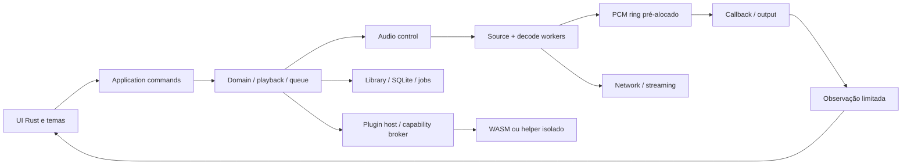

# Arquitetura e fronteiras

Versão: 0.7.0 · Data: 2026-10-14 · Estado: especificação proposta, implementação não iniciada.

## Topologia desktop

Dependency rule: domain não conhece egui/SQL/HTTP/OS. Application coordena traits, adapters implementam ports; não criar abstração genérica para tudo. Engine trata samples/clock/cancellation; UI só eventos/snapshots. Provider API é adapter, não motor de áudio. Boundaries de unsafe revisadas com invariants e fixtures.

## Workspace proposto

`vynamp-domain`: IDs, queue, state machine, capabilities/errors. `vynamp-app`: commands, events, workflows. `vynamp-audio`: graph/PCM/ring/clock. `vynamp-decode`: demux/codec registry. `vynamp-output`: backend trait e negociações. `vynamp-library`: DB/FTS/jobs. `vynamp-stream`: HTTP/ICY/HLS/cache. `vynamp-theme`: validator/layout bindings. `vynamp-plugins`: broker/runtime/package lifecycle. `vynamp-ui`: panes/semantics/render. `vynamp-platform`: adapters Windows/Linux/macOS/Android para keychain, routes, media controls e storage. `vynamp-desktop`: composition/config/bootstrap. `vynamp-cli`: diagnostics/validation/conversion. `vynamp-testkit`: fixtures/mocks. Separar crates conforme dependências reais, não criar vinte crates vazios no primeiro commit.

## Concurrency/backpressure

Tokio para I/O e controle de jobs, pools limitados para decode/análise; RT callback não entra no executor. Commands bounded256, snapshots overwrite latest, events bounded1024 com prioridade; áudio/estado crítico nunca depende de consumidor UI. Overflow de progresso descarta intermediários; critical event preservado ou causa recovery explícito. PCM ring capacity em frames definida por rate/latency, testada nos limites.

## Persistência e recursos

Config versioned JSON com atomic write; SQLite WAL com read pool controlado/write actor; cache/index separado de dados irreproduzíveis. Scope de contas fica fora da library local por namespace. Caches LRU têm quota e eviction; não desalocar buffers usados em RT. Jobs persistidos têm lease/checkpoint/idempotency. Um owner pela identidade canônica do armazenamento do perfil, mesmo entre sessões do usuário adquire lock OS antes de DB/config/playback. Segundo launch encaminha locators via IPC autenticado; múltiplas instâncias exigem perfis separados. Instalado e portable obedecem ao mesmo lock quando usam o mesmo perfil. [Contrato canônico](../platforms/04-ativacao-ownership.md).

## Distribuição e portabilidade

Platform adapters encapsulam paths/keychain/notifications/output. Builds desktop sem backend web. Sem HTTP server ativo por padrão. Helpers recebem IDs/handles mínimos, não token root. Atualização mantém rollback e backward compatibility do banco; backup antes migration irreversível. Migrations não rodam na callback nem durante streaming sem proteção do estado.

## Hosts multiplataforma

Desktop Rust egui/AccessKit candidato em Windows/Linux/macOS Intel+Silicon; host Android Kotlin/Compose e serviço de mídia chamam o mesmo núcleo Rust por bridge versionada. `vynamp-android-bridge` expõe handles/commands/snapshots; Android app shell possui lifecycle/permissões, não algoritmos duplicados de queue/DSP. Sources locais incluem path/FD/document URI com capacidade de seek e lifetime. M0 testa todo target antes congelar features de crates; JNI fica fora da callback. Ver [Android](../platforms/02-android.md).
