# DSP, equalização e presets

Versão: 0.7.4 · Data: 2026-11-05 · Estado: especificação proposta, implementação nativa não iniciada. **Nenhum módulo DSP está implementado no produto nativo.** No MVP web de referência (`vynamp-mvp-reference@0d9860b`, rev.38, fora deste repositório) parte dos módulos tem áudio real — inclusive Vinyl e Tube ([catálogo](09-dsp-catalog.md#famílias-v14-e-estado-no-protótipo-rev-15-relatado)); segue sendo evidência de código, não medição (ver [grafo modular](#grafo-modular-protótipo--nativo)).

Este documento é a visão funcional e técnica do subsistema DSP. Os detalhes estão em:

- [Equalizadores 10/20/31/64 + paramétrico 32](08-equalizers.md): subcapítulo obrigatório.
- [Catálogo de módulos DSP](09-dsp-catalog.md): parâmetros, posição, prioridade e testes de cada módulo.
- [vitrola — vinil e amplificador valvulado](10-vitrola.md): módulo DSP **interno** do app, com design aprovado em 2026-10-23 e incorporado em §8; não é biblioteca nem repositório externo ([ADR-014](../../adr/ADR-014-publico-dsp-interno.md)).
- [Contrato do sinal e proteção final true-peak](07-dsp-signal-contract.md): fonte normativa da ordem fixa.
- [Painel DSP e medidores](../../design/06-painel-dsp.md), [matriz de testes DSP](../../quality/04-matriz-dsp.md), [roadmap DSP](../../delivery/01-roadmap.md#roadmap-dsp-e-equalizadores) e [decisões](../../product/05-decisoes.md#decisões-dsp-e-equalizadores-2026-10-25).

Estados: **implementado** · **planejado** (tem TASK) · **proposto** · **dependente de investigação**.

## Visão geral

- **Motor modular** (planejado, TASK-E04-03): grafo de nós independentes, compilado fora da callback e trocado em fronteira de bloco por generation. Cada nó pode ser configurado, ativado e desativado, e fica desacoplado da UI, que só envia comandos (`dsp.apply`, [contratos](../../architecture/04-contratos.md)) e lê snapshots.
- **Separação de responsabilidades**:
  - decodificação: biblioteca própria `vynamp-decode`, que entrega PCM na precisão original;
  - processamento: grafo DSP do Vynamp;
  - análise/medição: taps de observação copiados para um ring limitado e processados em worker ([visualizadores](../../extensions/05-visualizador.md));
  - saída: biblioteca própria `vynamp-output`, que **nunca** aplica ganho, dither ou resampling.

  Todo DSP acontece no engine do Vynamp, antes da saída.
- **Precisão**: filtros, estados e acumuladores em **f64**. Buffers entre nós em f32 só onde um benchmark provar que a precisão é adequada ([engine](01-engine.md)). O vitrola usa f64 internamente e aceita f32/f64 na fronteira. Trade-off: f64 dobra a banda de memória dos buffers e reduz o ganho de SIMD, mas evita erro acumulado em cascatas longas (EQ-64, PEQ32) e problemas de coeficientes em baixa frequência e alta Fs. A decisão por buffer é **dependente de investigação** (benchmark em E04-03/E10-07). "Pipeline 64-bit" não vira marketing se partes forem f32.
- **Canais**: mono, estéreo e multicanal com matriz explícita (5.1/7.1 em [engine](01-engine.md)). O EQ começa com o canal Both/Left/Right; o editor por canal multicanal fica em M5 (TASK-E12-10). No vitrola, o vinil é desativado em multicanal e a válvula atua por canal.
- **Tempo real**: callback sem alocação, lock, I/O, log, rede ou JNI. Coeficientes calculados fora da callback. Parâmetros entregues por troca atômica de snapshot, com interpolação de 10–50 ms.

## Cadeia real de processamento

A ordem fixa vem do [contrato do sinal](07-dsp-signal-contract.md). O pipeline ilustrativo do pedido foi **adaptado** a essa cadeia: o resampler continua único e final, a proteção true-peak continua em posição fixa e depois dela só vêm quantização, dither e conversão.

```mermaid
flowchart LR
  SRC["Fonte: arquivo / stream / rádio"] --> DEC["vynamp-decode<br/>demux + decode<br/>(precisão original)"]
  DEC --> TRIM["Trim / gain intrínseco<br/>declarado do codec"]
  TRIM --> RG["ReplayGain / preamp / headroom"]
  subgraph STREAM["Segmento por stream (ordem proposta)"]
    direction LR
    EQ{"EQ: um modo ativo<br/>EQ-10 / 20 / 31 / 64<br/>ou PEQ até 32"}
    EQ --> COR["Correção de fone / AutoEQ<br/>Convolution FIR"]
    COR --> VIT["vitrola<br/>vinil + válvula<br/>(opcional)"]
    VIT --> FX["Tone / dinâmica / imagem<br/>tempo-pitch / criativos"]
  end
  RG --> EQ
  FX --> MIX["Mixer / crossfade"]
  MIX --> MASTER["Ganho master digital<br/>(volume do usuário)"]
  MASTER --> RS["Resampler final<br/>(taxa de saída)"]
  RS --> TP["Proteção final true-peak<br/>POSIÇÃO FIXA"]
  TP --> DIT["Quantização / dither / conversão"]
  DIT --> OUT["vynamp-output<br/>shared / exclusive / DoP<br/>sem ganho, dither ou resampling"]
  OUT --> DEV["Dispositivo"]
  DEC -. "modo transparente: caminho inteiro, sem grafo DSP" .-> OUT
  TRIM -. "tap source" .-> OBS[("Ring de observação<br/>worker: meters / FFT / LUFS")]
  RG -. "tap pre-EQ" .-> OBS
  FX -. "tap post-EQ" .-> OBS
  DIT -. "tap final (padrão)" .-> OBS
```

| Estágio | Por que nesta posição | Estado |
|---|---|---|
| Trim/gain intrínseco | é metadado do codec; precisa vir antes de qualquer ganho do usuário para não aplicar duas vezes | planejado (E17-02) |
| ReplayGain/preamp | normalização por metadados e reserva de headroom antes dos boosts | planejado (E04-01) |
| EQ (um modo) | correção tonal sobre o sinal normalizado; um só modo processa por vez, os outros ficam guardados | planejado (E04-01/04, E12-10) |
| Correção de fone/FIR | correção do transdutor depois do gosto do usuário; latência declarada | planejado (import E04-09); FIR **proposto** |
| vitrola (módulo interno) | após o EQ e **antes do volume do usuário**: a saturação depende do nível da gravação ([vitrola §8.8](10-vitrola.md)) | design aprovado; integração em [TASK-E19-07](../../libs/engine/tasks/items/TASK-E19-07.md), após E04-03; posição relativa ao resampler: **conflito aberto D-DSP-05** |
| Tone/dinâmica/imagem/criativos | depois da coloração; o limiter criativo é reordenável, mas não substitui a proteção final | planejado (E04-07/08); vários **propostos** |
| Mixer/crossfade | soma de fontes correlacionadas antes da proteção | planejado (E01-05, E04-03) |
| Ganho master | volume digital do usuário, normalmente 0..1 | planejado |
| Resampler final | uma única conversão de taxa na saída | planejado (E04-02) |
| Proteção true-peak | teto final medido no PCM entregue; nada de ganho/plugin/mix/resampling depois | planejado (E17-07/08) |
| Dither/conversão | só ao reduzir para inteiro; último estágio | planejado |

**Ordenação, dependências e incompatibilidades.** A ordem dentro do segmento por stream é **proposta** (a pedido: correção tonal → emulação → dinâmica/imagem). Reordenação livre **não** é prometida: só o limiter criativo e os efeitos marcados "reordenável" mudam de lugar, e só se o grafo validar (sem ciclos, latência compensada). São incompatíveis com qualquer DSP ativo: modo transparente, DSD nativo/DoP (E12-04) e passthrough codificado (M5). O vinil é incompatível com multicanal.

## Contrato conceitual dos nós

Proposto, a fixar em TASK-E04-03. O formato espelha a trait `Processor` do vitrola, para que o adaptador seja trivial:

- `prepare(sample_rate, max_block_frames, channel_layout) -> Result` aloca tudo. É chamado fora da RT, em toda troca de Fs ou de layout.
- `process(&mut AudioBlock, &BlockContext)` não aloca nem bloqueia e retorna em tempo limitado. `AudioBlock` é planar ou intercalado, em f32/f64, com o número de frames real do bloco.
- `reset()` limpa o estado (seek, troca de generation).
- `latency_frames()` e `tail_frames()` são declarados. O grafo soma as latências para o clock apresentado e para a compensação de caminhos paralelos.
- Metadados: ID estável, versão, parâmetros com unidade, faixa, default e "smoothable", custo estimado e canais suportados.
- Serialização: estado de parâmetros versionado (preset). O estado interno persistente separado (ex.: `WearState` do módulo vitrola) tem formato e migração próprios.
- `BlockContext`: posição em frames, generation, eventos de transporte (start/stop/pause/seek/track_changed/fim de álbum) e metadados da faixa quando houver. É opcional (rádio/stream).

**Parâmetros UI → engine.** A UI produz um snapshot imutável. O control thread valida e calcula os coeficientes e publica o snapshot por ponteiro atômico. A callback troca de snapshot na fronteira de bloco e interpola. O snapshot antigo é descartado fora da RT.

**Análise × reprodução.** O DSP de visualização (FFT, LUFS, true-peak meter, correlação) roda em worker sobre cópias e nunca altera o caminho de reprodução. A proteção final true-peak é um nó de reprodução, separado do true-peak meter.

**Fallback.** Se um nó falhar (NaN/Inf, instabilidade, plugin travado), ele entra em bypass seguro e o diagnóstico fica visível, sem derrubar a reprodução. Preset incompatível com a Fs ou os canais é rejeitado ou adaptado com aviso identificável.

## Grafo modular: protótipo × nativo

Complemento da revisão 15 da referência HTML/SVG/JS (2026-10-28). Separação de status: **especificado** (este documento) · **implementado no protótipo** (relatado) · **validado no protótipo** (relatado) · **nativo** (hoje: nada). O protótipo fica fora deste repositório, e os arquivos de evidência dele (`interactive/*`, `*-validation.json`; protótipo rev.14/15, histórico; fonte atual: vynamp-mvp-reference@0d9860b901510021bcca4c31a25014373ea7c452 rev.38) não existem aqui. O que é **evidência relatada da referência externa rev. 14/15** continua marcado como tal; onde a leitura do **código do pin rev.38** foi feita para este documento, o arquivo é citado e a afirmação vale como verificada. Medição em execução: nada.

- **Contrato do protótipo.** A visão "Fluxo modular", acessível por Áudio e efeitos, é um grafo editável: nós com parâmetros próprios por instância, portas tipadas (áudio estéreo e controle CV, só saída→entrada do mesmo tipo), sem ciclos, conexões duplicadas ou autoconexões, com nós fixos de entrada e saída, fan-out e soma de rotas paralelas (que exige headroom). A ordem de construção é topológica e determinística; nó desconectado não processa; cadeia habilitada sem caminho de entrada a saída resulta em silêncio, sem rota seca oculta. O grafo é **contrato do protótipo**: define o que a referência web demonstra, não o que o produto nativo promete.
- **Relação com o editor tradicional.** O catálogo e os editores anteriores continuam disponíveis e não passam a ser DSP real por causa do grafo. "Copiar ajuste do catálogo" é ação explícita. Posição no fluxo do protótipo: entrada após o EQ clássico existente, saída antes do volume digital do player (ver [contrato do sinal](07-dsp-signal-contract.md) para a ordem fixa nativa).
- **Ligação com áudio no protótipo (relatado).** No pin rev.38 o grafo mistura as duas coisas: nós nativos do Web Audio para a maioria dos módulos e **AudioWorklet** onde a Web Audio API não basta — `vynamp-advanced37` (bandas do EQ-64, limiter, loudness-meter, Vinyl e Tube) e `vynamp-dynamics36` (gate e expander), montados em `mvp/graph-audio.js`; o `registerProcessor` de `vynamp-advanced37` está em `mvp/advanced-dsp.js`. A rev. 15, que ligava só com nós nativos e não tinha AudioWorklet, é histórico. Ajustes comuns atualizam parâmetros com suavização e mudanças de topologia criam nova rota com transição curta. Limites do adaptador relatados: 64 nós, 128 conexões, preset de até 512 KiB, até 512 biquads de EQ e 32 MiB de IR sintética. Esses limites são do adaptador web e **não** são capacidade comprovada da engine nativa; latência e CPU precisam de medição antes de virar meta.
- **No nativo, a reordenação livre continua não prometida** (D-DSP-10). A ordem fixa por stream de [Cadeia real](#cadeia-real-de-processamento) e do [contrato do sinal](07-dsp-signal-contract.md) permanece. A organização do painel em famílias não muda a ordem da cadeia nem habilita reordenação.
- **Decisão aberta (D-DSP-12).** Se e quando o produto nativo oferecerá roteamento livre (grafo editável pelo usuário) ou manterá a ordem fixa com módulos opcionais fica sem decisão. Enquanto não houver decisão formal do mantenedor, as TASKs nativas não devem assumir grafo livre, nem o protótipo deve ser lido como compromisso de marco. Ver [decisões](../../product/05-decisoes.md#decisões-dsp-e-equalizadores-2026-10-25).
- **Capacidades por módulo e limites** (Limiter amostral que não é True Peak; Saturação que não é o Tube; Vinyl/Tube com **áudio real** no pin rev.38, mas sem validação acústica): [catálogo](09-dsp-catalog.md#famílias-v14-e-estado-no-protótipo-rev-15-relatado). Equalizadores no grafo: [EQ §14](08-equalizers.md#14-mvp-htmlsvgjs--contrato-documental).
- **Interface.** Acesso, controles e aceite DSP-UX: [painel DSP §8](../../design/06-painel-dsp.md#8-acesso-e-controles-dsp-ux); fluxo no painel: [§9](../../design/06-painel-dsp.md#9-fluxo-modular-grafo--referência-do-protótipo); VUs integrados: [§6.1](../../design/06-painel-dsp.md#61-integração-visual-dos-vu-meters-vu-int). Testes: [matriz §2.2](../../quality/04-matriz-dsp.md#22-grafo-modular-e-vu-int), planejados para o nativo.

## Bypass, transições e presets

- Bypass por nó e bypass global ("DSP desligado"), sempre por crossfade, sem clicks ou pops. Nó desligado é **bypass real**. Mudanças de parâmetro passam por smoothing de 10–50 ms. A troca de modo do EQ é feita por crossfade entre cadeias (planejado).
- Presets (planejado): JSON próprio versionado com UUID, nome, autor, parâmetros independentes de sample rate, ordem de nós, checksum e provenance. Precedência: sessão > faixa > gênero > dispositivo > global. Escopos: global, por dispositivo de saída (stable ID) e por fone/caixa (perfil de dispositivo com rótulo do usuário; **proposto**). Transferir preset não acessa a rede. AutoEQ/headphone correction é import explícito, com origem e licença, e nunca presume o modelo do fone. Ao trocar de DAC, o perfil é lembrado, sem elevar o volume em silêncio.
- Restauração segura: preset inválido, de versão futura ou corrompido mantém o anterior e mostra o erro. Migração versionada.
- Presets de uso (proposto, UI em [painel DSP](../../design/06-painel-dsp.md)): **Original/Neutro** (DSP desligado), **Fones**, **Caixas estéreo**. **Home Theater** só aparece se o caminho multicanal estiver suportado; até lá fica oculto ou indisponível com motivo.

## Bit-perfect, exclusivo e saída

Regras da `vynamp-output` (design aprovado em 2026-10-25) somadas às de [saídas](04-outputs-hires.md):

- **Bit-perfect/transparente = DSP desligado.** RG, preamp, EQ, efeitos, vitrola (módulo interno), mix, master digital, resampler, dither e limiters ficam fora; volume unity; mesma taxa e mapa de canais. Ligar qualquer DSP pede para sair do modo e retira o selo. Não há fallback silencioso.
- **Exclusivo ≠ bit-perfect.** Exclusive event-driven (WASAPI), ALSA `hw:` direto e CoreAudio hog só evitam o mixer do OS. A biblioteca reporta `PathProperties` (`os_mixer_bypassed`, `os_resampling`, `library_conversion`, `endpoint_volume`) e nunca diz "bit-perfect verificado". Esse rótulo exige captura (`capture-verified`/`hardware-verified`).
- DSP ativo é permitido em shared e em exclusive. Nesses casos, o rótulo é "processado".
- `ShareMode::Exclusive` indisponível → erro (`on_unavailable: Error` é o padrão). O player oferece shared, sem aplicar sozinho. Conversão de tipo só com `conversion: Allow` e sem dither (o dither é do Vynamp).
- **DSD**: DoP e DSD nativo exigem DSP desligado (E12-04). O vitrola se desativa sozinho. ASIO fica fora do núcleo da `vynamp-output` (sem adapter planejado nela). Backends descritos na spec da biblioteca: WASAPI, ALSA, PipeWire/PulseAudio, CoreAudio, AAudio.

## Monitoramento e robustez

- Medições: clipping por estágio (pós-EQ, pós-vitrola, final), headroom estimado, redução de ganho, latência total declarada, CPU do grafo e ocupação de buffer/underruns. Os contadores RT são atômicos e coletados fora da callback ([performance](../../quality/02-performance.md)).
- Falhas: perda de dispositivo → pausa, flush e posição conservada. Underrun → zeros sem repetição (a biblioteca preenche o silêncio correto do formato) e contador. Troca de faixa/Fs → `prepare` fora da RT e crossfade. Seek → `reset` e descarte de lookahead e tails da generation anterior. Plugin travado → bypass e circuit breaker (E07-04/E12-07).

## Requisitos de compatibilidade atuais (mantidos)

Limiter true-peak opcional, com teto padrão de −1 dBTP e lookahead anunciado; o aumento de latência é visível. Soft clipping não substitui true-peak. Compressor com threshold/ratio/attack/release/knee/makeup e meter de redução. Normalização por ReplayGain track/album, peak guard configurável, preamp para arquivos sem tag e nenhum scan ao tocar. Analyzer de loudness em batch, com padrão e versão registrados. LUFS não se mistura com dB de RG sem conversão especificada.

M3: balance/pan, mono, channel routing básico, fades, tempo 0,5–2× com preservação de pitch, pitch ±12 semitons, velocidade independente; reverb/echo/chorus/flanger e silence trim opcional. Efeitos avançados podem ser módulos first-party com os mesmos contratos; bypass seguro em falha. Voice remover é efeito exploratório M5 e não separação profissional garantida.

## Aceite

Medir a resposta dos filtros com impulso/sweep, com tolerância de ±0,2 dB para a curva-alvo nos pontos definidos. Verificar estabilidade perto de Nyquist, ausência de NaN e de amplificação involuntária. EQ flat em bypass é sample-exact no caminho transparente quando desligado. True-peak meter contra fixture, com tolerância de 0,1 dB. Testar alteração rápida, taxa nova, canais e restore. O teste de ouvido complementa os testes numéricos, não os substitui. Matriz completa: [testes DSP](../../quality/04-matriz-dsp.md) e [EQ §16](08-equalizers.md#16-testes-e-aceite-por-modalidade).
